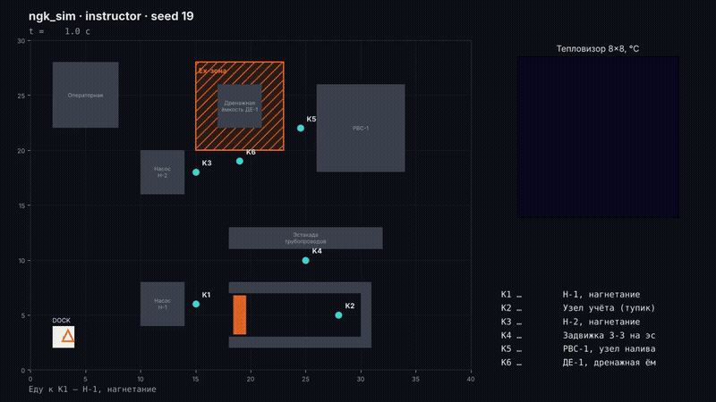
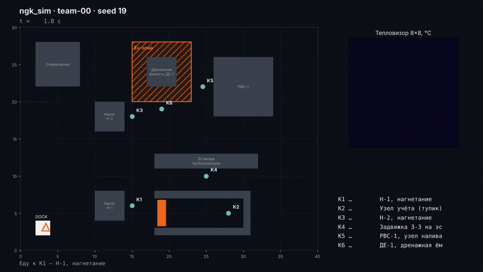
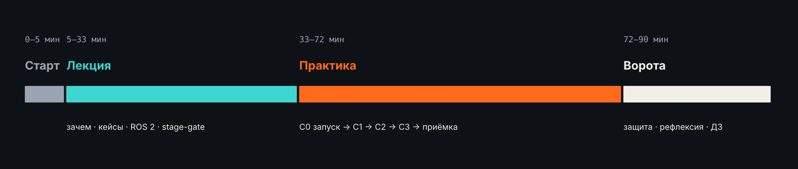
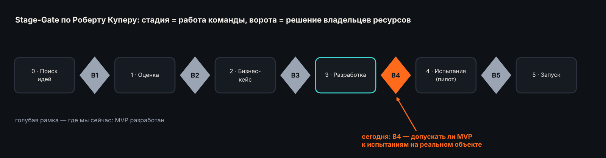
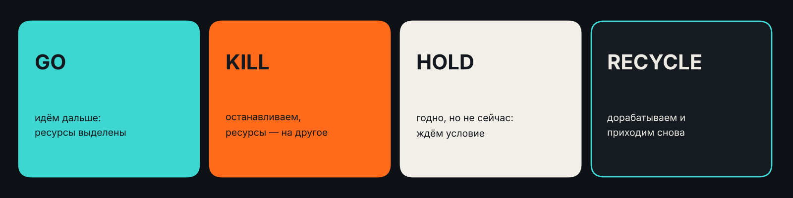
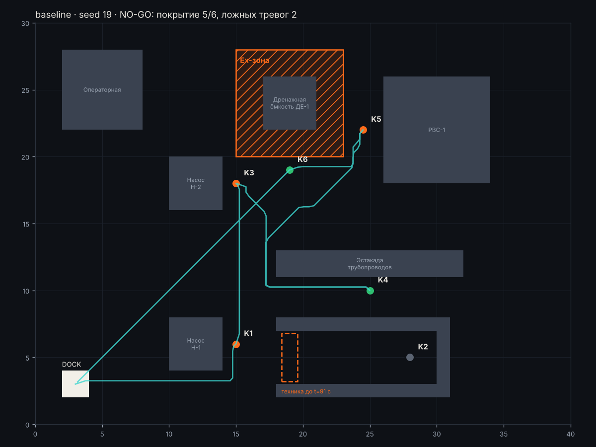
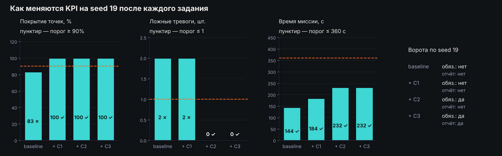
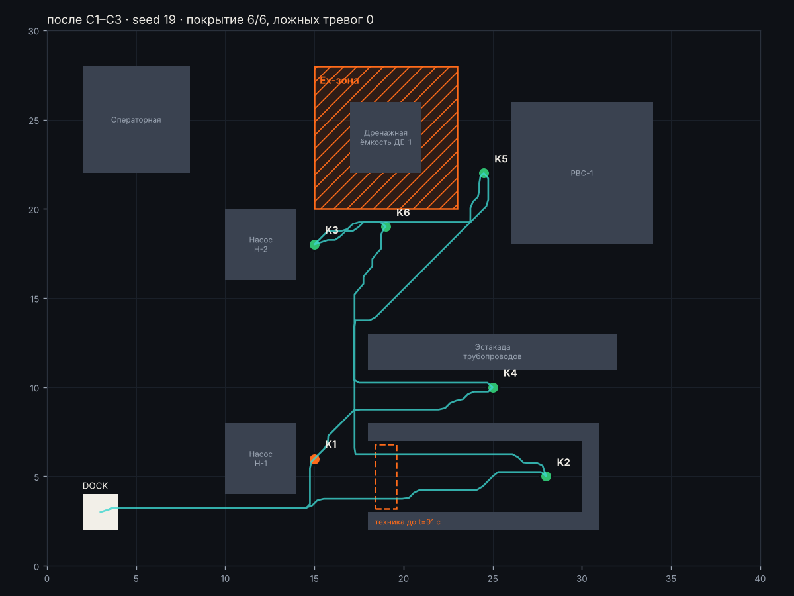

# 🤖 Инспекционный робот для объекта НГК · урок на 90 минут

[](https://github.com/ulyan17/ngk-inspection-mvp/actions/workflows/ci.yml)


**Практическое занятие курса «Газпром нефти» в СПбПУ.** Команды доводят MVP робота-инспектора до рабочего состояния, проверяют его на скрытых сценариях и защищают решение на стадийных воротах Go/No-Go.

<p align="center"></p>

| | |
|---|---|
| ⏱ **Длительность** | 90 минут: 28 лекция · 39 практика · 23 ворота и итоги |
| 👥 **Формат** | команды по 3–4 человека, одного ноутбука на команду достаточно |
| 💻 **Нужно** | Python 3.10+ на Windows, macOS или Linux. ROS на занятии не нужен |
| 📦 **Сдаёте** | код в `student/` и 4 документа в `submission/` |
| 🏁 **Итог** | решение Go / Kill / Hold / Recycle, защищённое цифрами |

---

## Содержание

1. [🎯 Задание](#-задание) — что нужно сделать и что сдать
2. [📊 Оценивание](#-оценивание) — 100 баллов
3. [🗓 План урока](#-план-урока)
4. [Часть 1 · Лекция](#часть-1--лекция-28-минут)
5. [Часть 2 · Практика](#часть-2--практика-39-минут): [C0](#c0--запуск-и-разбор-5-минут) · [C1](#c1--миссия-10-минут) · [C2](#c2--инспекция-12-минут) · [C3](#c3--отчёт-8-минут) · [Приёмка](#-приёмка-4-минуты)
6. [Часть 3 · Ворота](#часть-3--ворота-14-минут)
7. [Рефлексия и домашнее задание](#рефлексия-2-минуты)
8. [📚 Справочник](#-справочник) — команды, API, устройство кода, если что-то не работает

---

## 🎯 Задание

> **Легенда.** Вы — R&D-команда, которая разрабатывает робота-инспектора для насосной станции. Робот должен сам обходить 6 точек контроля, считывать манометры и «тепловизор», находить неисправность и не поднимать ложных тревог.
>
> Через 90 минут — **ворота В4**. Комиссия решит, допускать ли робота к пилоту на реальном объекте. Сейчас MVP эти ворота **не проходит**.

<table><tr>
<td width="50%"><br><b>Сейчас (baseline):</b> K2 пропущена, 2 ложные тревоги → <b>NO-GO</b></td>
<td width="50%"><br><b>Цель:</b> все 6 точек, 0 ложных тревог, аномалия найдена → <b>GO-кандидат</b></td>
</tr></table>

### Ваша задача из трёх частей

| | Что сделать | Где | Время |
|---|---|---|---|
| **1. Довести MVP** | Исправить три проблемы baseline: заданий C1, C2, C3 | `student/mission.py`, `inspector.py`, `report.py` | 30 мин |
| **2. Пройти приёмку** | Заморозить код и прогнать робота на 3 скрытых сценариях, которые назовёт преподаватель | `python -m ngk_sim accept` | 4 мин |
| **3. Защитить решение** | Заполнить документы ворот и за 2 минуты защитить решение перед комиссией | `submission/` | 17 мин |

### Что сдаём

| Файл | Что внутри | Кто заполняет | Когда |
|---|---|---|---|
| `student/*.py` | ваш код C1–C3 | водитель | на практике |
| [`submission/TEAM.md`](submission/TEAM.md) | название команды, участники, роли | любой | **в начале практики** |
| [`submission/kpi_table.md`](submission/kpi_table.md) | журнал: что изменили → как поменялись KPI | инженер KPI | **после каждого запуска** |
| `submission/gate_kpi.md` | таблица приёмки по 3 скрытым seed | создаётся **автоматически** командой `accept` | 68–72 мин |
| [`submission/gate_review.md`](submission/gate_review.md) | решение, обоснование, риски, что нужно для пилота | вся команда | 72–75 мин |
| — | защита на воротах, 2 минуты | вся команда | 75–86 мин |

**Работа сдана, если** в форке во вкладке **Actions** зелёные оба задания:
- **«Код и тесты»** — `pytest` и проверка формата отчёта;
- **«Сдача (submission/)»** — документы заполнены (`python -m ngk_sim check-submission`).

---

## 📊 Оценивание

| Блок | Баллы | Как проверяется |
|---|---:|---|
| **C1 · миссия** | 15 | `tests/test_c1_mission.py`, 5 тестов по 3 балла |
| **C2 · инспекция** | 20 | `tests/test_c2_inspector.py`, 7 тестов (≈ 3 балла за тест) |
| **C3 · отчёт** | 10 | `tests/test_c3_report.py` и `python -m ngk_sim validate` |
| **Приёмка** | 15 | `gate_kpi.md`: 5 баллов за каждый скрытый seed, где выполнены **все обязательные** критерии |
| **Документы** | 15 | `kpi_table.md` (5): видно, что дало каждое изменение · `gate_review.md` (10): решение, обоснование, риски |
| **Защита** | 25 | решение опирается на KPI (10) · названы реальные риски пилота (5) · ответ на вопрос комиссии (5) · уложились в 2 минуты (5) |
| **Итого** | **100** | |
| *Бонус* | *+5* | порядок «ближайший сосед», адаптивный досъём замеров, ожидание при перекрытом проезде |

> Оценивается **обоснование**, а не «правильность» решения. Честный Recycle с конкретным планом доработки стоит больше, чем натянутый Go, который игнорирует невыполненный обязательный критерий.

---

## 🗓 План урока



| Минуты | Блок | Что делаете вы | Результат |
|---|---|---|---|
| 0–5 | Старт | смотрите видео, отвечаете: «Что робот должен доказать, чтобы его пустили на площадку?» | список критериев на доске |
| 5–33 | Лекция | слушаете, отвечаете на 2 контрольных вопроса | понимаете задачи, ограничения, stage-gate |
| 33–36 | Подготовка | клонируете репозиторий, делитесь на роли, заполняете `TEAM.md` | у команды всё запускается |
| 36–43 | **C0** | запускаете baseline, находите три причины No-Go | строка 0 в `kpi_table.md` |
| 43–53 | **C1** | миссия: повтор недоступной точки | покрытие 6/6 |
| 53–65 | **C2** | инспекция: замеры, медиана, «пятно» | 0 ложных тревог |
| 65–68 | **C3** | отчёт: сводка и таблица | все тесты зелёные |
| 68–72 | **Приёмка** | code freeze, `accept` на скрытых seed | `gate_kpi.md` |
| 72–86 | **Ворота** | заполняете `gate_review.md`, защищаете решение | решение комиссии |
| 86–88 | Рефлексия | сравниваем свои критерии с воротами | — |
| 88–90 | ДЗ | получаете задание на ROS 2 | — |

---

## Часть 1 · Лекция (28 минут)

Полный конспект с источниками — **[docs/LECTURE.md](docs/LECTURE.md)**. Здесь главное.

**Зачем роботы на объектах НГК.** Три причины: **безопасность** (человек реже заходит во взрывоопасные зоны, на высоту, на ночные обходы), **экономика** (меньше операционных затрат и командировок на удалённые объекты), **данные** (одинаковый маршрут и сенсоры каждый день → показания можно сравнивать и прогнозировать).

**Кто уже работает на площадках.** ANYbotics ANYmal X — шагающий робот для взрывоопасных зон (поставки начались в октябре 2026), Boston Dynamics Spot у Chevron, Woodside и Aker BP, Taurob Inspector — наследник победителя конкурса ARGOS (Total, 2017), российский мобильный обходчик «Газпром трансгаз Томск» с газоанализатором.

**Что инспектирует робот:** показания манометров и задвижек (камера), утечки газа (газоанализатор, оптическая и акустическая камеры), перегрев (тепловизор), шум и вибрацию (микрофон), визуальный осмотр.

**Ограничения реального объекта:** Ex-зоны (ATEX/IECEx, в ЕАЭС — ТР ТС 012/2011), нет связи и GPS, погода, регламенты охраны труда, люди и техника на проезде.


**MVP, прототип и пилот — разные вопросы.** Прототип: «работает ли принцип?» MVP: «даёт ли минимальный набор функций ценность пользователю?» Пилот: «работает ли в реальных условиях объекта?» Наш MVP в симуляции — около TRL 4, проверка в лабораторной среде.



**Ворота** — заранее назначенная точка, где проект останавливают и решают, вкладывать ли в него дальше. Решают не разработчики, а владельцы ресурсов и рисков: владелец объекта, служба ОТ и ПБ, R&D, финансы. Критерии известны заранее: **обязательные** (провал любого — не Go) и **желательные** (взвешиваются).



### Критерии наших ворот

Пороги лежат в [`configs/gate_thresholds.json`](configs/gate_thresholds.json). KPI считает симулятор **по эталону** — не по вашему отчёту.

| Критерий | Порог | Тип | Почему важно |
|---|---|---|---|
| Нарушения Ex-зон | 0 | обязательный | безопасность не обсуждается |
| Покрытие точек контроля | ≥ 90% | обязательный | непроверенная точка = непроверенный риск |
| Аномалия найдена | да | обязательный | ради этого робот и нужен |
| Ложные тревоги | ≤ 1 за прогон | обязательный | оператор перестаёт верить роботу, который зря поднимает тревогу |
| Ручные вмешательства | 0 | обязательный | робот, которого надо подменять, не автономен |
| Сбой запуска | нет, 3 из 3 | обязательный | воспроизводимость |
| Точность показаний | ≥ 80% точек ±0,15 бар | желательный | качество данных |
| Время миссии | ≤ 360 с | желательный | робот не должен ехать вечно |

---

## Часть 2 · Практика (39 минут)

Пошаговое руководство с реальными выводами симулятора после каждого шага — **[docs/PRACTICE.md](docs/PRACTICE.md)**.

### Подготовка (до занятия или в первые 3 минуты)

```bash
git clone https://github.com/<ваш-логин>/ngk-inspection-mvp   # сначала сделайте форк!
cd ngk-inspection-mvp
pip install -e .            # numpy, matplotlib, pytest
python check_env.py         # всё должно быть зелёным
```

**Роли в команде:**
- 🧑‍💻 **водитель** — за клавиатурой, пишет код;
- 🧭 **штурман** — читает TODO, тесты и подсказки;
- 📈 **инженер KPI** — ведёт `submission/kpi_table.md`, готовит защиту.

Заполните [`submission/TEAM.md`](submission/TEAM.md) и впишите название команды в `student/team.py`.

### Объект: насосная станция 40×30 м


| Элемент | Что это |
|---|---|
| **K1–K6** | точки контроля: манометр, «тепловизор» 8×8 и метка с ID. У каждой есть паспорт — допустимое давление и предел температуры |
| **Ex-зона** (штриховка) | взрывоопасная зона вокруг дренажной ёмкости. Планировщик её обходит, как keepout-фильтр в Nav2 |
| **Техника** (оранжевый прямоугольник) | в начале миссии может перекрыть тупик с K2, потом уезжает |
| **DOCK** | станция зарядки: старт и финиш |
| **Аномалия** | ровно одна; где и какая — зависит от seed (номера сценария). Демо-сценарий — seed 19 |

Чтобы мир был похож на настоящий, датчики ошибаются: бывают **смазанные кадры** (нет показания манометра), **выбросы** манометра и **блики** на тепловизоре.

### Как устроен код


Вы работаете **только в `student/`**. Симулятор передаёт вашей функции `run_mission(ctx)` объект `ctx` — это аналог узла ROS 2 со всеми клиентами (полный список — в [справочнике](#что-доступно-вашему-коду-ctx)).

---

### C0 · Запуск и разбор (5 минут)

```bash
python -m ngk_sim run          # окно с анимацией; без окна: --no-viz
```

Посмотрите на анимацию и итоговую таблицу в терминале:

```
 ✅ Нарушения Ex-зон                          0   порог <= 0      (обяз.)
 ❌ Покрытие точек контроля                0.83   порог >= 0.9    (обяз.)
 ✅ Аномалия найдена                         да   порог == да     (обяз.)
 ❌ Ложные тревоги                            2   порог <= 1      (обяз.)
 ❌ Точность показаний (±0,15 бар)         0.67   порог >= 0.8    (желат.)
 ❌ Отчёт не прошёл проверку формата
```



**❓ Вопрос команде:** аномалия одна, а тревог три. Почему No-Go? Найдите три причины, прежде чем читать дальше.

<details><summary><b>Ответ</b></summary>

| Что видим | Почему | Задание |
|---|---|---|
| K2 серая, покрытие 5/6 | тупик перекрыт техникой, baseline пропустил точку и не вернулся | **C1** · `mission.py` |
| Тревоги на K3 и K5, хотя аномалия на K1 | на K3 выброс манометра, на K5 блик тепловизора; baseline верит одному замеру | **C2** · `inspector.py` |
| Отчёт не прошёл проверку | нет сводки и таблицы | **C3** · `report.py` |

</details>

📈 **Инженер KPI:** строка 0 в `kpi_table.md`.

---

### C1 · Миссия (10 минут)

**Цель:** робот не теряет точку, если к ней временно нет проезда.
**Файл:** `student/mission.py` · **Проверка:** `pytest tests/test_c1_mission.py` · **Подсказки:** [hints/C1.md](hints/C1.md)

1. **C1.1** — `MAX_RETRIES = 1`.
2. **C1.2** — если точка недоступна, верните её в конец очереди. Если попытки кончились, опубликуйте честный `UNKNOWN`:

```python
if result != TaskResult.SUCCEEDED:
    attempts[cp.id] += 1
    if attempts[cp.id] <= MAX_RETRIES:
        queue.append(cp.id)                       # вернёмся позже, когда техника уедет
    else:
        publish_unknown(ctx, cp, "unreachable")   # честно: «не смог проверить»
    continue
```

✅ **Готово, если:** 5 тестов C1 зелёные, в итоге миссии `Покрытие точек контроля 1`. Ложные тревоги пока остаются — это следующий шаг.

---

### C2 · Инспекция (12 минут)

**Цель:** отличать настоящую неисправность от шума датчиков.
**Файл:** `student/inspector.py` · **Проверка:** `pytest tests/test_c2_inspector.py` · **Подсказки:** [hints/C2.md](hints/C2.md)


**❓ Вопрос команде:** чем блик отличается от перегрева на этих кадрах? По какому правилу их различить?

Три рычага:

1. **C2.1** — `N_MEASUREMENTS = 3`: несколько замеров на точке (каждый стоит 4 с времени миссии).
2. **C2.2** — в `robust_gauge()` медиана вместо первого показания: `statistics.median(values)`.
3. **C2.3** — перегрев — это **пятно**, а не пиксель: `MIN_HOT_PIXELS = 2`, `MIN_HOT_FRAMES = 2`.

✅ **Готово, если:** 7 тестов C2 зелёные, в итоге миссии `Ложные тревоги 0`, `Аномалия найдена да`, время ≤ 360 с.



Видно цену надёжности: после C2 миссия длится 232 с вместо 184 — порог 360 с, запас есть.

---

### C3 · Отчёт (8 минут)

**Цель:** отчёт, который понятен оператору и проходит автоматическую проверку.
**Файлы:** `student/report.py`, `student/team.py` · **Проверка:** `pytest` и `python -m ngk_sim validate out/seed_19/report.json` · **Подсказки:** [hints/C3.md](hints/C3.md)

1. **C3.1** — заполните `summary` в `build_report()`: `checkpoints_total`, `checkpoints_inspected`, `coverage`, `anomalies`, `alarms`. «Проверена» — статус `OK` или `ANOMALY`.
2. **C3.2** — таблица Markdown в `to_markdown()`. Так должен выглядеть `out/seed_19/report.md`:

| Точка | Статус | Давление, бар | Макс., °C | Причина |
|---|---|---|---|---|
| K1 Н-1, нагнетание | ANOMALY | 4.56 | 89.6 | overheat |
| K2 Узел учёта (тупик) | OK | 2.96 | 121.4 | |
| K3 Н-2, нагнетание | OK | 5.02 | 32.0 | |
| … | | | | |

**❓ Вопрос команде:** у K2 максимум 121 °C, но статус OK. Почему? Как это объяснить оператору?

✅ **Готово, если:** `pytest` — все тесты зелёные, валидатор пишет «Отчёт корректен».

---

### ✓ Приёмка (4 минуты)

Преподаватель объявляет **code freeze** и называет три скрытых seed. Код больше не меняем.

```bash
python -m ngk_sim accept --seeds A B C
```

Команда прогоняет робота на трёх незнакомых мирах: аномалия теперь в другом месте и другого типа. Результат автоматически сохраняется в `submission/gate_kpi.md`. Пример таблицы для команды с минимальным решением:

| Критерий | Тип | seed A | seed B | seed C | Итог |
|---|---|---|---|---|---|
| Покрытие точек контроля | обязательный | 1 ✅ | 1 ✅ | 1 ✅ | ✅ |
| Аномалия найдена | обязательный | да ✅ | да ✅ | да ✅ | ✅ |
| Ложные тревоги | обязательный | 0 ✅ | 1 ✅ | 0 ✅ | ✅ |
| Точность показаний | желательный | 1 ✅ | 0.67 ❌ | 1 ✅ | ❌ |

Обязательные выполнены, один желательный — нет. Это и есть материал для ворот: **Go с условиями или Recycle?**



---

## Часть 3 · Ворота (14 минут)

**1. Заполните [`submission/gate_review.md`](submission/gate_review.md) (3 минуты):** итог KPI из `gate_kpi.md`, **одно** решение (`[x]`), обоснование в 3–5 предложений, два риска пилота, что нужно для следующей стадии.

**2. Защита — 2 минуты на команду:**

| # | План доклада |
|---|---|
| 1 | KPI против порогов: что выполнено, что нет |
| 2 | Решение: Go / Kill / Hold / Recycle |
| 3 | Главный риск и что с ним делать |
| 4 | Что нужно для пилота на реальном объекте |

**3. Вопрос комиссии.** Комиссия — преподаватель и студент из соседней команды. Пример вопросов:
- Какой KPI ближе всего к порогу и почему?
- Что сломается первым на реальном объекте?
- Сколько ложных тревог за смену выдержит оператор?
- Почему это не подгонка под seed 19?

**4. Проверьте сдачу и сделайте push:**

```bash
python -m ngk_sim check-submission
git add -A && git commit -m "Сдача: команда <название>" && git push
```

---

## Рефлексия (2 минуты)

Вернитесь к критериям, которые зал назвал на 0-й минуте. Что совпало с воротами? Чего не хватило? Что важно для настоящего пилота, но в наши ворота не вошло: сертификация Ex, связь, погода, интеграция с АСУ ТП, стоимость?

## Домашнее задание

Перенести MVP на настоящий стек: **ROS 2 Jazzy + Gazebo Harmonic + Nav2**. Задания T1–T6 и бонусы — в [ros2_homework/README.md](ros2_homework/README.md). Логика из `student/` переносится в узлы rclpy почти без изменений.

---

## 📚 Справочник

### Команды

| Команда | Что делает |
|---|---|
| `python check_env.py` | проверка окружения |
| `python -m ngk_sim run` | миссия на seed 19 с анимацией (`--no-viz` — без окна, `--seed N` — другой мир) |
| `pytest` | все тесты · `pytest tests/test_c1_mission.py` — только C1 |
| `python -m ngk_sim validate out/seed_19/report.json` | проверка формата отчёта |
| `python -m ngk_sim accept --seeds A B C` | приёмка → `submission/gate_kpi.md` |
| `python -m ngk_sim check-submission` | проверка документов перед сдачей |
| `python -m ngk_sim record --out mission.mp4` | видео миссии без окна (нужен ffmpeg; или `.gif`) |
| `python -m ngk_sim world` | карта объекта в `world.png` |

### Что доступно вашему коду (`ctx`)

| | |
|---|---|
| `ctx.world.checkpoints` | паспорт точек: `id`, `name`, `x`, `y`, `p_min`, `p_max`, `temp_limit_c`, `tag_id`, `pose` |
| `ctx.nav` | навигатор как `BasicNavigator` из Nav2: `goToPose(pose)`, `isTaskComplete()`, `getResult()`, `getFeedback()`, `cancelTask()`, `getPose()` |
| `ctx.sensors.capture(cp_id)` | один замер, 4 с: `gauge_bar` (может быть `None`), `thermal` — матрица 8×8 °C, `tag_id` |
| `ctx.operator.manual_reading(cp_id)` | точный замер оператором — **+1 ручное вмешательство** и 60 с (портит KPI) |
| `ctx.bus.publish(topic, msg)` | опубликовать сообщение (`Topics.RESULT`, `Topics.ALARM`) |
| `ctx.wait(s)` · `ctx.now()` · `ctx.log(text)` | подождать на месте · время симуляции · лог |

### ROS 2 ↔ ngk_sim

| ROS 2 / Nav2 | Здесь |
|---|---|
| узел rclpy | модуль в `student/` |
| `publisher.publish(msg)` в `/inspection/result` | `ctx.bus.publish(Topics.RESULT, msg)` |
| `BasicNavigator.goToPose()` / `isTaskComplete()` / `getResult()` | `ctx.nav.goToPose()` / `isTaskComplete()` / `getResult()` |
| keepout-фильтр Nav2 | Ex-зона непроходима для планировщика A* |
| `ros2 bag record` (MCAP) | `out/seed_N/mission.jsonl` |

### Структура репозитория

```
ngk-inspection-mvp/
├── student/                ← ВЫ РАБОТАЕТЕ ЗДЕСЬ
│   ├── mission.py          C1 · очередь точек, повторные попытки
│   ├── inspector.py        C2 · замеры, OK / ANOMALY / UNKNOWN, тревога
│   ├── report.py           C3 · отчёт JSON + Markdown
│   └── team.py             название команды
├── submission/             ← ДОКУМЕНТЫ ДЛЯ СДАЧИ
│   ├── TEAM.md · kpi_table.md · gate_review.md
│   └── gate_kpi.md         создаётся командой accept
├── ngk_sim/                симулятор (менять не нужно)
├── configs/gate_thresholds.json   пороги ворот
├── tests/                  автопроверка C1–C3
├── hints/                  подсказки, раскрывайте по одной
├── docs/                   LECTURE.md · PRACTICE.md · картинки и видео
├── ros2_homework/          домашнее задание на ROS 2
└── .github/workflows/      GitHub Actions: «Код и тесты» и «Сдача»
```

### Видео

- [docs/video/baseline.mp4](docs/video/baseline.mp4) — baseline на seed 19 (No-Go)
- [docs/video/solution.mp4](docs/video/solution.mp4) — после доработки (Go-кандидат)

### Если что-то не работает

| Проблема | Решение |
|---|---|
| `pip install -e .` ругается | `pip install numpy matplotlib pytest` и запускайте из корня репозитория |
| Нет интернета | преподаватель раздаст папку `wheels/`: `pip install --no-index --find-links wheels numpy matplotlib pytest` |
| Окно анимации пустое или не открывается | `--no-viz`, результаты в `out/seed_19/` (`map.png`, `report.md`) |
| Анимация медленная | `--speed 5` |
| `ModuleNotFoundError: student` | запускайте команды из корня репозитория |
| Нет Python на ноутбуке | работайте с ноутбука соседа по команде |
