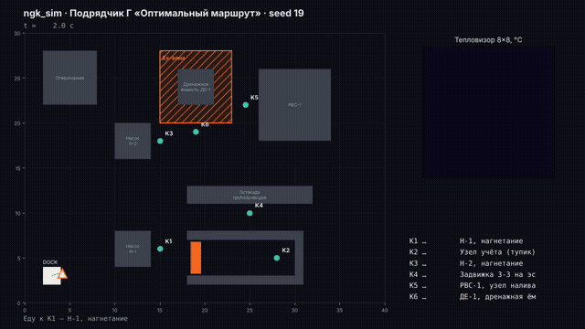
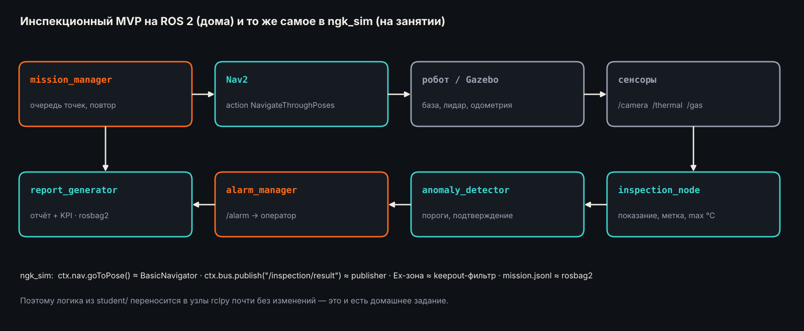
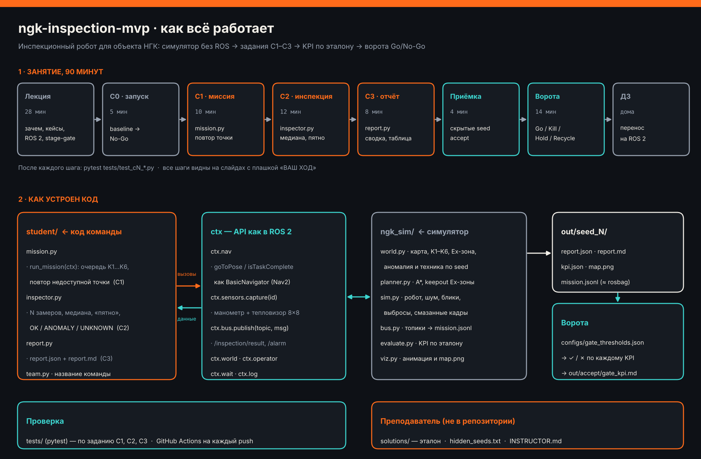
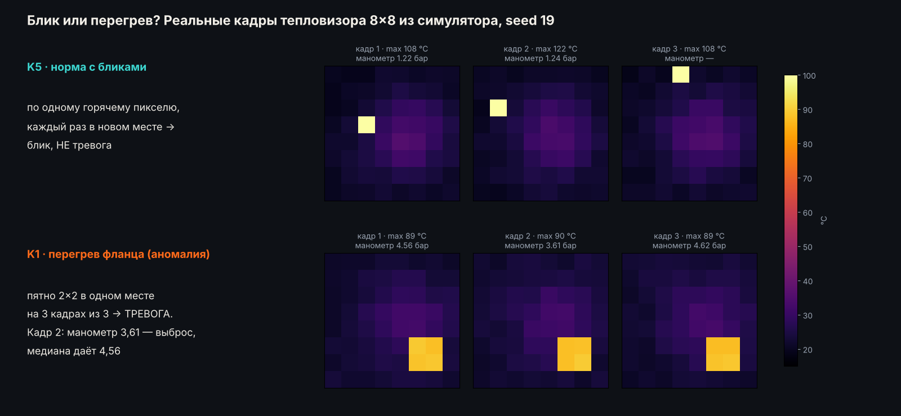
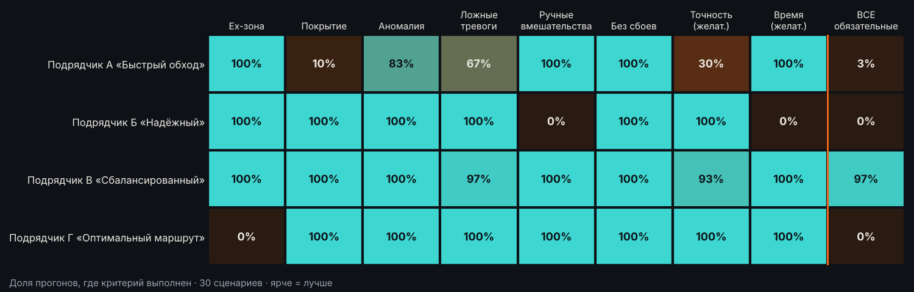

# 🤖 Ворота Go/No-Go для робота-инспектора · урок на 90 минут

[](https://github.com/ulyan17/ngk-inspection-mvp/actions/workflows/ci.yml)


**Практическое занятие курса «Газпром нефти» в СПбПУ.** Четыре подрядчика прислали готовых роботов-инспекторов для насосной станции. Вы — комиссия на стадийных воротах: запускаете роботов, измеряете, ищете скрытые изъяны и решаете, кого допускать к пилоту на реальном объекте.

<table>
<tr>
<td width="25%"><br><b>А «Быстрый обход»</b></td>
<td width="25%"><br><b>Б «Надёжный»</b></td>
<td width="25%"><br><b>В «Сбалансированный»</b></td>
<td width="25%"><br><b>Г «Оптимальный маршрут»</b></td>
</tr>
</table>

| | |
|---|---|
| ⏱ **Длительность** | 90 минут: 28 лекция · 39 практика · 23 ворота и итоги |
| 👥 **Формат** | команды по 3–4 человека, одного ноутбука на команду достаточно |
| 💻 **Нужно** | Python 3.10+ на Windows, macOS или Linux. ROS и программирование на занятии не нужны |
| 📝 **Сдаёте** | протокол ворот в `submission/` |
| 🏠 **Дома** | сами становитесь подрядчиком: дорабатываете своего робота и переносите на ROS 2 → [homework/](homework/README.md) |

---

## Содержание

1. [🎯 Задание](#-задание)
2. [📊 Оценивание](#-оценивание)
3. [🗓 План урока](#-план-урока)
4. [Часть 1 · Лекция](#часть-1--лекция-28-минут)
5. [Часть 2 · Практика: комиссия на воротах](#часть-2--практика-комиссия-на-воротах-39-минут): [П0](#п0--подготовка-5-минут) · [П1](#п1--знакомство-с-подрядчиками-10-минут) · [П2](#п2--измерения-7-минут) · [П3](#п3--расследование-10-минут) · [П4](#п4--решения-7-минут)
6. [Часть 3 · Защита на воротах](#часть-3--защита-на-воротах-14-минут)
7. [Рефлексия и домашнее задание](#рефлексия-2-минуты)
8. [📚 Справочник](#-справочник)

---

## 🎯 Задание

> **Легенда.** Компания готовит пилот робота-инспектора на насосной станции. Четыре подрядчика прислали свои MVP и коммерческие предложения — в каждом обещания «лучший», «надёжный», «без ложных тревог».
>
> Вы — **комиссия на воротах В4**: решаете, кого допустить к испытаниям на реальном объекте. Обещаниям не верите — проверяете измерениями. Код писать не нужно: роботы готовы, ваша работа — **оценить их и обосновать решение**.

### Что сделать

| Шаг | Что делаете | Команда | Время |
|---|---|---|---|
| **П0** | ставите и проверяете окружение, делитесь на роли | `python check_env.py` | 5 мин |
| **П1** | смотрите каждого подрядчика в работе, сверяете с его обещаниями | `python -m ngk_sim run --variant A` (B, C, D) | 10 мин |
| **П2** | измеряете всех на одних сценариях и проверяете надёжность | `python -m ngk_sim compare` и `compare --runs 30` | 7 мин |
| **П3** | находите **причину** каждого провала и доказательство | карты, отчёты, журнал миссии, код | 10 мин |
| **П4** | принимаете решение по каждому подрядчику и выбираете, кого пустить на пилот | заполняете протокол | 7 мин |
| **Защита** | 2 минуты: кого выбрали, почему, какие риски | — | 14 мин |

### Что сдаём

| Файл | Что внутри | Когда |
|---|---|---|
| [`submission/TEAM.md`](submission/TEAM.md) | команда, участники, роли | П0 |
| `submission/compare.md` + `.png` | сводка KPI на 5 сценариях — создаётся **автоматически** командой `compare` | П2 |
| `submission/compare_30.md` + `.png` | надёжность на 30 сценариях — **автоматически**, `compare --runs 30` | П2 |
| [`submission/gate_protocol.md`](submission/gate_protocol.md) | **протокол ворот**: по каждому подрядчику — измерения, причина, решение, что исправить; кого на пилот; риски; ваше мнение о порогах | П1–П4 |

**Работа сдана, если** `python -m ngk_sim check-submission` показывает все ✅ и после `git push` во вкладке **Actions** зелёное задание **«Занятие: протокол ворот»**.

---

## 📊 Оценивание

| Блок | Баллы | Что оценивается |
|---|---:|---|
| **Подготовка** | 5 | `TEAM.md`, всё запускается |
| **Измерения** | 10 | обе сводки `compare` в `submission/`, перенесены в раздел 1 протокола |
| **Разбор подрядчиков** | 30 | по 7,5 за каждого: что показали измерения (2), **настоящая причина** провала (3), **доказательство** — файл, кадр, строка кода (2,5) |
| **Решения** | 15 | решения по каждому подрядчику непротиворечивы KPI (8), выбор кандидата обоснован (7) |
| **Риски и пороги** | 10 | реальные риски пилота (5), осмысленное мнение о порогах ворот (5) |
| **Защита** | 30 | решение опирается на цифры (12), ответ на вопрос комиссии (10), уложились в 2 минуты (8) |
| **Итого** | **100** | |

> Оценивается **обоснование**, а не «правильный» подрядчик. «Никого не пускаем» — тоже допустимый ответ, если он подкреплён цифрами.

---

## 🗓 План урока


| Минуты | Блок | Что делаете вы | Результат |
|---|---|---|---|
| 0–5 | Старт | видео, вопрос залу: «Что робот должен доказать, чтобы его пустили на площадку?» | список критериев на доске |
| 5–33 | Лекция | слушаете, отвечаете на 2 контрольных вопроса | понимаете задачи, ограничения и stage-gate |
| 33–38 | **П0** · подготовка | ставите, делитесь на роли, `TEAM.md` | всё запускается |
| 38–48 | **П1** · знакомство | запускаете А, Б, В, Г, сверяете с обещаниями | черновик «Измерения показали» |
| 48–55 | **П2** · измерения | `compare` и `compare --runs 30` | раздел 1 протокола |
| 55–65 | **П3** · расследование | ищете причины и доказательства | «Почему» по каждому подрядчику |
| 65–72 | **П4** · решения | решения, кандидат на пилот, риски, пороги | протокол готов, `push` |
| 72–86 | **Защита** | 2 минуты на команду | решение комиссии |
| 86–88 | Рефлексия | сравниваем свои критерии с воротами | — |
| 88–90 | ДЗ | [станьте подрядчиком сами](homework/README.md) | — |

---

## Часть 1 · Лекция (28 минут)

Полный конспект с источниками — **[docs/LECTURE.md](docs/LECTURE.md)**. Здесь главное.

**Зачем роботы на объектах НГК.** **Безопасность**: человек реже заходит во взрывоопасные зоны, на высоту, на ночные обходы. **Экономика**: меньше операционных затрат и командировок на удалённые объекты. **Данные**: одинаковый маршрут и сенсоры каждый день, показания можно сравнивать.

**Кто уже работает на площадках.** ANYbotics ANYmal X — шагающий робот для взрывоопасных зон, поставки начались в октябре 2026. Boston Dynamics Spot — у Chevron, Woodside и Aker BP. Taurob Inspector — наследник победителя конкурса ARGOS (Total, 2017). Российский мобильный обходчик «Газпром трансгаз Томск» с газоанализатором.

**Что инспектирует робот:** манометры и задвижки (камера), утечки газа (газоанализатор, оптическая и акустическая камеры), перегрев (тепловизор), шум и вибрацию (микрофон), визуальный осмотр.

**Ограничения реального объекта:** Ex-зоны (ATEX/IECEx, в ЕАЭС — ТР ТС 012/2011), нет связи и GPS, погода, регламенты охраны труда, люди и техника на проезде.



**MVP, прототип и пилот — разные вопросы.** Прототип: «работает ли принцип?» MVP: «даёт ли минимальный набор функций ценность пользователю?» Пилот: «работает ли в реальных условиях объекта?»


**Ворота** — заранее назначенная точка, где проект останавливают и решают, вкладывать ли дальше. Решают не разработчики, а владельцы ресурсов и рисков. Критерии известны заранее: **обязательные** (провал любого — не Go) и **желательные** (взвешиваются).


### Критерии наших ворот

Пороги — в [`configs/gate_thresholds.json`](configs/gate_thresholds.json). KPI считает симулятор **по эталону**, а не по отчёту подрядчика.

| Критерий | Порог | Тип | Почему важно |
|---|---|---|---|
| Нарушения Ex-зон | 0 | обязательный | безопасность не обсуждается |
| Покрытие точек контроля | ≥ 90% | обязательный | непроверенная точка = непроверенный риск |
| Аномалия найдена | да | обязательный | ради этого робот и нужен |
| Ложные тревоги | ≤ 1 за прогон | обязательный | оператор перестаёт верить роботу, который зря поднимает тревогу |
| Ручные вмешательства | 0 | обязательный | робот, которого надо подменять, не автономен |
| Сбой запуска | нет | обязательный | воспроизводимость |
| Точность показаний | ≥ 80% точек ±0,15 бар | желательный | качество данных |
| Время миссии | ≤ 360 с | желательный | робот не должен ехать вечно |

---

## Часть 2 · Практика: комиссия на воротах (39 минут)

### Объект: насосная станция 40×30 м


| Элемент | Что это |
|---|---|
| **K1–K6** | точки контроля: манометр, «тепловизор» 8×8 и метка с ID. У каждой есть паспорт — допустимое давление и предел температуры |
| **Ex-зона** (штриховка) | взрывоопасная зона вокруг дренажной ёмкости. Заезжать нельзя |
| **Техника** (оранжевый прямоугольник) | в начале миссии может перекрыть тупик с K2, потом уезжает |
| **DOCK** | станция зарядки: старт и финиш |
| **Аномалия** | ровно одна; где и какая — зависит от сценария (seed) |

Датчики ошибаются, как настоящие: бывают **смазанные кадры** (нет показания манометра), **выбросы** манометра и **блики** на тепловизоре.



---

### П0 · Подготовка (5 минут)

```bash
git clone https://github.com/<ваш-логин>/ngk-inspection-mvp   # сначала сделайте форк
cd ngk-inspection-mvp
pip install -e .
python check_env.py
```

Роли в команде:
- 🎬 **оператор стенда** — запускает команды;
- 🔍 **следователь** — ищет причины в картах, отчётах и коде;
- ✍️ **секретарь комиссии** — ведёт `gate_protocol.md`.

Заполните [`submission/TEAM.md`](submission/TEAM.md).

---

### П1 · Знакомство с подрядчиками (10 минут)

Прочитайте **[заявления подрядчиков](variants/VENDORS.md)** и запустите каждого на демо-сценарии:

```bash
python -m ngk_sim run --variant A      # затем B, C, D (можно русскими буквами: А, Б, В, Г)
```

| | Подрядчик | Обещает |
|---|---|---|
| **А** | «Быстрый обход» | полный обход за 2,5 минуты, одного замера на точку достаточно |
| **Б** | «Надёжный» | 100% точность и ни одной ложной тревоги; при сомнениях подключает оператора |
| **В** | «Сбалансированный» | выполняет все обязательные критерии заказчика |
| **Г** | «Оптимальный маршрут» | лучшие KPI среди всех, без участия оператора |

Во время анимации смотрите на маршрут, на цвет точек (зелёный — норма, оранжевый — тревога, серый — не проверена) и на кадры тепловизора. В конце в терминале появится таблица «ИТОГ МИССИИ» и истина сценария: где на самом деле была аномалия.

**❓ Вопрос команде:** чьё обещание уже на первом запуске не совпало с тем, что вы видите?

✍️ Запишите в протокол черновик «Измерения показали» для каждого подрядчика.

---

### П2 · Измерения (7 минут)

Один запуск — это случай, а не доказательство. Проверьте всех на одних и тех же пяти сценариях приёмки:

```bash
python -m ngk_sim compare
```

Команда создаёт сводку `submission/compare.md` и тепловую таблицу `submission/compare.png`: какая доля прогонов прошла каждый критерий.

Затем проверьте **надёжность** на 30 случайных сценариях:

```bash
python -m ngk_sim compare --runs 30
```

Результат — `submission/compare_30.md` и `.png`. Сравните две таблицы.

**❓ Вопрос команде:** у кого-то результат на 5 сценариях и на 30 заметно различается? Какой цифре вы больше доверяете и почему? Хватит ли 5 прогонов, чтобы пустить робота на настоящий объект?

✍️ Заполните раздел 1 протокола.

---

### П3 · Расследование (10 минут)

Цифры говорят, **что** не так. Комиссия должна понимать, **почему**: от этого зависит, исправим ли изъян за неделю или это проблема всего подхода. Для каждого провала найдите причину и доказательство.

**Где искать:**

| Источник | Как получить | Что там видно |
|---|---|---|
| Карта прогона | `out/compare/maps/<A\|B\|C\|D>/seed_N.png` | маршрут, какие точки проверены, где тревоги, **заезды в Ex-зону красным** |
| Повтор конкретного сценария | `python -m ngk_sim run --variant C --seed 104` | анимация, лог в терминале, истина сценария |
| Отчёт подрядчика | `out/seed_N/report.md` после `run` | статус и показания по каждой точке |
| Журнал миссии | `out/seed_N/mission.jsonl` | все сообщения: замеры, тревоги, лог |
| Код подрядчика | `variants/<буква>_…/mission.py` | параметры: сколько замеров, есть ли повтор, какие флаги |

**Подсказки — куда смотреть** (не ответы):

- **А:** что происходит с K2 в анимации? Сколько замеров на точку делает А и что это значит для бликов и выбросов?
- **Б:** сколько раз в логе встречается «вызываю оператора»? Из чего складываются ~600 секунд?
- **В:** на каком из пяти сценариев провал? Запустите его отдельно. Что за тревога и на какой точке?
- **Г:** внимательно посмотрите на маршрут рядом с Ex-зоной. Найдите в коде строку, которая за это отвечает.

Чтобы отличить блик от настоящего перегрева, посмотрите на реальные кадры тепловизора:



✍️ Заполните «Почему (причина и доказательство)» по каждому подрядчику. Хорошее доказательство — конкретика по формуле **«файл → что в нём видно → вывод»**. Например: «`out/compare/maps/X/seed_N.png` → точка K… серая → робот не вернулся к недоступной точке». Плохое доказательство: «плохой алгоритм».

---

### П4 · Решения (7 минут)



В [`submission/gate_protocol.md`](submission/gate_protocol.md):

1. **Решение по каждому подрядчику**: Go / Go с условиями / Hold / Recycle / Kill, плюс что ему исправить.
2. **Кого допускаем к пилоту** — ровно один вариант, в том числе «никого», с условиями и обоснованием.
3. **Два риска** пилота на реальном объекте.
4. **Вопрос к самим воротам:** согласны ли вы с порогами? Что бы добавили для настоящей станции?

**❓ Вопросы для обсуждения в команде:**
- Подрядчик с лучшими цифрами нарушил одно обязательное правило. Это повод для Kill или для Recycle? Что важнее: изъян или то, что о нём умолчали?
- Робот, который работает идеально, но каждые несколько минут зовёт человека, — это MVP робота или MVP оператора?
- 97% — это много или мало, если речь об одной ложной тревоге в смену на реальном объекте?

Перед сдачей:

```bash
python -m ngk_sim check-submission
git add -A && git commit -m "Протокол ворот: команда <название>" && git push
```

---

## Часть 3 · Защита на воротах (14 минут)

**2 минуты на команду:**

| # | План доклада |
|---|---|
| 1 | Кого допускаем к пилоту (или никого) — одной фразой |
| 2 | На каких цифрах это решение стоит: 5 сценариев против 30 |
| 3 | Самая неприятная находка расследования и её доказательство |
| 4 | Главный риск пилота и что с ним делать |

**Вопросы комиссии** (комиссия — преподаватель и студент из соседней команды):
- Почему вы доверяете этим цифрам? Хватает ли прогонов?
- Что подрядчику, которого вы отклонили, нужно исправить, чтобы вы сказали Go?
- Какой изъян вы бы пропустили, если бы смотрели только на итоговую таблицу?
- Какой порог ворот вы бы изменили для настоящей станции?

> Хорошая защита отвечает не на вопрос «кто лучший», а на вопрос «**почему мы готовы отвечать за этого робота на реальном объекте**».

---

## Рефлексия (2 минуты)

Вернитесь к критериям, которые зал назвал на 0-й минуте. Что совпало с воротами? Чего не хватило? Что важно для настоящего пилота, но в наши ворота не вошло: сертификация Ex, связь, погода, интеграция с АСУ ТП, стоимость?

## Домашнее задание

**Станьте подрядчиком сами.** В папке `student/` лежит робот, который получает No-Go. Доработайте его (C1–C3), пройдите приёмку и защитите его на воротах. Затем перенесите на ROS 2.

**→ [homework/README.md](homework/README.md)** — пошаговое руководство с ожидаемыми результатами · **[homework/ROS2.md](homework/ROS2.md)** — часть на ROS 2 Jazzy + Gazebo Harmonic + Nav2.


---

## 📚 Справочник

### Команды

| Команда | Что делает |
|---|---|
| `python check_env.py` | проверка окружения |
| `python -m ngk_sim run --variant A` | подрядчик А на демо-сценарии seed 19 с анимацией (`--seed N` — другой сценарий, `--no-viz` — без окна) |
| `python -m ngk_sim compare` | все подрядчики на 5 сценариях приёмки → `submission/compare.md` |
| `python -m ngk_sim compare --runs 30` | надёжность на 30 сценариях → `submission/compare_30.md` |
| `python -m ngk_sim check-submission` | проверка протокола перед сдачей |
| `python -m ngk_sim record --variant D --out d.mp4` | видео прогона без окна (нужен ffmpeg; или `.gif`) |
| `python -m ngk_sim world` | карта объекта |
| *дома:* `python -m ngk_sim run` · `pytest` · `accept` · `check-submission --homework` | см. [homework/README.md](homework/README.md) |

### Структура репозитория

```
ngk-inspection-mvp/
├── submission/             ← ЗАНЯТИЕ: протокол ворот
│   ├── TEAM.md · gate_protocol.md
│   └── compare*.md/.png    создаются командой compare
├── variants/               четыре готовых робота подрядчиков + VENDORS.md (их обещания)
├── homework/               ← ДОМАШНЕЕ ЗАДАНИЕ: руководство, ROS2.md, kpi_table.md, gate_review.md
├── student/                ваш робот для домашнего задания (C1–C3)
├── ngk_sim/                симулятор: мир, планировщик, датчики, KPI, сравнение
├── configs/gate_thresholds.json   пороги ворот
├── tests/                  автопроверка
├── hints/                  подсказки к домашнему заданию
├── docs/                   LECTURE.md, картинки и видео
└── .github/workflows/      GitHub Actions: занятие и домашнее задание
```

### Видео

Подрядчики на демо-сценарии seed 19: [А](docs/video/vendor-A.mp4) · [Б](docs/video/vendor-B.mp4) · [В](docs/video/vendor-C.mp4) · [Г](docs/video/vendor-D.mp4)

### Если что-то не работает

| Проблема | Решение |
|---|---|
| `pip install -e .` ругается | `pip install numpy matplotlib pytest` и запускайте из корня репозитория |
| Нет интернета | преподаватель раздаст папку `wheels/`: `pip install --no-index --find-links wheels numpy matplotlib pytest` |
| Окно анимации пустое или не открывается | `--no-viz`, результаты в `out/seed_19/` (`map.png`, `report.md`) или смотрите GIF в этом README |
| Анимация медленная | `--speed 5` |
| `ModuleNotFoundError` | запускайте команды из корня репозитория |
| Нет Python на ноутбуке | работайте с ноутбука соседа по команде |
