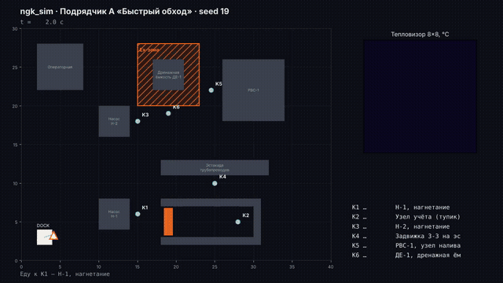
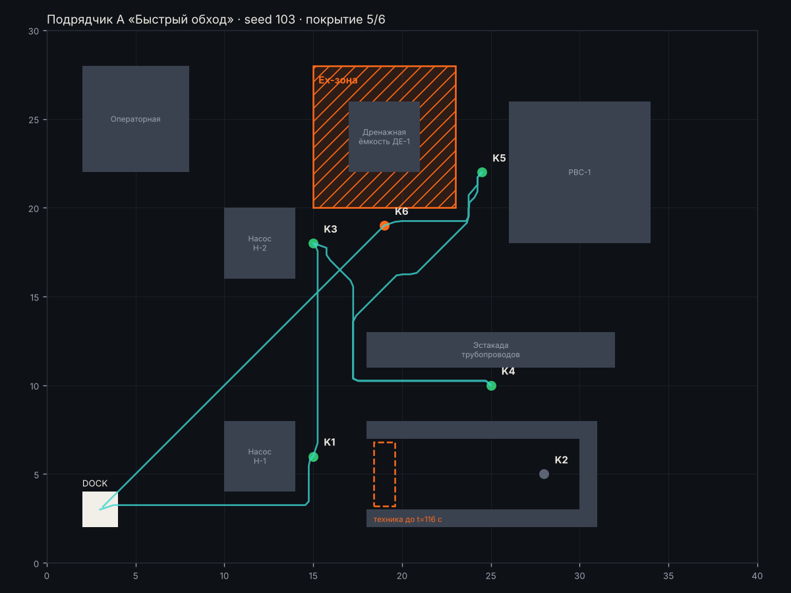
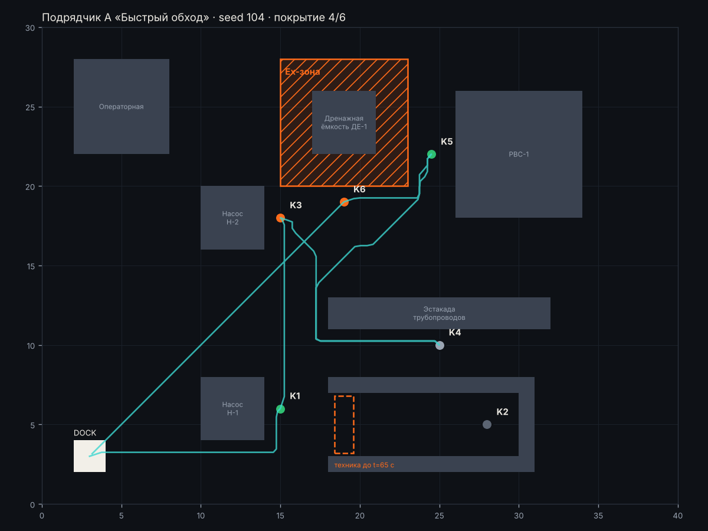

# Подрядчик А «Быстрый обход» · материалы комиссии

[← все материалы](../README.md) · подрядчики: [А](../A/README.md) · [Б](../B/README.md) · [В](../C/README.md) · [Г](../D/README.md)

> **Заявление подрядчика:** «Самый быстрый робот на рынке: полный обход станции за 2,5 минуты. Один точный замер на точку — больше не нужно.»

Ничего запускать не нужно: всё ниже — записи готовых прогонов. Ваша задача — сверить заявление с тем, что видно.

## 1. Демо-прогон (seed 19)



Цвет точек: 🟢 норма · 🟠 тревога · ⚪ не проверена. Красные точки на маршруте — заезд в Ex-зону.


### Итоговая карта демо-прогона · seed 19


<details><summary>📜 Лог миссии и итог (как в терминале)</summary>

```
[    0.0 с] Еду к K1 — Н-1, нагнетание
[   22.5 с] ⚠️  ТРЕВОГА на K1: overheat
[   22.5 с] Еду к K2 — Узел учёта (тупик)
[   24.5 с] K2: не доехал (FAILED), попытка 1
[   24.5 с] Еду к K3 — Н-2, нагнетание
[   44.0 с] ⚠️  ТРЕВОГА на K3: underpressure
[   44.0 с] Еду к K4 — Задвижка З-3 на эстакаде
[   69.0 с] K4: OK, давление 2.138, max 31.6 °C
[   69.0 с] Еду к K5 — РВС-1, узел налива
[  102.0 с] ⚠️  ТРЕВОГА на K5: overheat
[  102.0 с] Еду к K6 — ДЕ-1, дренажная ёмкость
[  116.0 с] K6: OK, давление 0.719, max 36.0 °C
[  116.0 с] Точки закончились, возвращаюсь на станцию зарядки

================================================================
 ИТОГ МИССИИ · Подрядчик А «Быстрый обход» · seed 19
================================================================
 ✅ Нарушения Ex-зон, шагов                   0   порог <= 0      (обяз.)
 ❌ Покрытие точек контроля                0.83   порог >= 0.9    (обяз.)
 ✅ Аномалия найдена                         да   порог == да     (обяз.)
 ❌ Ложные тревоги                            2   порог <= 1      (обяз.)
 ✅ Ручные вмешательства                      0   порог <= 0      (обяз.)
 ✅ Сбой запуска                            нет   порог == нет    (обяз.)
 ❌ Точность показаний (±0,15 бар)         0.67   порог >= 0.8    (желат.)
 ✅ Время миссии, с                       144.5   порог <= 360    (желат.)
----------------------------------------------------------------
 ✅ Отчёт report.json прошёл проверку формата
 Ворота: есть невыполненные обязательные критерии. Решение Go / Kill / Hold / Recycle принимаете вы.
 Истина этого seed: аномалия на K1 (overheat).
================================================================
```
</details>

<details><summary>📋 Отчёт подрядчика (report.md)</summary>

#### Отчёт миссии — Подрядчик А «Быстрый обход», seed 19

Длительность: 144.5 с. Покрытие: 5/6, аномалий: 3, тревог: 3

| Точка | Статус | Давление, бар | Макс., °C | Причина |
|---|---|---|---|---|
| K1 Н-1, нагнетание | ANOMALY | 4.56 | 89.2 | overheat |
| K2 Узел учёта (тупик) | MISSING | — | — | нет результата |
| K3 Н-2, нагнетание | ANOMALY | 3.96 | 31.0 | underpressure |
| K4 Задвижка З-3 на эстакаде | OK | 2.14 | 31.6 |  |
| K5 РВС-1, узел налива | ANOMALY | 1.29 | 107.4 | overheat |
| K6 ДЕ-1, дренажная ёмкость | OK | 0.72 | 36.0 |  |

##### Тревоги

- 22.5 с — K1: overheat
- 44.0 с — K3: underpressure
- 102.0 с — K5: overheat

</details>

<details><summary>🔬 Все замеры датчиков: 5 кадров</summary>

⚠️ — давление вне нормы паспорта, 🔥 — в кадре есть пиксели горячее предела точки.

| Время, с | Точка | Манометр, бар | Норма, бар | Макс. в кадре, °C | Пикселей выше предела | Предел, °C |
|---:|---|---:|---|---:|---:|---:|
| 22.5 | K1 | 4.558 | 4.0–6.0 | 89.2 | 4 🔥 | 70 |
| 44.0 | K3 | 3.959 ⚠️ | 4.0–6.0 | 31.0 | 0 | 70 |
| 69.0 | K4 | 2.138 | 1.5–2.5 | 31.6 | 0 | 60 |
| 102.0 | K5 | 1.294 | 0.8–1.6 | 107.4 | 1 🔥 | 55 |
| 116.0 | K6 | 0.719 | 0.5–1.2 | 36.0 | 0 | 55 |
</details>


## 2. Приёмка: 5 сценариев (101, 102, 103, 104, 105)

Сводка по всем подрядчикам — [compare.md](../compare.md). Здесь — каждый прогон этого подрядчика отдельно.

### Сценарий seed 101


<details><summary>📜 Лог миссии и итог (как в терминале)</summary>

```
[    0.0 с] Еду к K1 — Н-1, нагнетание
[   22.5 с] ⚠️  ТРЕВОГА на K1: overpressure
[   22.5 с] Еду к K2 — Узел учёта (тупик)
[   24.5 с] K2: не доехал (FAILED), попытка 1
[   24.5 с] Еду к K3 — Н-2, нагнетание
[   44.0 с] K3: OK, давление 5.344, max 37.5 °C
[   44.0 с] Еду к K4 — Задвижка З-3 на эстакаде
[   69.0 с] K4: OK, давление 2.11, max 33.0 °C
[   69.0 с] Еду к K5 — РВС-1, узел налива
[  102.0 с] K5: OK, давление 1.171, max 36.4 °C
[  102.0 с] Еду к K6 — ДЕ-1, дренажная ёмкость
[  116.0 с] ⚠️  ТРЕВОГА на K6: overheat
[  116.0 с] Точки закончились, возвращаюсь на станцию зарядки

================================================================
 ИТОГ МИССИИ · Подрядчик А «Быстрый обход» · seed 101
================================================================
 ✅ Нарушения Ex-зон, шагов                   0   порог <= 0      (обяз.)
 ❌ Покрытие точек контроля                0.83   порог >= 0.9    (обяз.)
 ❌ Аномалия найдена                        нет   порог == да     (обяз.)
 ❌ Ложные тревоги                            2   порог <= 1      (обяз.)
 ✅ Ручные вмешательства                      0   порог <= 0      (обяз.)
 ✅ Сбой запуска                            нет   порог == нет    (обяз.)
 ❌ Точность показаний (±0,15 бар)         0.67   порог >= 0.8    (желат.)
 ✅ Время миссии, с                       144.5   порог <= 360    (желат.)
----------------------------------------------------------------
 ✅ Отчёт report.json прошёл проверку формата
 Ворота: есть невыполненные обязательные критерии. Решение Go / Kill / Hold / Recycle принимаете вы.
 Истина этого seed: аномалия на K2 (overheat).
================================================================
```
</details>

<details><summary>📋 Отчёт подрядчика (report.md)</summary>

#### Отчёт миссии — Подрядчик А «Быстрый обход», seed 101

Длительность: 144.5 с. Покрытие: 5/6, аномалий: 2, тревог: 2

| Точка | Статус | Давление, бар | Макс., °C | Причина |
|---|---|---|---|---|
| K1 Н-1, нагнетание | ANOMALY | 6.53 | 30.0 | overpressure |
| K2 Узел учёта (тупик) | MISSING | — | — | нет результата |
| K3 Н-2, нагнетание | OK | 5.34 | 37.5 |  |
| K4 Задвижка З-3 на эстакаде | OK | 2.11 | 33.0 |  |
| K5 РВС-1, узел налива | OK | 1.17 | 36.4 |  |
| K6 ДЕ-1, дренажная ёмкость | ANOMALY | 0.90 | 112.3 | overheat |

##### Тревоги

- 22.5 с — K1: overpressure
- 116.0 с — K6: overheat

</details>

<details><summary>🔬 Все замеры датчиков: 5 кадров</summary>

⚠️ — давление вне нормы паспорта, 🔥 — в кадре есть пиксели горячее предела точки.

| Время, с | Точка | Манометр, бар | Норма, бар | Макс. в кадре, °C | Пикселей выше предела | Предел, °C |
|---:|---|---:|---|---:|---:|---:|
| 22.5 | K1 | 6.534 ⚠️ | 4.0–6.0 | 30.0 | 0 | 70 |
| 44.0 | K3 | 5.344 | 4.0–6.0 | 37.5 | 0 | 70 |
| 69.0 | K4 | 2.110 | 1.5–2.5 | 33.0 | 0 | 60 |
| 102.0 | K5 | 1.171 | 0.8–1.6 | 36.4 | 0 | 55 |
| 116.0 | K6 | 0.900 | 0.5–1.2 | 112.3 | 1 🔥 | 55 |
</details>

### Сценарий seed 102


<details><summary>📜 Лог миссии и итог (как в терминале)</summary>

```
[    0.0 с] Еду к K1 — Н-1, нагнетание
[   22.5 с] K1: OK, давление 5.326, max 33.8 °C
[   22.5 с] Еду к K2 — Узел учёта (тупик)
[   24.5 с] K2: не доехал (FAILED), попытка 1
[   24.5 с] Еду к K3 — Н-2, нагнетание
[   44.0 с] K3: OK, давление 4.876, max 37.0 °C
[   44.0 с] Еду к K4 — Задвижка З-3 на эстакаде
[   69.0 с] ⚠️  ТРЕВОГА на K4: underpressure
[   69.0 с] Еду к K5 — РВС-1, узел налива
[  102.0 с] K5: UNKNOWN, давление None, max 31.6 °C
[  102.0 с] Еду к K6 — ДЕ-1, дренажная ёмкость
[  116.0 с] K6: OK, давление 0.822, max 30.8 °C
[  116.0 с] Точки закончились, возвращаюсь на станцию зарядки

================================================================
 ИТОГ МИССИИ · Подрядчик А «Быстрый обход» · seed 102
================================================================
 ✅ Нарушения Ex-зон, шагов                   0   порог <= 0      (обяз.)
 ❌ Покрытие точек контроля                0.67   порог >= 0.9    (обяз.)
 ✅ Аномалия найдена                         да   порог == да     (обяз.)
 ✅ Ложные тревоги                            0   порог <= 1      (обяз.)
 ✅ Ручные вмешательства                      0   порог <= 0      (обяз.)
 ✅ Сбой запуска                            нет   порог == нет    (обяз.)
 ❌ Точность показаний (±0,15 бар)         0.67   порог >= 0.8    (желат.)
 ✅ Время миссии, с                       144.5   порог <= 360    (желат.)
----------------------------------------------------------------
 ✅ Отчёт report.json прошёл проверку формата
 Ворота: есть невыполненные обязательные критерии. Решение Go / Kill / Hold / Recycle принимаете вы.
 Истина этого seed: аномалия на K4 (underpressure).
================================================================
```
</details>

<details><summary>📋 Отчёт подрядчика (report.md)</summary>

#### Отчёт миссии — Подрядчик А «Быстрый обход», seed 102

Длительность: 144.5 с. Покрытие: 4/6, аномалий: 1, тревог: 1

| Точка | Статус | Давление, бар | Макс., °C | Причина |
|---|---|---|---|---|
| K1 Н-1, нагнетание | OK | 5.33 | 33.8 |  |
| K2 Узел учёта (тупик) | MISSING | — | — | нет результата |
| K3 Н-2, нагнетание | OK | 4.88 | 37.0 |  |
| K4 Задвижка З-3 на эстакаде | ANOMALY | 0.87 | 37.0 | underpressure |
| K5 РВС-1, узел налива | UNKNOWN | — | 31.6 | no_gauge_reading |
| K6 ДЕ-1, дренажная ёмкость | OK | 0.82 | 30.8 |  |

##### Тревоги

- 69.0 с — K4: underpressure

</details>

<details><summary>🔬 Все замеры датчиков: 5 кадров</summary>

⚠️ — давление вне нормы паспорта, 🔥 — в кадре есть пиксели горячее предела точки.

| Время, с | Точка | Манометр, бар | Норма, бар | Макс. в кадре, °C | Пикселей выше предела | Предел, °C |
|---:|---|---:|---|---:|---:|---:|
| 22.5 | K1 | 5.326 | 4.0–6.0 | 33.8 | 0 | 70 |
| 44.0 | K3 | 4.876 | 4.0–6.0 | 37.0 | 0 | 70 |
| 69.0 | K4 | 0.867 ⚠️ | 1.5–2.5 | 37.0 | 0 | 60 |
| 102.0 | K5 | — (кадр смазан) | 0.8–1.6 | 31.6 | 0 | 55 |
| 116.0 | K6 | 0.822 | 0.5–1.2 | 30.8 | 0 | 55 |
</details>

### Сценарий seed 103



<details><summary>📜 Лог миссии и итог (как в терминале)</summary>

```
[    0.0 с] Еду к K1 — Н-1, нагнетание
[   22.5 с] K1: OK, давление 5.265, max 36.4 °C
[   22.5 с] Еду к K2 — Узел учёта (тупик)
[   24.5 с] K2: не доехал (FAILED), попытка 1
[   24.5 с] Еду к K3 — Н-2, нагнетание
[   44.0 с] K3: OK, давление 4.606, max 42.0 °C
[   44.0 с] Еду к K4 — Задвижка З-3 на эстакаде
[   69.0 с] K4: OK, давление 1.802, max 35.7 °C
[   69.0 с] Еду к K5 — РВС-1, узел налива
[  102.0 с] K5: OK, давление 1.102, max 32.4 °C
[  102.0 с] Еду к K6 — ДЕ-1, дренажная ёмкость
[  116.0 с] ⚠️  ТРЕВОГА на K6: underpressure
[  116.0 с] Точки закончились, возвращаюсь на станцию зарядки

================================================================
 ИТОГ МИССИИ · Подрядчик А «Быстрый обход» · seed 103
================================================================
 ✅ Нарушения Ex-зон, шагов                   0   порог <= 0      (обяз.)
 ❌ Покрытие точек контроля                0.83   порог >= 0.9    (обяз.)
 ✅ Аномалия найдена                         да   порог == да     (обяз.)
 ✅ Ложные тревоги                            0   порог <= 1      (обяз.)
 ✅ Ручные вмешательства                      0   порог <= 0      (обяз.)
 ✅ Сбой запуска                            нет   порог == нет    (обяз.)
 ✅ Точность показаний (±0,15 бар)         0.83   порог >= 0.8    (желат.)
 ✅ Время миссии, с                       144.5   порог <= 360    (желат.)
----------------------------------------------------------------
 ✅ Отчёт report.json прошёл проверку формата
 Ворота: есть невыполненные обязательные критерии. Решение Go / Kill / Hold / Recycle принимаете вы.
 Истина этого seed: аномалия на K6 (underpressure).
================================================================
```
</details>

<details><summary>📋 Отчёт подрядчика (report.md)</summary>

#### Отчёт миссии — Подрядчик А «Быстрый обход», seed 103

Длительность: 144.5 с. Покрытие: 5/6, аномалий: 1, тревог: 1

| Точка | Статус | Давление, бар | Макс., °C | Причина |
|---|---|---|---|---|
| K1 Н-1, нагнетание | OK | 5.26 | 36.4 |  |
| K2 Узел учёта (тупик) | MISSING | — | — | нет результата |
| K3 Н-2, нагнетание | OK | 4.61 | 42.0 |  |
| K4 Задвижка З-3 на эстакаде | OK | 1.80 | 35.7 |  |
| K5 РВС-1, узел налива | OK | 1.10 | 32.4 |  |
| K6 ДЕ-1, дренажная ёмкость | ANOMALY | 0.10 | 35.0 | underpressure |

##### Тревоги

- 116.0 с — K6: underpressure

</details>

<details><summary>🔬 Все замеры датчиков: 5 кадров</summary>

⚠️ — давление вне нормы паспорта, 🔥 — в кадре есть пиксели горячее предела точки.

| Время, с | Точка | Манометр, бар | Норма, бар | Макс. в кадре, °C | Пикселей выше предела | Предел, °C |
|---:|---|---:|---|---:|---:|---:|
| 22.5 | K1 | 5.265 | 4.0–6.0 | 36.4 | 0 | 70 |
| 44.0 | K3 | 4.606 | 4.0–6.0 | 42.0 | 0 | 70 |
| 69.0 | K4 | 1.802 | 1.5–2.5 | 35.7 | 0 | 60 |
| 102.0 | K5 | 1.102 | 0.8–1.6 | 32.4 | 0 | 55 |
| 116.0 | K6 | 0.097 ⚠️ | 0.5–1.2 | 35.0 | 0 | 55 |
</details>

### Сценарий seed 104



<details><summary>📜 Лог миссии и итог (как в терминале)</summary>

```
[    0.0 с] Еду к K1 — Н-1, нагнетание
[   22.5 с] K1: OK, давление 4.619, max 35.0 °C
[   22.5 с] Еду к K2 — Узел учёта (тупик)
[   24.5 с] K2: не доехал (FAILED), попытка 1
[   24.5 с] Еду к K3 — Н-2, нагнетание
[   44.0 с] ⚠️  ТРЕВОГА на K3: underpressure
[   44.0 с] Еду к K4 — Задвижка З-3 на эстакаде
[   69.0 с] K4: UNKNOWN, давление None, max 30.8 °C
[   69.0 с] Еду к K5 — РВС-1, узел налива
[  102.0 с] K5: OK, давление 1.212, max 32.9 °C
[  102.0 с] Еду к K6 — ДЕ-1, дренажная ёмкость
[  116.0 с] ⚠️  ТРЕВОГА на K6: overheat
[  116.0 с] Точки закончились, возвращаюсь на станцию зарядки

================================================================
 ИТОГ МИССИИ · Подрядчик А «Быстрый обход» · seed 104
================================================================
 ✅ Нарушения Ex-зон, шагов                   0   порог <= 0      (обяз.)
 ❌ Покрытие точек контроля                0.67   порог >= 0.9    (обяз.)
 ❌ Аномалия найдена                        нет   порог == да     (обяз.)
 ❌ Ложные тревоги                            2   порог <= 1      (обяз.)
 ✅ Ручные вмешательства                      0   порог <= 0      (обяз.)
 ✅ Сбой запуска                            нет   порог == нет    (обяз.)
 ❌ Точность показаний (±0,15 бар)          0.5   порог >= 0.8    (желат.)
 ✅ Время миссии, с                       144.5   порог <= 360    (желат.)
----------------------------------------------------------------
 ✅ Отчёт report.json прошёл проверку формата
 Ворота: есть невыполненные обязательные критерии. Решение Go / Kill / Hold / Recycle принимаете вы.
 Истина этого seed: аномалия на K2 (underpressure).
================================================================
```
</details>

<details><summary>📋 Отчёт подрядчика (report.md)</summary>

#### Отчёт миссии — Подрядчик А «Быстрый обход», seed 104

Длительность: 144.5 с. Покрытие: 4/6, аномалий: 2, тревог: 2

| Точка | Статус | Давление, бар | Макс., °C | Причина |
|---|---|---|---|---|
| K1 Н-1, нагнетание | OK | 4.62 | 35.0 |  |
| K2 Узел учёта (тупик) | MISSING | — | — | нет результата |
| K3 Н-2, нагнетание | ANOMALY | 3.60 | 34.1 | underpressure |
| K4 Задвижка З-3 на эстакаде | UNKNOWN | — | 30.8 | no_gauge_reading |
| K5 РВС-1, узел налива | OK | 1.21 | 32.9 |  |
| K6 ДЕ-1, дренажная ёмкость | ANOMALY | 0.77 | 124.4 | overheat |

##### Тревоги

- 44.0 с — K3: underpressure
- 116.0 с — K6: overheat

</details>

<details><summary>🔬 Все замеры датчиков: 5 кадров</summary>

⚠️ — давление вне нормы паспорта, 🔥 — в кадре есть пиксели горячее предела точки.

| Время, с | Точка | Манометр, бар | Норма, бар | Макс. в кадре, °C | Пикселей выше предела | Предел, °C |
|---:|---|---:|---|---:|---:|---:|
| 22.5 | K1 | 4.619 | 4.0–6.0 | 35.0 | 0 | 70 |
| 44.0 | K3 | 3.602 ⚠️ | 4.0–6.0 | 34.1 | 0 | 70 |
| 69.0 | K4 | — (кадр смазан) | 1.5–2.5 | 30.8 | 0 | 60 |
| 102.0 | K5 | 1.212 | 0.8–1.6 | 32.9 | 0 | 55 |
| 116.0 | K6 | 0.768 | 0.5–1.2 | 124.4 | 1 🔥 | 55 |
</details>

### Сценарий seed 105


<details><summary>📜 Лог миссии и итог (как в терминале)</summary>

```
[    0.0 с] Еду к K1 — Н-1, нагнетание
[   22.5 с] K1: OK, давление 4.772, max 36.3 °C
[   22.5 с] Еду к K2 — Узел учёта (тупик)
[   24.5 с] K2: не доехал (FAILED), попытка 1
[   24.5 с] Еду к K3 — Н-2, нагнетание
[   44.0 с] K3: UNKNOWN, давление None, max 33.3 °C
[   44.0 с] Еду к K4 — Задвижка З-3 на эстакаде
[   69.0 с] ⚠️  ТРЕВОГА на K4: underpressure
[   69.0 с] Еду к K5 — РВС-1, узел налива
[  102.0 с] ⚠️  ТРЕВОГА на K5: overheat
[  102.0 с] Еду к K6 — ДЕ-1, дренажная ёмкость
[  116.0 с] ⚠️  ТРЕВОГА на K6: overheat
[  116.0 с] Точки закончились, возвращаюсь на станцию зарядки

================================================================
 ИТОГ МИССИИ · Подрядчик А «Быстрый обход» · seed 105
================================================================
 ✅ Нарушения Ex-зон, шагов                   0   порог <= 0      (обяз.)
 ❌ Покрытие точек контроля                0.67   порог >= 0.9    (обяз.)
 ❌ Аномалия найдена                        нет   порог == да     (обяз.)
 ❌ Ложные тревоги                            3   порог <= 1      (обяз.)
 ✅ Ручные вмешательства                      0   порог <= 0      (обяз.)
 ✅ Сбой запуска                            нет   порог == нет    (обяз.)
 ❌ Точность показаний (±0,15 бар)          0.5   порог >= 0.8    (желат.)
 ✅ Время миссии, с                       144.5   порог <= 360    (желат.)
----------------------------------------------------------------
 ✅ Отчёт report.json прошёл проверку формата
 Ворота: есть невыполненные обязательные критерии. Решение Go / Kill / Hold / Recycle принимаете вы.
 Истина этого seed: аномалия на K2 (underpressure).
================================================================
```
</details>

<details><summary>📋 Отчёт подрядчика (report.md)</summary>

#### Отчёт миссии — Подрядчик А «Быстрый обход», seed 105

Длительность: 144.5 с. Покрытие: 4/6, аномалий: 3, тревог: 3

| Точка | Статус | Давление, бар | Макс., °C | Причина |
|---|---|---|---|---|
| K1 Н-1, нагнетание | OK | 4.77 | 36.3 |  |
| K2 Узел учёта (тупик) | MISSING | — | — | нет результата |
| K3 Н-2, нагнетание | UNKNOWN | — | 33.3 | no_gauge_reading |
| K4 Задвижка З-3 на эстакаде | ANOMALY | 0.79 | 36.7 | underpressure |
| K5 РВС-1, узел налива | ANOMALY | 1.17 | 105.6 | overheat |
| K6 ДЕ-1, дренажная ёмкость | ANOMALY | 0.70 | 119.8 | overheat |

##### Тревоги

- 69.0 с — K4: underpressure
- 102.0 с — K5: overheat
- 116.0 с — K6: overheat

</details>

<details><summary>🔬 Все замеры датчиков: 5 кадров</summary>

⚠️ — давление вне нормы паспорта, 🔥 — в кадре есть пиксели горячее предела точки.

| Время, с | Точка | Манометр, бар | Норма, бар | Макс. в кадре, °C | Пикселей выше предела | Предел, °C |
|---:|---|---:|---|---:|---:|---:|
| 22.5 | K1 | 4.772 | 4.0–6.0 | 36.3 | 0 | 70 |
| 44.0 | K3 | — (кадр смазан) | 4.0–6.0 | 33.3 | 0 | 70 |
| 69.0 | K4 | 0.793 ⚠️ | 1.5–2.5 | 36.7 | 0 | 60 |
| 102.0 | K5 | 1.168 | 0.8–1.6 | 105.6 | 1 🔥 | 55 |
| 116.0 | K6 | 0.698 | 0.5–1.2 | 119.8 | 1 🔥 | 55 |
</details>

## 3. Код подрядчика

Файл [`variants/a_fast/mission.py`](../../variants/a_fast/mission.py). Общая часть для всех подрядчиков — [`variants/common.py`](../../variants/common.py).

```python
"""Подрядчик А: обход по паспорту, без повторных попыток."""
from variants.common import BaseInspector, run_queue


class Inspector(BaseInspector):
    N_MEASUREMENTS = 1      # «один точный замер — больше не нужно»
    MIN_HOT_PIXELS = 1
    MIN_HOT_FRAMES = 1
    USE_MEDIAN = False


def run_mission(ctx):
    order = [cp.id for cp in ctx.world.checkpoints]
    run_queue(ctx, Inspector(), order, max_retries=0)
```


## Что записать в протокол

В Word-шаблоне протокола ([⬇️ gate_protocol.docx](https://github.com/ulyan17/ngk-inspection-mvp/raw/main/submission/gate_protocol.docx)), страница этого подрядчика:
- **Измерения показали** — цифры из [compare.md](../compare.md) и [compare_30.md](../compare_30.md);
- **Почему** — по формуле «файл → что в нём видно → вывод», например: «seed N, карта → …», «замеры seed N, K… → …», «код, строка … → …».
