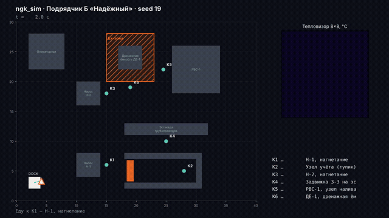
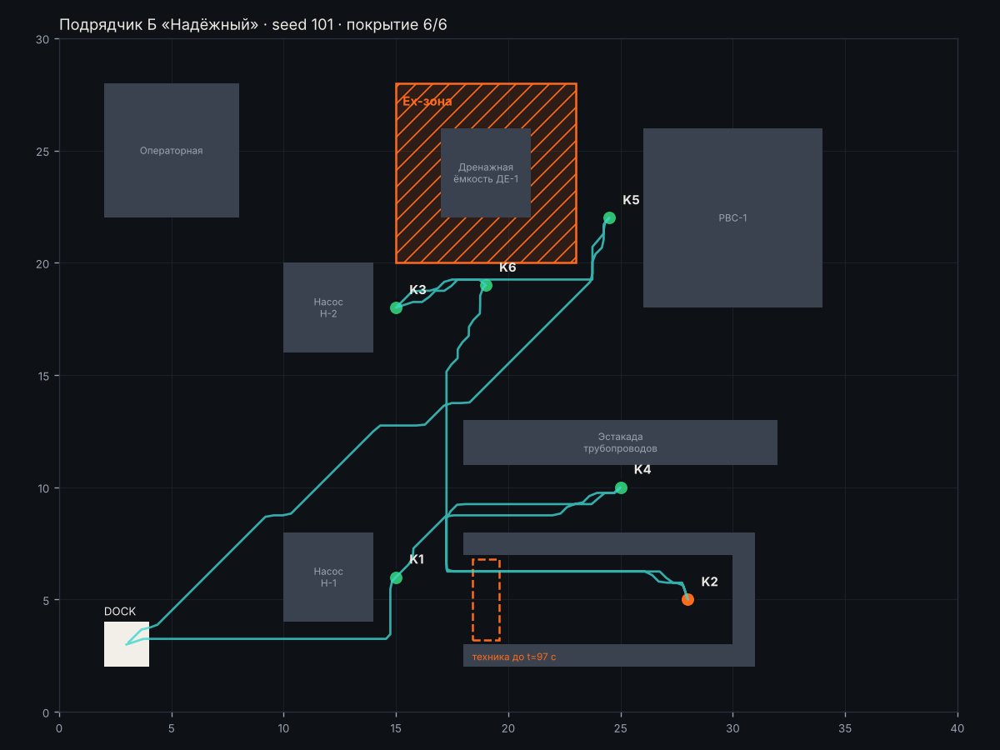
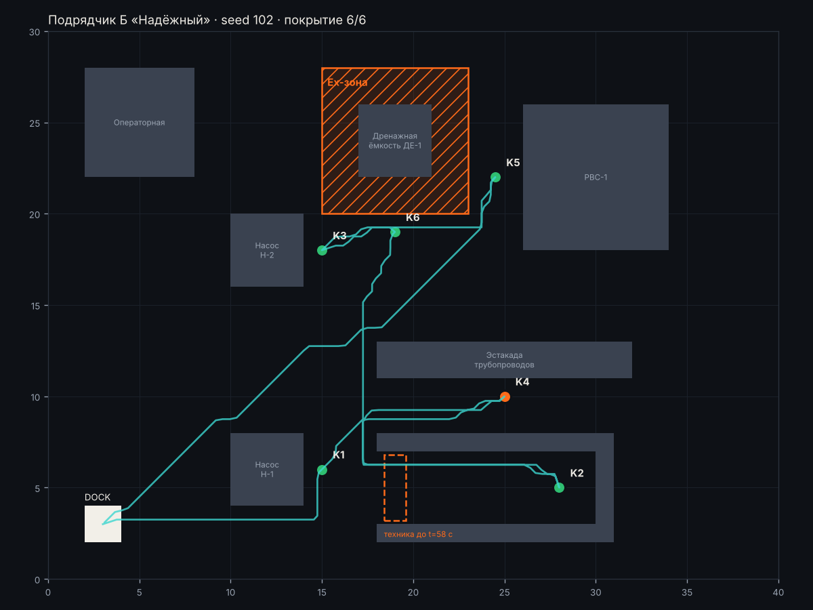

# Подрядчик Б «Надёжный» · материалы комиссии

[← все материалы](../README.md) · подрядчики: [А](../A/README.md) · [Б](../B/README.md) · [В](../C/README.md) · [Г](../D/README.md)

> **Заявление подрядчика:** «Стопроцентная точность показаний и ни одной ложной тревоги. Если датчик хоть немного сомневается — подключаем оператора, он перепроверит.»

Ничего запускать не нужно: всё ниже — записи готовых прогонов. Ваша задача — сверить заявление с тем, что видно.

## 1. Демо-прогон (seed 19)



Цвет точек: 🟢 норма · 🟠 тревога · ⚪ не проверена. Красные точки на маршруте — заезд в Ex-зону.


### Итоговая карта демо-прогона · seed 19


<details><summary>📜 Лог миссии и итог (как в терминале)</summary>

```
[    0.0 с] Еду к K1 — Н-1, нагнетание
[   42.5 с] K1: показания сомнительные — вызываю оператора
[  102.5 с] ⚠️  ТРЕВОГА на K1: overheat
[  102.5 с] Еду к K4 — Задвижка З-3 на эстакаде
[  141.5 с] K4: показания сомнительные — вызываю оператора
[  201.5 с] K4: OK, давление 2.119, max 32.5 °C
[  201.5 с] Еду к K2 — Узел учёта (тупик)
[  253.5 с] K2: OK, давление 2.963, max 31.1 °C
[  253.5 с] Еду к K6 — ДЕ-1, дренажная ёмкость
[  309.0 с] K6: показания сомнительные — вызываю оператора
[  369.0 с] K6: OK, давление 0.719, max 35.8 °C
[  369.0 с] Еду к K3 — Н-2, нагнетание
[  399.0 с] K3: показания сомнительные — вызываю оператора
[  459.0 с] K3: OK, давление 4.944, max 31.3 °C
[  459.0 с] Еду к K5 — РВС-1, узел налива
[  498.5 с] K5: показания сомнительные — вызываю оператора
[  558.5 с] K5: OK, давление 1.222, max 34.3 °C
[  558.5 с] Точки закончились, возвращаюсь на станцию зарядки

================================================================
 ИТОГ МИССИИ · Подрядчик Б «Надёжный» · seed 19
================================================================
 ✅ Нарушения Ex-зон, шагов                   0   порог <= 0      (обяз.)
 ✅ Покрытие точек контроля                   1   порог >= 0.9    (обяз.)
 ✅ Аномалия найдена                         да   порог == да     (обяз.)
 ✅ Ложные тревоги                            0   порог <= 1      (обяз.)
 ❌ Ручные вмешательства                      5   порог <= 0      (обяз.)
 ✅ Сбой запуска                            нет   порог == нет    (обяз.)
 ✅ Точность показаний (±0,15 бар)            1   порог >= 0.8    (желат.)
 ❌ Время миссии, с                         597   порог <= 360    (желат.)
----------------------------------------------------------------
 ✅ Отчёт report.json прошёл проверку формата
 Ворота: есть невыполненные обязательные критерии. Решение Go / Kill / Hold / Recycle принимаете вы.
 Истина этого seed: аномалия на K1 (overheat).
================================================================
```
</details>

<details><summary>📋 Отчёт подрядчика (report.md)</summary>

#### Отчёт миссии — Подрядчик Б «Надёжный», seed 19

Длительность: 597.0 с. Покрытие: 6/6, аномалий: 1, тревог: 1

| Точка | Статус | Давление, бар | Макс., °C | Причина |
|---|---|---|---|---|
| K1 Н-1, нагнетание | ANOMALY | 4.60 | 88.5 | overheat |
| K2 Узел учёта (тупик) | OK | 2.96 | 31.1 |  |
| K3 Н-2, нагнетание | OK | 4.94 | 31.3 |  |
| K4 Задвижка З-3 на эстакаде | OK | 2.12 | 32.5 |  |
| K5 РВС-1, узел налива | OK | 1.22 | 34.3 |  |
| K6 ДЕ-1, дренажная ёмкость | OK | 0.72 | 35.8 |  |

##### Тревоги

- 102.5 с — K1: overheat

</details>

<details><summary>🔬 Все замеры датчиков: 41 кадров</summary>

⚠️ — давление вне нормы паспорта, 🔥 — в кадре есть пиксели горячее предела точки.

| Время, с | Точка | Манометр, бар | Норма, бар | Макс. в кадре, °C | Пикселей выше предела | Предел, °C |
|---:|---|---:|---|---:|---:|---:|
| 22.5 | K1 | 4.558 | 4.0–6.0 | 89.2 | 4 🔥 | 70 |
| 26.5 | K1 | 3.612 ⚠️ | 4.0–6.0 | 89.6 | 4 🔥 | 70 |
| 30.5 | K1 | 4.616 | 4.0–6.0 | 88.9 | 4 🔥 | 70 |
| 34.5 | K1 | 4.669 | 4.0–6.0 | 89.7 | 4 🔥 | 70 |
| 38.5 | K1 | 4.573 | 4.0–6.0 | 89.1 | 4 🔥 | 70 |
| 42.5 | K1 | 4.674 | 4.0–6.0 | 89.4 | 4 🔥 | 70 |
| 102.5 | K1 | 4.597 | 4.0–6.0 | 88.5 | 4 🔥 | 70 |
| 121.5 | K4 | 2.086 | 1.5–2.5 | 32.1 | 0 | 60 |
| 125.5 | K4 | 2.148 | 1.5–2.5 | 33.5 | 0 | 60 |
| 129.5 | K4 | 2.155 | 1.5–2.5 | 33.4 | 0 | 60 |
| 133.5 | K4 | 2.152 | 1.5–2.5 | 33.0 | 0 | 60 |
| 137.5 | K4 | 2.111 | 1.5–2.5 | 33.3 | 0 | 60 |
| 141.5 | K4 | — (кадр смазан) | 1.5–2.5 | 32.8 | 0 | 60 |
| 201.5 | K4 | 2.119 | 1.5–2.5 | 32.5 | 0 | 60 |
| 233.5 | K2 | 2.999 | 2.5–3.5 | 31.1 | 0 | 60 |
| 237.5 | K2 | 2.959 | 2.5–3.5 | 29.5 | 0 | 60 |
| 241.5 | K2 | 2.962 | 2.5–3.5 | 29.1 | 0 | 60 |
| 245.5 | K2 | 2.986 | 2.5–3.5 | 30.9 | 0 | 60 |
| 249.5 | K2 | 2.956 | 2.5–3.5 | 30.2 | 0 | 60 |
| 253.5 | K2 | 2.965 | 2.5–3.5 | 30.3 | 0 | 60 |
| 289.0 | K6 | 0.000 ⚠️ | 0.5–1.2 | 36.0 | 0 | 55 |
| 293.0 | K6 | 0.719 | 0.5–1.2 | 35.0 | 0 | 55 |
| 297.0 | K6 | 0.765 | 0.5–1.2 | 35.4 | 0 | 55 |
| 301.0 | K6 | — (кадр смазан) | 0.5–1.2 | 36.0 | 0 | 55 |
| 305.0 | K6 | 0.702 | 0.5–1.2 | 35.6 | 0 | 55 |
| 309.0 | K6 | 0.699 | 0.5–1.2 | 36.7 | 0 | 55 |
| 369.0 | K6 | 0.719 | 0.5–1.2 | 35.8 | 0 | 55 |
| 379.0 | K3 | 5.000 | 4.0–6.0 | 32.3 | 0 | 70 |
| 383.0 | K3 | 4.961 | 4.0–6.0 | 30.6 | 0 | 70 |
| 387.0 | K3 | 4.936 | 4.0–6.0 | 32.1 | 0 | 70 |
| 391.0 | K3 | 6.495 ⚠️ | 4.0–6.0 | 31.1 | 0 | 70 |
| 395.0 | K3 | 4.942 | 4.0–6.0 | 32.2 | 0 | 70 |
| 399.0 | K3 | 4.924 | 4.0–6.0 | 32.7 | 0 | 70 |
| 459.0 | K3 | 4.944 | 4.0–6.0 | 31.3 | 0 | 70 |
| 478.5 | K5 | 0.000 ⚠️ | 0.8–1.6 | 35.8 | 0 | 55 |
| 482.5 | K5 | 1.280 | 0.8–1.6 | 117.9 | 1 🔥 | 55 |
| 486.5 | K5 | 1.209 | 0.8–1.6 | 35.8 | 0 | 55 |
| 490.5 | K5 | 1.254 | 0.8–1.6 | 110.0 | 1 🔥 | 55 |
| 494.5 | K5 | 1.210 | 0.8–1.6 | 103.9 | 1 🔥 | 55 |
| 498.5 | K5 | 1.260 | 0.8–1.6 | 35.8 | 0 | 55 |
| 558.5 | K5 | 1.222 | 0.8–1.6 | 34.3 | 0 | 55 |
</details>


## 2. Приёмка: 5 сценариев (101, 102, 103, 104, 105)

Сводка по всем подрядчикам — [compare.md](../compare.md). Здесь — каждый прогон этого подрядчика отдельно.

### Сценарий seed 101



<details><summary>📜 Лог миссии и итог (как в терминале)</summary>

```
[    0.0 с] Еду к K1 — Н-1, нагнетание
[   42.5 с] K1: показания сомнительные — вызываю оператора
[  102.5 с] K1: OK, давление 5.163, max 29.9 °C
[  102.5 с] Еду к K4 — Задвижка З-3 на эстакаде
[  141.5 с] K4: показания сомнительные — вызываю оператора
[  201.5 с] K4: OK, давление 2.11, max 31.9 °C
[  201.5 с] Еду к K2 — Узел учёта (тупик)
[  253.5 с] K2: показания сомнительные — вызываю оператора
[  313.5 с] ⚠️  ТРЕВОГА на K2: overheat
[  313.5 с] Еду к K6 — ДЕ-1, дренажная ёмкость
[  369.0 с] K6: показания сомнительные — вызываю оператора
[  429.0 с] K6: OK, давление 0.972, max 33.3 °C
[  429.0 с] Еду к K3 — Н-2, нагнетание
[  459.0 с] K3: показания сомнительные — вызываю оператора
[  519.0 с] K3: OK, давление 5.434, max 36.2 °C
[  519.0 с] Еду к K5 — РВС-1, узел налива
[  558.5 с] K5: показания сомнительные — вызываю оператора
[  618.5 с] K5: OK, давление 1.174, max 35.9 °C
[  618.5 с] Точки закончились, возвращаюсь на станцию зарядки

================================================================
 ИТОГ МИССИИ · Подрядчик Б «Надёжный» · seed 101
================================================================
 ✅ Нарушения Ex-зон, шагов                   0   порог <= 0      (обяз.)
 ✅ Покрытие точек контроля                   1   порог >= 0.9    (обяз.)
 ✅ Аномалия найдена                         да   порог == да     (обяз.)
 ✅ Ложные тревоги                            0   порог <= 1      (обяз.)
 ❌ Ручные вмешательства                      6   порог <= 0      (обяз.)
 ✅ Сбой запуска                            нет   порог == нет    (обяз.)
 ✅ Точность показаний (±0,15 бар)            1   порог >= 0.8    (желат.)
 ❌ Время миссии, с                         657   порог <= 360    (желат.)
----------------------------------------------------------------
 ✅ Отчёт report.json прошёл проверку формата
 Ворота: есть невыполненные обязательные критерии. Решение Go / Kill / Hold / Recycle принимаете вы.
 Истина этого seed: аномалия на K2 (overheat).
================================================================
```
</details>

<details><summary>📋 Отчёт подрядчика (report.md)</summary>

#### Отчёт миссии — Подрядчик Б «Надёжный», seed 101

Длительность: 657.0 с. Покрытие: 6/6, аномалий: 1, тревог: 1

| Точка | Статус | Давление, бар | Макс., °C | Причина |
|---|---|---|---|---|
| K1 Н-1, нагнетание | OK | 5.16 | 29.9 |  |
| K2 Узел учёта (тупик) | ANOMALY | 3.09 | 78.6 | overheat |
| K3 Н-2, нагнетание | OK | 5.43 | 36.2 |  |
| K4 Задвижка З-3 на эстакаде | OK | 2.11 | 31.9 |  |
| K5 РВС-1, узел налива | OK | 1.17 | 35.9 |  |
| K6 ДЕ-1, дренажная ёмкость | OK | 0.97 | 33.3 |  |

##### Тревоги

- 313.5 с — K2: overheat

</details>

<details><summary>🔬 Все замеры датчиков: 42 кадров</summary>

⚠️ — давление вне нормы паспорта, 🔥 — в кадре есть пиксели горячее предела точки.

| Время, с | Точка | Манометр, бар | Норма, бар | Макс. в кадре, °C | Пикселей выше предела | Предел, °C |
|---:|---|---:|---|---:|---:|---:|
| 22.5 | K1 | 6.534 ⚠️ | 4.0–6.0 | 30.0 | 0 | 70 |
| 26.5 | K1 | 5.073 | 4.0–6.0 | 31.3 | 0 | 70 |
| 30.5 | K1 | 5.163 | 4.0–6.0 | 31.0 | 0 | 70 |
| 34.5 | K1 | 5.160 | 4.0–6.0 | 31.0 | 0 | 70 |
| 38.5 | K1 | 5.091 | 4.0–6.0 | 31.3 | 0 | 70 |
| 42.5 | K1 | 5.147 | 4.0–6.0 | 29.7 | 0 | 70 |
| 102.5 | K1 | 5.163 | 4.0–6.0 | 29.9 | 0 | 70 |
| 121.5 | K4 | 2.179 | 1.5–2.5 | 32.9 | 0 | 60 |
| 125.5 | K4 | — (кадр смазан) | 1.5–2.5 | 111.0 | 1 🔥 | 60 |
| 129.5 | K4 | 2.087 | 1.5–2.5 | 32.2 | 0 | 60 |
| 133.5 | K4 | 2.001 | 1.5–2.5 | 32.3 | 0 | 60 |
| 137.5 | K4 | 2.109 | 1.5–2.5 | 31.1 | 0 | 60 |
| 141.5 | K4 | 1.231 ⚠️ | 1.5–2.5 | 33.2 | 0 | 60 |
| 201.5 | K4 | 2.110 | 1.5–2.5 | 31.9 | 0 | 60 |
| 233.5 | K2 | 3.130 | 2.5–3.5 | 79.2 | 4 🔥 | 60 |
| 237.5 | K2 | — (кадр смазан) | 2.5–3.5 | 79.6 | 4 🔥 | 60 |
| 241.5 | K2 | 3.144 | 2.5–3.5 | 80.1 | 4 🔥 | 60 |
| 245.5 | K2 | 3.029 | 2.5–3.5 | 79.9 | 4 🔥 | 60 |
| 249.5 | K2 | 3.103 | 2.5–3.5 | 79.9 | 4 🔥 | 60 |
| 253.5 | K2 | 3.111 | 2.5–3.5 | 79.7 | 4 🔥 | 60 |
| 313.5 | K2 | 3.087 | 2.5–3.5 | 78.6 | 4 🔥 | 60 |
| 349.0 | K6 | 0.938 | 0.5–1.2 | 119.4 | 1 🔥 | 55 |
| 353.0 | K6 | 0.929 | 0.5–1.2 | 116.1 | 1 🔥 | 55 |
| 357.0 | K6 | 0.970 | 0.5–1.2 | 32.9 | 0 | 55 |
| 361.0 | K6 | 1.015 | 0.5–1.2 | 101.9 | 1 🔥 | 55 |
| 365.0 | K6 | 1.006 | 0.5–1.2 | 123.3 | 1 🔥 | 55 |
| 369.0 | K6 | — (кадр смазан) | 0.5–1.2 | 119.9 | 1 🔥 | 55 |
| 429.0 | K6 | 0.972 | 0.5–1.2 | 33.3 | 0 | 55 |
| 439.0 | K3 | 5.430 | 4.0–6.0 | 37.6 | 0 | 70 |
| 443.0 | K3 | 5.447 | 4.0–6.0 | 36.4 | 0 | 70 |
| 447.0 | K3 | — (кадр смазан) | 4.0–6.0 | 37.2 | 0 | 70 |
| 451.0 | K3 | 5.425 | 4.0–6.0 | 37.2 | 0 | 70 |
| 455.0 | K3 | 5.526 | 4.0–6.0 | 36.7 | 0 | 70 |
| 459.0 | K3 | 5.441 | 4.0–6.0 | 36.8 | 0 | 70 |
| 519.0 | K3 | 5.434 | 4.0–6.0 | 36.2 | 0 | 70 |
| 538.5 | K5 | 1.196 | 0.8–1.6 | 36.8 | 0 | 55 |
| 542.5 | K5 | 1.170 | 0.8–1.6 | 36.5 | 0 | 55 |
| 546.5 | K5 | — (кадр смазан) | 0.8–1.6 | 35.9 | 0 | 55 |
| 550.5 | K5 | 1.149 | 0.8–1.6 | 36.7 | 0 | 55 |
| 554.5 | K5 | 1.251 | 0.8–1.6 | 37.1 | 0 | 55 |
| 558.5 | K5 | — (кадр смазан) | 0.8–1.6 | 100.9 | 1 🔥 | 55 |
| 618.5 | K5 | 1.174 | 0.8–1.6 | 35.9 | 0 | 55 |
</details>

### Сценарий seed 102



<details><summary>📜 Лог миссии и итог (как в терминале)</summary>

```
[    0.0 с] Еду к K1 — Н-1, нагнетание
[   42.5 с] K1: показания сомнительные — вызываю оператора
[  102.5 с] K1: OK, давление 5.41, max 33.7 °C
[  102.5 с] Еду к K4 — Задвижка З-3 на эстакаде
[  141.5 с] K4: показания сомнительные — вызываю оператора
[  201.5 с] ⚠️  ТРЕВОГА на K4: underpressure
[  201.5 с] Еду к K2 — Узел учёта (тупик)
[  253.5 с] K2: показания сомнительные — вызываю оператора
[  313.5 с] K2: OK, давление 3.036, max 38.1 °C
[  313.5 с] Еду к K6 — ДЕ-1, дренажная ёмкость
[  369.0 с] K6: показания сомнительные — вызываю оператора
[  429.0 с] K6: OK, давление 0.782, max 29.5 °C
[  429.0 с] Еду к K3 — Н-2, нагнетание
[  459.0 с] K3: показания сомнительные — вызываю оператора
[  519.0 с] K3: OK, давление 4.86, max 37.0 °C
[  519.0 с] Еду к K5 — РВС-1, узел налива
[  558.5 с] K5: показания сомнительные — вызываю оператора
[  618.5 с] K5: OK, давление 1.288, max 32.1 °C
[  618.5 с] Точки закончились, возвращаюсь на станцию зарядки

================================================================
 ИТОГ МИССИИ · Подрядчик Б «Надёжный» · seed 102
================================================================
 ✅ Нарушения Ex-зон, шагов                   0   порог <= 0      (обяз.)
 ✅ Покрытие точек контроля                   1   порог >= 0.9    (обяз.)
 ✅ Аномалия найдена                         да   порог == да     (обяз.)
 ✅ Ложные тревоги                            0   порог <= 1      (обяз.)
 ❌ Ручные вмешательства                      6   порог <= 0      (обяз.)
 ✅ Сбой запуска                            нет   порог == нет    (обяз.)
 ✅ Точность показаний (±0,15 бар)            1   порог >= 0.8    (желат.)
 ❌ Время миссии, с                         657   порог <= 360    (желат.)
----------------------------------------------------------------
 ✅ Отчёт report.json прошёл проверку формата
 Ворота: есть невыполненные обязательные критерии. Решение Go / Kill / Hold / Recycle принимаете вы.
 Истина этого seed: аномалия на K4 (underpressure).
================================================================
```
</details>

<details><summary>📋 Отчёт подрядчика (report.md)</summary>

#### Отчёт миссии — Подрядчик Б «Надёжный», seed 102

Длительность: 657.0 с. Покрытие: 6/6, аномалий: 1, тревог: 1

| Точка | Статус | Давление, бар | Макс., °C | Причина |
|---|---|---|---|---|
| K1 Н-1, нагнетание | OK | 5.41 | 33.7 |  |
| K2 Узел учёта (тупик) | OK | 3.04 | 38.1 |  |
| K3 Н-2, нагнетание | OK | 4.86 | 37.0 |  |
| K4 Задвижка З-3 на эстакаде | ANOMALY | 0.86 | 36.2 | underpressure |
| K5 РВС-1, узел налива | OK | 1.29 | 32.1 |  |
| K6 ДЕ-1, дренажная ёмкость | OK | 0.78 | 29.5 |  |

##### Тревоги

- 201.5 с — K4: underpressure

</details>

<details><summary>🔬 Все замеры датчиков: 42 кадров</summary>

⚠️ — давление вне нормы паспорта, 🔥 — в кадре есть пиксели горячее предела точки.

| Время, с | Точка | Манометр, бар | Норма, бар | Макс. в кадре, °C | Пикселей выше предела | Предел, °C |
|---:|---|---:|---|---:|---:|---:|
| 22.5 | K1 | 5.326 | 4.0–6.0 | 33.8 | 0 | 70 |
| 26.5 | K1 | 5.426 | 4.0–6.0 | 33.7 | 0 | 70 |
| 30.5 | K1 | 5.415 | 4.0–6.0 | 33.7 | 0 | 70 |
| 34.5 | K1 | — (кадр смазан) | 4.0–6.0 | 33.8 | 0 | 70 |
| 38.5 | K1 | 5.450 | 4.0–6.0 | 34.3 | 0 | 70 |
| 42.5 | K1 | 4.013 | 4.0–6.0 | 33.4 | 0 | 70 |
| 102.5 | K1 | 5.410 | 4.0–6.0 | 33.7 | 0 | 70 |
| 121.5 | K4 | 0.000 ⚠️ | 1.5–2.5 | 37.4 | 0 | 60 |
| 125.5 | K4 | — (кадр смазан) | 1.5–2.5 | 37.4 | 0 | 60 |
| 129.5 | K4 | 0.835 ⚠️ | 1.5–2.5 | 36.4 | 0 | 60 |
| 133.5 | K4 | 0.878 ⚠️ | 1.5–2.5 | 37.1 | 0 | 60 |
| 137.5 | K4 | 0.864 ⚠️ | 1.5–2.5 | 108.2 | 1 🔥 | 60 |
| 141.5 | K4 | 0.934 ⚠️ | 1.5–2.5 | 37.2 | 0 | 60 |
| 201.5 | K4 | 0.862 ⚠️ | 1.5–2.5 | 36.2 | 0 | 60 |
| 233.5 | K2 | 3.035 | 2.5–3.5 | 38.2 | 0 | 60 |
| 237.5 | K2 | 2.995 | 2.5–3.5 | 38.8 | 0 | 60 |
| 241.5 | K2 | 4.398 ⚠️ | 2.5–3.5 | 38.5 | 0 | 60 |
| 245.5 | K2 | 3.093 | 2.5–3.5 | 38.8 | 0 | 60 |
| 249.5 | K2 | 2.955 | 2.5–3.5 | 38.7 | 0 | 60 |
| 253.5 | K2 | — (кадр смазан) | 2.5–3.5 | 38.6 | 0 | 60 |
| 313.5 | K2 | 3.036 | 2.5–3.5 | 38.1 | 0 | 60 |
| 349.0 | K6 | 0.783 | 0.5–1.2 | 29.9 | 0 | 55 |
| 353.0 | K6 | 0.000 ⚠️ | 0.5–1.2 | 29.9 | 0 | 55 |
| 357.0 | K6 | 0.757 | 0.5–1.2 | 28.7 | 0 | 55 |
| 361.0 | K6 | 0.778 | 0.5–1.2 | 29.3 | 0 | 55 |
| 365.0 | K6 | 0.770 | 0.5–1.2 | 29.4 | 0 | 55 |
| 369.0 | K6 | — (кадр смазан) | 0.5–1.2 | 30.7 | 0 | 55 |
| 429.0 | K6 | 0.782 | 0.5–1.2 | 29.5 | 0 | 55 |
| 439.0 | K3 | — (кадр смазан) | 4.0–6.0 | 37.5 | 0 | 70 |
| 443.0 | K3 | 4.845 | 4.0–6.0 | 38.2 | 0 | 70 |
| 447.0 | K3 | 4.821 | 4.0–6.0 | 38.0 | 0 | 70 |
| 451.0 | K3 | — (кадр смазан) | 4.0–6.0 | 37.1 | 0 | 70 |
| 455.0 | K3 | 4.818 | 4.0–6.0 | 36.7 | 0 | 70 |
| 459.0 | K3 | 4.897 | 4.0–6.0 | 37.8 | 0 | 70 |
| 519.0 | K3 | 4.860 | 4.0–6.0 | 37.0 | 0 | 70 |
| 538.5 | K5 | 2.481 ⚠️ | 0.8–1.6 | 111.1 | 1 🔥 | 55 |
| 542.5 | K5 | 1.316 | 0.8–1.6 | 105.0 | 1 🔥 | 55 |
| 546.5 | K5 | 1.258 | 0.8–1.6 | 32.3 | 0 | 55 |
| 550.5 | K5 | 0.224 ⚠️ | 0.8–1.6 | 32.2 | 0 | 55 |
| 554.5 | K5 | — (кадр смазан) | 0.8–1.6 | 32.8 | 0 | 55 |
| 558.5 | K5 | 1.258 | 0.8–1.6 | 32.9 | 0 | 55 |
| 618.5 | K5 | 1.288 | 0.8–1.6 | 32.1 | 0 | 55 |
</details>

### Сценарий seed 103


<details><summary>📜 Лог миссии и итог (как в терминале)</summary>

```
[    0.0 с] Еду к K1 — Н-1, нагнетание
[   42.5 с] K1: OK, давление 5.367, max 37.9 °C
[   42.5 с] Еду к K4 — Задвижка З-3 на эстакаде
[   81.5 с] K4: показания сомнительные — вызываю оператора
[  141.5 с] K4: OK, давление 1.875, max 36.2 °C
[  141.5 с] Еду к K2 — Узел учёта (тупик)
[  193.5 с] K2: показания сомнительные — вызываю оператора
[  253.5 с] K2: OK, давление 3.121, max 34.0 °C
[  253.5 с] Еду к K6 — ДЕ-1, дренажная ёмкость
[  309.0 с] K6: показания сомнительные — вызываю оператора
[  369.0 с] ⚠️  ТРЕВОГА на K6: underpressure
[  369.0 с] Еду к K3 — Н-2, нагнетание
[  399.0 с] K3: показания сомнительные — вызываю оператора
[  459.0 с] K3: OK, давление 4.561, max 41.3 °C
[  459.0 с] Еду к K5 — РВС-1, узел налива
[  498.5 с] K5: показания сомнительные — вызываю оператора
[  558.5 с] K5: OK, давление 1.118, max 32.1 °C
[  558.5 с] Точки закончились, возвращаюсь на станцию зарядки

================================================================
 ИТОГ МИССИИ · Подрядчик Б «Надёжный» · seed 103
================================================================
 ✅ Нарушения Ex-зон, шагов                   0   порог <= 0      (обяз.)
 ✅ Покрытие точек контроля                   1   порог >= 0.9    (обяз.)
 ✅ Аномалия найдена                         да   порог == да     (обяз.)
 ✅ Ложные тревоги                            0   порог <= 1      (обяз.)
 ❌ Ручные вмешательства                      5   порог <= 0      (обяз.)
 ✅ Сбой запуска                            нет   порог == нет    (обяз.)
 ✅ Точность показаний (±0,15 бар)            1   порог >= 0.8    (желат.)
 ❌ Время миссии, с                         597   порог <= 360    (желат.)
----------------------------------------------------------------
 ✅ Отчёт report.json прошёл проверку формата
 Ворота: есть невыполненные обязательные критерии. Решение Go / Kill / Hold / Recycle принимаете вы.
 Истина этого seed: аномалия на K6 (underpressure).
================================================================
```
</details>

<details><summary>📋 Отчёт подрядчика (report.md)</summary>

#### Отчёт миссии — Подрядчик Б «Надёжный», seed 103

Длительность: 597.0 с. Покрытие: 6/6, аномалий: 1, тревог: 1

| Точка | Статус | Давление, бар | Макс., °C | Причина |
|---|---|---|---|---|
| K1 Н-1, нагнетание | OK | 5.37 | 37.9 |  |
| K2 Узел учёта (тупик) | OK | 3.12 | 34.0 |  |
| K3 Н-2, нагнетание | OK | 4.56 | 41.3 |  |
| K4 Задвижка З-3 на эстакаде | OK | 1.88 | 36.2 |  |
| K5 РВС-1, узел налива | OK | 1.12 | 32.1 |  |
| K6 ДЕ-1, дренажная ёмкость | ANOMALY | 0.05 | 35.2 | underpressure |

##### Тревоги

- 369.0 с — K6: underpressure

</details>

<details><summary>🔬 Все замеры датчиков: 41 кадров</summary>

⚠️ — давление вне нормы паспорта, 🔥 — в кадре есть пиксели горячее предела точки.

| Время, с | Точка | Манометр, бар | Норма, бар | Макс. в кадре, °C | Пикселей выше предела | Предел, °C |
|---:|---|---:|---|---:|---:|---:|
| 22.5 | K1 | 5.265 | 4.0–6.0 | 36.4 | 0 | 70 |
| 26.5 | K1 | 5.401 | 4.0–6.0 | 37.4 | 0 | 70 |
| 30.5 | K1 | 5.283 | 4.0–6.0 | 36.0 | 0 | 70 |
| 34.5 | K1 | 5.340 | 4.0–6.0 | 36.1 | 0 | 70 |
| 38.5 | K1 | 5.403 | 4.0–6.0 | 37.9 | 0 | 70 |
| 42.5 | K1 | 5.395 | 4.0–6.0 | 35.9 | 0 | 70 |
| 61.5 | K4 | 1.840 | 1.5–2.5 | 36.1 | 0 | 60 |
| 65.5 | K4 | 1.913 | 1.5–2.5 | 37.1 | 0 | 60 |
| 69.5 | K4 | 1.863 | 1.5–2.5 | 36.8 | 0 | 60 |
| 73.5 | K4 | 1.838 | 1.5–2.5 | 37.3 | 0 | 60 |
| 77.5 | K4 | — (кадр смазан) | 1.5–2.5 | 35.9 | 0 | 60 |
| 81.5 | K4 | 1.916 | 1.5–2.5 | 37.1 | 0 | 60 |
| 141.5 | K4 | 1.875 | 1.5–2.5 | 36.2 | 0 | 60 |
| 173.5 | K2 | 1.596 ⚠️ | 2.5–3.5 | 35.2 | 0 | 60 |
| 177.5 | K2 | 3.182 | 2.5–3.5 | 35.3 | 0 | 60 |
| 181.5 | K2 | — (кадр смазан) | 2.5–3.5 | 105.1 | 1 🔥 | 60 |
| 185.5 | K2 | 3.144 | 2.5–3.5 | 115.8 | 1 🔥 | 60 |
| 189.5 | K2 | 1.609 ⚠️ | 2.5–3.5 | 103.3 | 1 🔥 | 60 |
| 193.5 | K2 | 3.095 | 2.5–3.5 | 35.0 | 0 | 60 |
| 253.5 | K2 | 3.121 | 2.5–3.5 | 34.0 | 0 | 60 |
| 289.0 | K6 | 0.035 ⚠️ | 0.5–1.2 | 34.2 | 0 | 55 |
| 293.0 | K6 | 0.094 ⚠️ | 0.5–1.2 | 35.4 | 0 | 55 |
| 297.0 | K6 | 0.063 ⚠️ | 0.5–1.2 | 35.0 | 0 | 55 |
| 301.0 | K6 | 0.140 ⚠️ | 0.5–1.2 | 34.9 | 0 | 55 |
| 305.0 | K6 | — (кадр смазан) | 0.5–1.2 | 36.4 | 0 | 55 |
| 309.0 | K6 | 0.000 ⚠️ | 0.5–1.2 | 34.5 | 0 | 55 |
| 369.0 | K6 | 0.050 ⚠️ | 0.5–1.2 | 35.2 | 0 | 55 |
| 379.0 | K3 | 4.521 | 4.0–6.0 | 42.2 | 0 | 70 |
| 383.0 | K3 | 4.532 | 4.0–6.0 | 42.1 | 0 | 70 |
| 387.0 | K3 | — (кадр смазан) | 4.0–6.0 | 41.8 | 0 | 70 |
| 391.0 | K3 | 4.603 | 4.0–6.0 | 114.9 | 1 🔥 | 70 |
| 395.0 | K3 | 4.581 | 4.0–6.0 | 40.5 | 0 | 70 |
| 399.0 | K3 | 4.598 | 4.0–6.0 | 42.0 | 0 | 70 |
| 459.0 | K3 | 4.561 | 4.0–6.0 | 41.3 | 0 | 70 |
| 478.5 | K5 | 1.048 | 0.8–1.6 | 32.8 | 0 | 55 |
| 482.5 | K5 | 1.150 | 0.8–1.6 | 33.1 | 0 | 55 |
| 486.5 | K5 | 1.229 | 0.8–1.6 | 32.5 | 0 | 55 |
| 490.5 | K5 | 2.000 ⚠️ | 0.8–1.6 | 33.0 | 0 | 55 |
| 494.5 | K5 | 1.236 | 0.8–1.6 | 31.9 | 0 | 55 |
| 498.5 | K5 | 1.094 | 0.8–1.6 | 33.5 | 0 | 55 |
| 558.5 | K5 | 1.118 | 0.8–1.6 | 32.1 | 0 | 55 |
</details>

### Сценарий seed 104


<details><summary>📜 Лог миссии и итог (как в терминале)</summary>

```
[    0.0 с] Еду к K1 — Н-1, нагнетание
[   42.5 с] K1: показания сомнительные — вызываю оператора
[  102.5 с] K1: OK, давление 4.59, max 34.5 °C
[  102.5 с] Еду к K4 — Задвижка З-3 на эстакаде
[  141.5 с] K4: показания сомнительные — вызываю оператора
[  201.5 с] K4: OK, давление 2.166, max 30.0 °C
[  201.5 с] Еду к K2 — Узел учёта (тупик)
[  253.5 с] K2: показания сомнительные — вызываю оператора
[  313.5 с] ⚠️  ТРЕВОГА на K2: underpressure
[  313.5 с] Еду к K6 — ДЕ-1, дренажная ёмкость
[  369.0 с] K6: показания сомнительные — вызываю оператора
[  429.0 с] K6: OK, давление 0.827, max 31.9 °C
[  429.0 с] Еду к K3 — Н-2, нагнетание
[  459.0 с] K3: показания сомнительные — вызываю оператора
[  519.0 с] K3: OK, давление 4.923, max 34.7 °C
[  519.0 с] Еду к K5 — РВС-1, узел налива
[  558.5 с] K5: показания сомнительные — вызываю оператора
[  618.5 с] K5: OK, давление 1.155, max 32.1 °C
[  618.5 с] Точки закончились, возвращаюсь на станцию зарядки

================================================================
 ИТОГ МИССИИ · Подрядчик Б «Надёжный» · seed 104
================================================================
 ✅ Нарушения Ex-зон, шагов                   0   порог <= 0      (обяз.)
 ✅ Покрытие точек контроля                   1   порог >= 0.9    (обяз.)
 ✅ Аномалия найдена                         да   порог == да     (обяз.)
 ✅ Ложные тревоги                            0   порог <= 1      (обяз.)
 ❌ Ручные вмешательства                      6   порог <= 0      (обяз.)
 ✅ Сбой запуска                            нет   порог == нет    (обяз.)
 ✅ Точность показаний (±0,15 бар)            1   порог >= 0.8    (желат.)
 ❌ Время миссии, с                         657   порог <= 360    (желат.)
----------------------------------------------------------------
 ✅ Отчёт report.json прошёл проверку формата
 Ворота: есть невыполненные обязательные критерии. Решение Go / Kill / Hold / Recycle принимаете вы.
 Истина этого seed: аномалия на K2 (underpressure).
================================================================
```
</details>

<details><summary>📋 Отчёт подрядчика (report.md)</summary>

#### Отчёт миссии — Подрядчик Б «Надёжный», seed 104

Длительность: 657.0 с. Покрытие: 6/6, аномалий: 1, тревог: 1

| Точка | Статус | Давление, бар | Макс., °C | Причина |
|---|---|---|---|---|
| K1 Н-1, нагнетание | OK | 4.59 | 34.5 |  |
| K2 Узел учёта (тупик) | ANOMALY | 1.76 | 31.6 | underpressure |
| K3 Н-2, нагнетание | OK | 4.92 | 34.7 |  |
| K4 Задвижка З-3 на эстакаде | OK | 2.17 | 30.0 |  |
| K5 РВС-1, узел налива | OK | 1.16 | 32.1 |  |
| K6 ДЕ-1, дренажная ёмкость | OK | 0.83 | 31.9 |  |

##### Тревоги

- 313.5 с — K2: underpressure

</details>

<details><summary>🔬 Все замеры датчиков: 42 кадров</summary>

⚠️ — давление вне нормы паспорта, 🔥 — в кадре есть пиксели горячее предела точки.

| Время, с | Точка | Манометр, бар | Норма, бар | Макс. в кадре, °C | Пикселей выше предела | Предел, °C |
|---:|---|---:|---|---:|---:|---:|
| 22.5 | K1 | 4.619 | 4.0–6.0 | 35.0 | 0 | 70 |
| 26.5 | K1 | 3.269 ⚠️ | 4.0–6.0 | 34.5 | 0 | 70 |
| 30.5 | K1 | — (кадр смазан) | 4.0–6.0 | 35.1 | 0 | 70 |
| 34.5 | K1 | 4.647 | 4.0–6.0 | 35.3 | 0 | 70 |
| 38.5 | K1 | 4.531 | 4.0–6.0 | 124.4 | 1 🔥 | 70 |
| 42.5 | K1 | 4.624 | 4.0–6.0 | 36.0 | 0 | 70 |
| 102.5 | K1 | 4.590 | 4.0–6.0 | 34.5 | 0 | 70 |
| 121.5 | K4 | — (кадр смазан) | 1.5–2.5 | 31.4 | 0 | 60 |
| 125.5 | K4 | 2.186 | 1.5–2.5 | 110.0 | 1 🔥 | 60 |
| 129.5 | K4 | 2.106 | 1.5–2.5 | 30.7 | 0 | 60 |
| 133.5 | K4 | 2.170 | 1.5–2.5 | 30.5 | 0 | 60 |
| 137.5 | K4 | 2.108 | 1.5–2.5 | 119.6 | 1 🔥 | 60 |
| 141.5 | K4 | 2.119 | 1.5–2.5 | 100.3 | 1 🔥 | 60 |
| 201.5 | K4 | 2.166 | 1.5–2.5 | 30.0 | 0 | 60 |
| 233.5 | K2 | 1.754 ⚠️ | 2.5–3.5 | 32.7 | 0 | 60 |
| 237.5 | K2 | 1.779 ⚠️ | 2.5–3.5 | 31.9 | 0 | 60 |
| 241.5 | K2 | — (кадр смазан) | 2.5–3.5 | 32.6 | 0 | 60 |
| 245.5 | K2 | — (кадр смазан) | 2.5–3.5 | 32.3 | 0 | 60 |
| 249.5 | K2 | 1.717 ⚠️ | 2.5–3.5 | 32.7 | 0 | 60 |
| 253.5 | K2 | 1.750 ⚠️ | 2.5–3.5 | 31.4 | 0 | 60 |
| 313.5 | K2 | 1.762 ⚠️ | 2.5–3.5 | 31.6 | 0 | 60 |
| 349.0 | K6 | 0.764 | 0.5–1.2 | 32.6 | 0 | 55 |
| 353.0 | K6 | — (кадр смазан) | 0.5–1.2 | 32.9 | 0 | 55 |
| 357.0 | K6 | 0.000 ⚠️ | 0.5–1.2 | 32.5 | 0 | 55 |
| 361.0 | K6 | 0.778 | 0.5–1.2 | 32.3 | 0 | 55 |
| 365.0 | K6 | 0.000 ⚠️ | 0.5–1.2 | 33.3 | 0 | 55 |
| 369.0 | K6 | — (кадр смазан) | 0.5–1.2 | 31.7 | 0 | 55 |
| 429.0 | K6 | 0.827 | 0.5–1.2 | 31.9 | 0 | 55 |
| 439.0 | K3 | 4.865 | 4.0–6.0 | 35.9 | 0 | 70 |
| 443.0 | K3 | 4.896 | 4.0–6.0 | 34.5 | 0 | 70 |
| 447.0 | K3 | — (кадр смазан) | 4.0–6.0 | 35.1 | 0 | 70 |
| 451.0 | K3 | 4.924 | 4.0–6.0 | 34.8 | 0 | 70 |
| 455.0 | K3 | 4.838 | 4.0–6.0 | 35.5 | 0 | 70 |
| 459.0 | K3 | 4.984 | 4.0–6.0 | 33.8 | 0 | 70 |
| 519.0 | K3 | 4.923 | 4.0–6.0 | 34.7 | 0 | 70 |
| 538.5 | K5 | 1.151 | 0.8–1.6 | 31.3 | 0 | 55 |
| 542.5 | K5 | 1.144 | 0.8–1.6 | 31.8 | 0 | 55 |
| 546.5 | K5 | 1.163 | 0.8–1.6 | 31.4 | 0 | 55 |
| 550.5 | K5 | — (кадр смазан) | 0.8–1.6 | 32.4 | 0 | 55 |
| 554.5 | K5 | 1.161 | 0.8–1.6 | 33.6 | 0 | 55 |
| 558.5 | K5 | 1.170 | 0.8–1.6 | 31.0 | 0 | 55 |
| 618.5 | K5 | 1.155 | 0.8–1.6 | 32.1 | 0 | 55 |
</details>

### Сценарий seed 105


<details><summary>📜 Лог миссии и итог (как в терминале)</summary>

```
[    0.0 с] Еду к K1 — Н-1, нагнетание
[   42.5 с] K1: показания сомнительные — вызываю оператора
[  102.5 с] K1: OK, давление 4.799, max 36.8 °C
[  102.5 с] Еду к K4 — Задвижка З-3 на эстакаде
[  141.5 с] K4: OK, давление 1.95, max 38.4 °C
[  141.5 с] Еду к K2 — Узел учёта (тупик)
[  193.5 с] K2: показания сомнительные — вызываю оператора
[  253.5 с] ⚠️  ТРЕВОГА на K2: underpressure
[  253.5 с] Еду к K6 — ДЕ-1, дренажная ёмкость
[  309.0 с] K6: показания сомнительные — вызываю оператора
[  369.0 с] K6: OK, давление 0.713, max 33.3 °C
[  369.0 с] Еду к K3 — Н-2, нагнетание
[  399.0 с] K3: показания сомнительные — вызываю оператора
[  459.0 с] K3: OK, давление 4.906, max 34.2 °C
[  459.0 с] Еду к K5 — РВС-1, узел налива
[  498.5 с] K5: показания сомнительные — вызываю оператора
[  558.5 с] K5: OK, давление 1.129, max 34.6 °C
[  558.5 с] Точки закончились, возвращаюсь на станцию зарядки

================================================================
 ИТОГ МИССИИ · Подрядчик Б «Надёжный» · seed 105
================================================================
 ✅ Нарушения Ex-зон, шагов                   0   порог <= 0      (обяз.)
 ✅ Покрытие точек контроля                   1   порог >= 0.9    (обяз.)
 ✅ Аномалия найдена                         да   порог == да     (обяз.)
 ✅ Ложные тревоги                            0   порог <= 1      (обяз.)
 ❌ Ручные вмешательства                      5   порог <= 0      (обяз.)
 ✅ Сбой запуска                            нет   порог == нет    (обяз.)
 ✅ Точность показаний (±0,15 бар)            1   порог >= 0.8    (желат.)
 ❌ Время миссии, с                         597   порог <= 360    (желат.)
----------------------------------------------------------------
 ✅ Отчёт report.json прошёл проверку формата
 Ворота: есть невыполненные обязательные критерии. Решение Go / Kill / Hold / Recycle принимаете вы.
 Истина этого seed: аномалия на K2 (underpressure).
================================================================
```
</details>

<details><summary>📋 Отчёт подрядчика (report.md)</summary>

#### Отчёт миссии — Подрядчик Б «Надёжный», seed 105

Длительность: 597.0 с. Покрытие: 6/6, аномалий: 1, тревог: 1

| Точка | Статус | Давление, бар | Макс., °C | Причина |
|---|---|---|---|---|
| K1 Н-1, нагнетание | OK | 4.80 | 36.8 |  |
| K2 Узел учёта (тупик) | ANOMALY | 1.97 | 38.9 | underpressure |
| K3 Н-2, нагнетание | OK | 4.91 | 34.2 |  |
| K4 Задвижка З-3 на эстакаде | OK | 1.95 | 38.4 |  |
| K5 РВС-1, узел налива | OK | 1.13 | 34.6 |  |
| K6 ДЕ-1, дренажная ёмкость | OK | 0.71 | 33.3 |  |

##### Тревоги

- 253.5 с — K2: underpressure

</details>

<details><summary>🔬 Все замеры датчиков: 41 кадров</summary>

⚠️ — давление вне нормы паспорта, 🔥 — в кадре есть пиксели горячее предела точки.

| Время, с | Точка | Манометр, бар | Норма, бар | Макс. в кадре, °C | Пикселей выше предела | Предел, °C |
|---:|---|---:|---|---:|---:|---:|
| 22.5 | K1 | 4.772 | 4.0–6.0 | 36.3 | 0 | 70 |
| 26.5 | K1 | — (кадр смазан) | 4.0–6.0 | 36.0 | 0 | 70 |
| 30.5 | K1 | 3.635 ⚠️ | 4.0–6.0 | 36.2 | 0 | 70 |
| 34.5 | K1 | 4.838 | 4.0–6.0 | 38.3 | 0 | 70 |
| 38.5 | K1 | 4.787 | 4.0–6.0 | 36.9 | 0 | 70 |
| 42.5 | K1 | — (кадр смазан) | 4.0–6.0 | 36.2 | 0 | 70 |
| 102.5 | K1 | 4.799 | 4.0–6.0 | 36.8 | 0 | 70 |
| 121.5 | K4 | 1.918 | 1.5–2.5 | 38.4 | 0 | 60 |
| 125.5 | K4 | 1.963 | 1.5–2.5 | 37.2 | 0 | 60 |
| 129.5 | K4 | 1.982 | 1.5–2.5 | 38.4 | 0 | 60 |
| 133.5 | K4 | 2.004 | 1.5–2.5 | 36.3 | 0 | 60 |
| 137.5 | K4 | 1.926 | 1.5–2.5 | 37.7 | 0 | 60 |
| 141.5 | K4 | 1.938 | 1.5–2.5 | 37.4 | 0 | 60 |
| 173.5 | K2 | — (кадр смазан) | 2.5–3.5 | 38.8 | 0 | 60 |
| 177.5 | K2 | 1.967 ⚠️ | 2.5–3.5 | 39.2 | 0 | 60 |
| 181.5 | K2 | 1.986 ⚠️ | 2.5–3.5 | 40.3 | 0 | 60 |
| 185.5 | K2 | 1.976 ⚠️ | 2.5–3.5 | 38.7 | 0 | 60 |
| 189.5 | K2 | 2.032 ⚠️ | 2.5–3.5 | 39.9 | 0 | 60 |
| 193.5 | K2 | 1.945 ⚠️ | 2.5–3.5 | 38.8 | 0 | 60 |
| 253.5 | K2 | 1.968 ⚠️ | 2.5–3.5 | 38.9 | 0 | 60 |
| 289.0 | K6 | 0.753 | 0.5–1.2 | 33.9 | 0 | 55 |
| 293.0 | K6 | 0.682 | 0.5–1.2 | 33.7 | 0 | 55 |
| 297.0 | K6 | 0.701 | 0.5–1.2 | 33.2 | 0 | 55 |
| 301.0 | K6 | 0.621 | 0.5–1.2 | 33.5 | 0 | 55 |
| 305.0 | K6 | 0.738 | 0.5–1.2 | 33.4 | 0 | 55 |
| 309.0 | K6 | — (кадр смазан) | 0.5–1.2 | 34.1 | 0 | 55 |
| 369.0 | K6 | 0.713 | 0.5–1.2 | 33.3 | 0 | 55 |
| 379.0 | K3 | 4.889 | 4.0–6.0 | 32.9 | 0 | 70 |
| 383.0 | K3 | 6.333 ⚠️ | 4.0–6.0 | 33.6 | 0 | 70 |
| 387.0 | K3 | — (кадр смазан) | 4.0–6.0 | 34.5 | 0 | 70 |
| 391.0 | K3 | 4.881 | 4.0–6.0 | 34.9 | 0 | 70 |
| 395.0 | K3 | 4.910 | 4.0–6.0 | 125.0 | 1 🔥 | 70 |
| 399.0 | K3 | — (кадр смазан) | 4.0–6.0 | 34.6 | 0 | 70 |
| 459.0 | K3 | 4.906 | 4.0–6.0 | 34.2 | 0 | 70 |
| 478.5 | K5 | 1.095 | 0.8–1.6 | 120.3 | 1 🔥 | 55 |
| 482.5 | K5 | 1.113 | 0.8–1.6 | 121.0 | 1 🔥 | 55 |
| 486.5 | K5 | 1.125 | 0.8–1.6 | 116.4 | 1 🔥 | 55 |
| 490.5 | K5 | 1.145 | 0.8–1.6 | 103.0 | 1 🔥 | 55 |
| 494.5 | K5 | 1.036 | 0.8–1.6 | 34.8 | 0 | 55 |
| 498.5 | K5 | — (кадр смазан) | 0.8–1.6 | 35.6 | 0 | 55 |
| 558.5 | K5 | 1.129 | 0.8–1.6 | 34.6 | 0 | 55 |
</details>

## 3. Код подрядчика

Файл [`variants/b_careful/mission.py`](../../variants/b_careful/mission.py). Общая часть для всех подрядчиков — [`variants/common.py`](../../variants/common.py).

```python
"""Подрядчик Б: 6 замеров на точку; если показания хоть немного расходятся — зовём оператора."""
from ngk_sim.api import Alarm, Status, Topics
from variants.common import BaseInspector, nearest_neighbour, run_queue

MAX_SPREAD_BAR = 0.15


class Inspector(BaseInspector):
    N_MEASUREMENTS = 6
    MIN_HOT_PIXELS = 2
    MIN_HOT_FRAMES = 3
    USE_MEDIAN = True

    def measure(self, ctx, cp):
        readings = super().measure(ctx, cp)
        values = [r.gauge_bar for r in readings if r.gauge_bar is not None]
        if len(values) < len(readings) or (values and max(values) - min(values) > MAX_SPREAD_BAR):
            ctx.log(f"{cp.id}: показания сомнительные — вызываю оператора")
            return [ctx.operator.manual_reading(cp.id)] * 3   # оператор проверяет вручную
        return readings


def run_mission(ctx):
    run_queue(ctx, Inspector(), nearest_neighbour(ctx.nav.getPose(), ctx.world.checkpoints),
              max_retries=3, wait_if_last=30)
```


## Что записать в протокол

В Word-шаблоне протокола ([⬇️ gate_protocol.docx](https://github.com/ulyan17/ngk-inspection-mvp/raw/main/submission/gate_protocol.docx)), страница этого подрядчика:
- **Измерения показали** — цифры из [compare.md](../compare.md) и [compare_30.md](../compare_30.md);
- **Почему** — по формуле «файл → что в нём видно → вывод», например: «seed N, карта → …», «замеры seed N, K… → …», «код, строка … → …».
