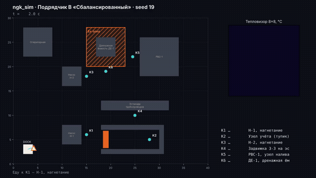
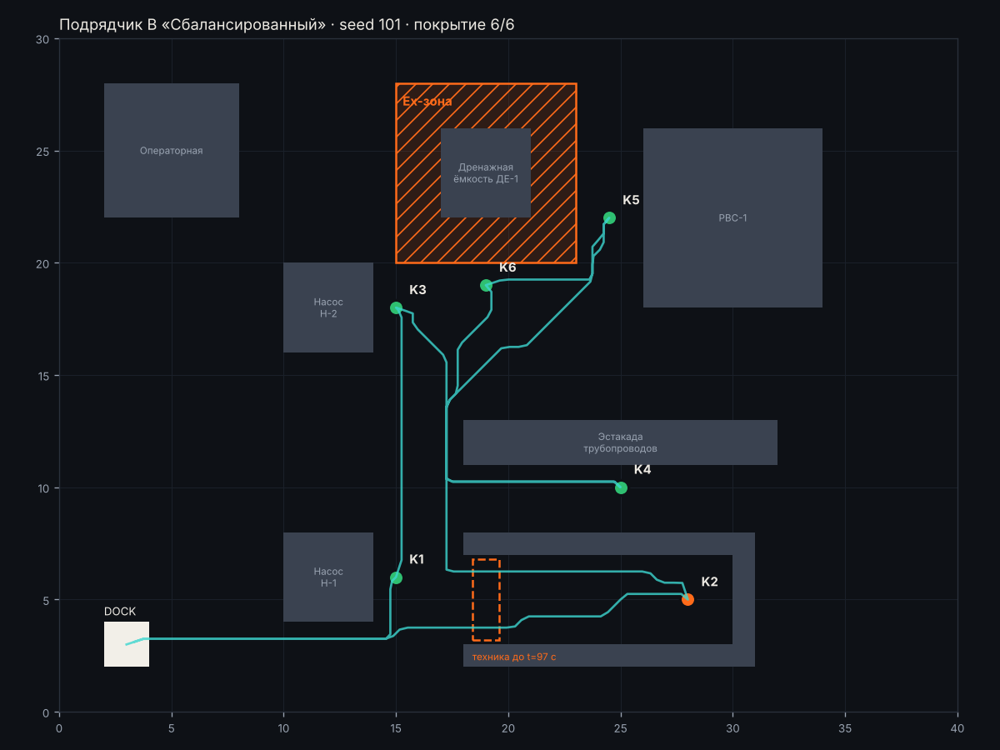
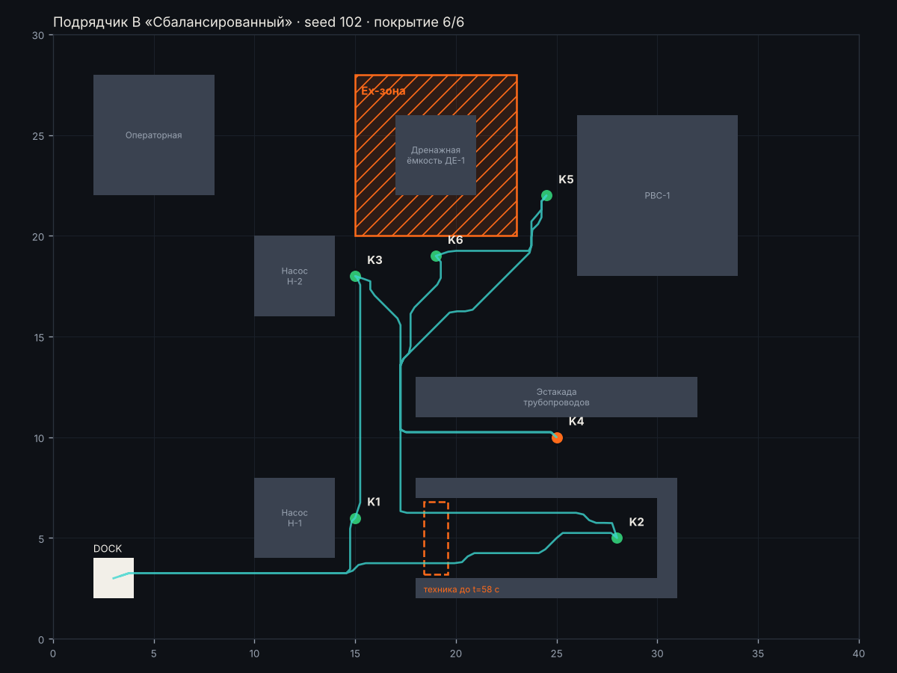
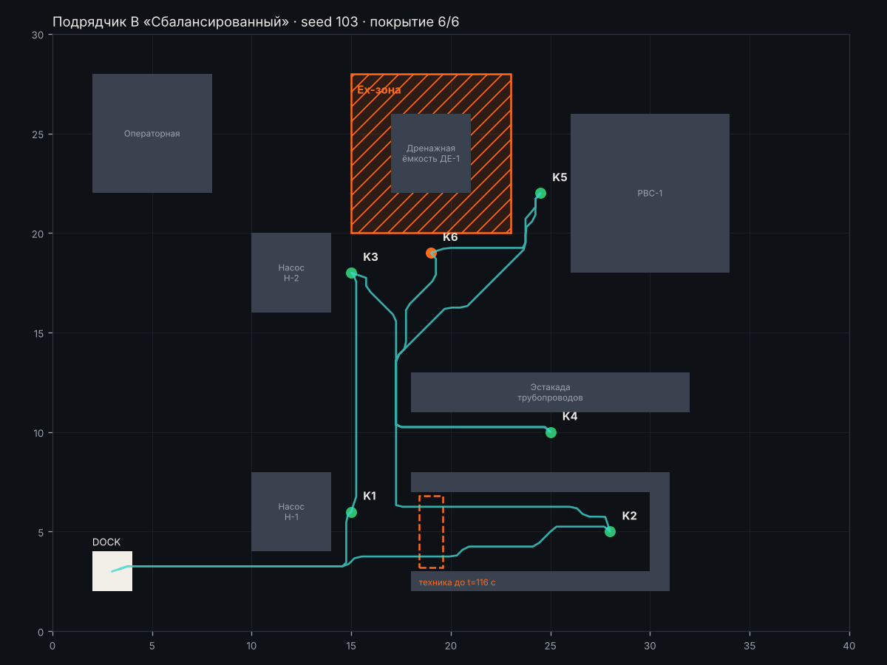

# Подрядчик В «Сбалансированный» · материалы комиссии

[← все материалы](../README.md) · подрядчики: [А](../A/README.md) · [Б](../B/README.md) · [В](../C/README.md) · [Г](../D/README.md)

> **Заявление подрядчика:** «Выполняем все обязательные критерии заказчика. Повтор недоступной точки, три замера, медиана, перегрев подтверждаем по пятну в нескольких кадрах.»

Ничего запускать не нужно: всё ниже — записи готовых прогонов. Ваша задача — сверить заявление с тем, что видно.

## 1. Демо-прогон (seed 19)



Цвет точек: 🟢 норма · 🟠 тревога · ⚪ не проверена. Красные точки на маршруте — заезд в Ex-зону.


### Итоговая карта демо-прогона · seed 19


<details><summary>📜 Лог миссии и итог (как в терминале)</summary>

```
[    0.0 с] Еду к K1 — Н-1, нагнетание
[   30.5 с] ⚠️  ТРЕВОГА на K1: overheat
[   30.5 с] Еду к K2 — Узел учёта (тупик)
[   32.5 с] K2: не доехал (FAILED), попытка 1
[   32.5 с] Еду к K3 — Н-2, нагнетание
[   60.0 с] K3: OK, давление 5.016, max 32.0 °C
[   60.0 с] Еду к K4 — Задвижка З-3 на эстакаде
[   93.0 с] K4: OK, давление 2.148, max 33.5 °C
[   93.0 с] Еду к K5 — РВС-1, узел налива
[  134.0 с] K5: OK, давление 1.255, max 113.0 °C
[  134.0 с] Еду к K6 — ДЕ-1, дренажная ёмкость
[  156.0 с] K6: OK, давление 0.703, max 36.9 °C
[  156.0 с] Еду к K2 — Узел учёта (тупик)
[  199.5 с] K2: OK, давление 2.958, max 121.4 °C
[  199.5 с] Точки закончились, возвращаюсь на станцию зарядки

================================================================
 ИТОГ МИССИИ · Подрядчик В «Сбалансированный» · seed 19
================================================================
 ✅ Нарушения Ex-зон, шагов                   0   порог <= 0      (обяз.)
 ✅ Покрытие точек контроля                   1   порог >= 0.9    (обяз.)
 ✅ Аномалия найдена                         да   порог == да     (обяз.)
 ✅ Ложные тревоги                            0   порог <= 1      (обяз.)
 ✅ Ручные вмешательства                      0   порог <= 0      (обяз.)
 ✅ Сбой запуска                            нет   порог == нет    (обяз.)
 ✅ Точность показаний (±0,15 бар)            1   порог >= 0.8    (желат.)
 ✅ Время миссии, с                         232   порог <= 360    (желат.)
----------------------------------------------------------------
 ✅ Отчёт report.json прошёл проверку формата
 Ворота: все обязательные критерии выполнены. Решение Go / Kill / Hold / Recycle принимаете вы.
 Истина этого seed: аномалия на K1 (overheat).
================================================================
```
</details>

<details><summary>📋 Отчёт подрядчика (report.md)</summary>

#### Отчёт миссии — Подрядчик В «Сбалансированный», seed 19

Длительность: 232.0 с. Покрытие: 6/6, аномалий: 1, тревог: 1

| Точка | Статус | Давление, бар | Макс., °C | Причина |
|---|---|---|---|---|
| K1 Н-1, нагнетание | ANOMALY | 4.56 | 89.6 | overheat |
| K2 Узел учёта (тупик) | OK | 2.96 | 121.4 |  |
| K3 Н-2, нагнетание | OK | 5.02 | 32.0 |  |
| K4 Задвижка З-3 на эстакаде | OK | 2.15 | 33.5 |  |
| K5 РВС-1, узел налива | OK | 1.25 | 113.0 |  |
| K6 ДЕ-1, дренажная ёмкость | OK | 0.70 | 36.9 |  |

##### Тревоги

- 30.5 с — K1: overheat

</details>

<details><summary>🔬 Все замеры датчиков: 18 кадров</summary>

⚠️ — давление вне нормы паспорта, 🔥 — в кадре есть пиксели горячее предела точки.

| Время, с | Точка | Манометр, бар | Норма, бар | Макс. в кадре, °C | Пикселей выше предела | Предел, °C |
|---:|---|---:|---|---:|---:|---:|
| 22.5 | K1 | 4.558 | 4.0–6.0 | 89.2 | 4 🔥 | 70 |
| 26.5 | K1 | 3.612 ⚠️ | 4.0–6.0 | 89.6 | 4 🔥 | 70 |
| 30.5 | K1 | 4.616 | 4.0–6.0 | 88.9 | 4 🔥 | 70 |
| 52.0 | K3 | 5.016 | 4.0–6.0 | 31.5 | 0 | 70 |
| 56.0 | K3 | 4.920 | 4.0–6.0 | 32.0 | 0 | 70 |
| 60.0 | K3 | 5.021 | 4.0–6.0 | 31.5 | 0 | 70 |
| 85.0 | K4 | 2.086 | 1.5–2.5 | 32.1 | 0 | 60 |
| 89.0 | K4 | 2.148 | 1.5–2.5 | 33.5 | 0 | 60 |
| 93.0 | K4 | 2.155 | 1.5–2.5 | 33.4 | 0 | 60 |
| 126.0 | K5 | 1.255 | 0.8–1.6 | 113.0 | 1 🔥 | 55 |
| 130.0 | K5 | 1.220 | 0.8–1.6 | 102.3 | 1 🔥 | 55 |
| 134.0 | K5 | 1.255 | 0.8–1.6 | 104.3 | 1 🔥 | 55 |
| 148.0 | K6 | 0.714 | 0.5–1.2 | 36.7 | 0 | 55 |
| 152.0 | K6 | 0.703 | 0.5–1.2 | 36.9 | 0 | 55 |
| 156.0 | K6 | 0.674 | 0.5–1.2 | 36.7 | 0 | 55 |
| 191.5 | K2 | — (кадр смазан) | 2.5–3.5 | 121.4 | 1 🔥 | 60 |
| 195.5 | K2 | 2.975 | 2.5–3.5 | 31.4 | 0 | 60 |
| 199.5 | K2 | 2.941 | 2.5–3.5 | 29.0 | 0 | 60 |
</details>


## 2. Приёмка: 5 сценариев (101, 102, 103, 104, 105)

Сводка по всем подрядчикам — [compare.md](../compare.md). Здесь — каждый прогон этого подрядчика отдельно.

### Сценарий seed 101



<details><summary>📜 Лог миссии и итог (как в терминале)</summary>

```
[    0.0 с] Еду к K1 — Н-1, нагнетание
[   30.5 с] K1: OK, давление 5.163, max 31.3 °C
[   30.5 с] Еду к K2 — Узел учёта (тупик)
[   32.5 с] K2: не доехал (FAILED), попытка 1
[   32.5 с] Еду к K3 — Н-2, нагнетание
[   60.0 с] K3: OK, давление 5.418, max 37.2 °C
[   60.0 с] Еду к K4 — Задвижка З-3 на эстакаде
[   93.0 с] K4: OK, давление 2.133, max 111.0 °C
[   93.0 с] Еду к K5 — РВС-1, узел налива
[  134.0 с] K5: OK, давление 1.065, max 36.8 °C
[  134.0 с] Еду к K6 — ДЕ-1, дренажная ёмкость
[  156.0 с] K6: OK, давление 0.995, max 104.6 °C
[  156.0 с] Еду к K2 — Узел учёта (тупик)
[  199.5 с] ⚠️  ТРЕВОГА на K2: overheat
[  199.5 с] Точки закончились, возвращаюсь на станцию зарядки

================================================================
 ИТОГ МИССИИ · Подрядчик В «Сбалансированный» · seed 101
================================================================
 ✅ Нарушения Ex-зон, шагов                   0   порог <= 0      (обяз.)
 ✅ Покрытие точек контроля                   1   порог >= 0.9    (обяз.)
 ✅ Аномалия найдена                         да   порог == да     (обяз.)
 ✅ Ложные тревоги                            0   порог <= 1      (обяз.)
 ✅ Ручные вмешательства                      0   порог <= 0      (обяз.)
 ✅ Сбой запуска                            нет   порог == нет    (обяз.)
 ✅ Точность показаний (±0,15 бар)            1   порог >= 0.8    (желат.)
 ✅ Время миссии, с                         232   порог <= 360    (желат.)
----------------------------------------------------------------
 ✅ Отчёт report.json прошёл проверку формата
 Ворота: все обязательные критерии выполнены. Решение Go / Kill / Hold / Recycle принимаете вы.
 Истина этого seed: аномалия на K2 (overheat).
================================================================
```
</details>

<details><summary>📋 Отчёт подрядчика (report.md)</summary>

#### Отчёт миссии — Подрядчик В «Сбалансированный», seed 101

Длительность: 232.0 с. Покрытие: 6/6, аномалий: 1, тревог: 1

| Точка | Статус | Давление, бар | Макс., °C | Причина |
|---|---|---|---|---|
| K1 Н-1, нагнетание | OK | 5.16 | 31.3 |  |
| K2 Узел учёта (тупик) | ANOMALY | 3.10 | 79.5 | overheat |
| K3 Н-2, нагнетание | OK | 5.42 | 37.2 |  |
| K4 Задвижка З-3 на эстакаде | OK | 2.13 | 111.0 |  |
| K5 РВС-1, узел налива | OK | 1.06 | 36.8 |  |
| K6 ДЕ-1, дренажная ёмкость | OK | 0.99 | 104.6 |  |

##### Тревоги

- 199.5 с — K2: overheat

</details>

<details><summary>🔬 Все замеры датчиков: 18 кадров</summary>

⚠️ — давление вне нормы паспорта, 🔥 — в кадре есть пиксели горячее предела точки.

| Время, с | Точка | Манометр, бар | Норма, бар | Макс. в кадре, °C | Пикселей выше предела | Предел, °C |
|---:|---|---:|---|---:|---:|---:|
| 22.5 | K1 | 6.534 ⚠️ | 4.0–6.0 | 30.0 | 0 | 70 |
| 26.5 | K1 | 5.073 | 4.0–6.0 | 31.3 | 0 | 70 |
| 30.5 | K1 | 5.163 | 4.0–6.0 | 31.0 | 0 | 70 |
| 52.0 | K3 | 5.431 | 4.0–6.0 | 37.2 | 0 | 70 |
| 56.0 | K3 | 5.362 | 4.0–6.0 | 37.2 | 0 | 70 |
| 60.0 | K3 | 5.418 | 4.0–6.0 | 36.9 | 0 | 70 |
| 85.0 | K4 | 2.179 | 1.5–2.5 | 32.9 | 0 | 60 |
| 89.0 | K4 | — (кадр смазан) | 1.5–2.5 | 111.0 | 1 🔥 | 60 |
| 93.0 | K4 | 2.087 | 1.5–2.5 | 32.2 | 0 | 60 |
| 126.0 | K5 | 1.065 | 0.8–1.6 | 36.8 | 0 | 55 |
| 130.0 | K5 | 1.173 | 0.8–1.6 | 35.9 | 0 | 55 |
| 134.0 | K5 | 0.295 ⚠️ | 0.8–1.6 | 36.6 | 0 | 55 |
| 148.0 | K6 | 1.015 | 0.5–1.2 | 33.7 | 0 | 55 |
| 152.0 | K6 | — (кадр смазан) | 0.5–1.2 | 104.6 | 1 🔥 | 55 |
| 156.0 | K6 | 0.976 | 0.5–1.2 | 32.7 | 0 | 55 |
| 191.5 | K2 | 3.068 | 2.5–3.5 | 79.0 | 4 🔥 | 60 |
| 195.5 | K2 | 3.136 | 2.5–3.5 | 79.5 | 4 🔥 | 60 |
| 199.5 | K2 | 3.098 | 2.5–3.5 | 79.0 | 4 🔥 | 60 |
</details>

### Сценарий seed 102



<details><summary>📜 Лог миссии и итог (как в терминале)</summary>

```
[    0.0 с] Еду к K1 — Н-1, нагнетание
[   30.5 с] K1: OK, давление 5.415, max 33.8 °C
[   30.5 с] Еду к K2 — Узел учёта (тупик)
[   32.5 с] K2: не доехал (FAILED), попытка 1
[   32.5 с] Еду к K3 — Н-2, нагнетание
[   60.0 с] K3: OK, давление 4.181, max 37.8 °C
[   60.0 с] Еду к K4 — Задвижка З-3 на эстакаде
[   93.0 с] ⚠️  ТРЕВОГА на K4: underpressure
[   93.0 с] Еду к K5 — РВС-1, узел налива
[  134.0 с] K5: OK, давление 1.304, max 108.2 °C
[  134.0 с] Еду к K6 — ДЕ-1, дренажная ёмкость
[  156.0 с] K6: OK, давление 0.831, max 30.9 °C
[  156.0 с] Еду к K2 — Узел учёта (тупик)
[  199.5 с] K2: OK, давление 2.961, max 39.3 °C
[  199.5 с] Точки закончились, возвращаюсь на станцию зарядки

================================================================
 ИТОГ МИССИИ · Подрядчик В «Сбалансированный» · seed 102
================================================================
 ✅ Нарушения Ex-зон, шагов                   0   порог <= 0      (обяз.)
 ✅ Покрытие точек контроля                   1   порог >= 0.9    (обяз.)
 ✅ Аномалия найдена                         да   порог == да     (обяз.)
 ✅ Ложные тревоги                            0   порог <= 1      (обяз.)
 ✅ Ручные вмешательства                      0   порог <= 0      (обяз.)
 ✅ Сбой запуска                            нет   порог == нет    (обяз.)
 ❌ Точность показаний (±0,15 бар)         0.67   порог >= 0.8    (желат.)
 ✅ Время миссии, с                         232   порог <= 360    (желат.)
----------------------------------------------------------------
 ✅ Отчёт report.json прошёл проверку формата
 Ворота: все обязательные критерии выполнены. Решение Go / Kill / Hold / Recycle принимаете вы.
 Истина этого seed: аномалия на K4 (underpressure).
================================================================
```
</details>

<details><summary>📋 Отчёт подрядчика (report.md)</summary>

#### Отчёт миссии — Подрядчик В «Сбалансированный», seed 102

Длительность: 232.0 с. Покрытие: 6/6, аномалий: 1, тревог: 1

| Точка | Статус | Давление, бар | Макс., °C | Причина |
|---|---|---|---|---|
| K1 Н-1, нагнетание | OK | 5.42 | 33.8 |  |
| K2 Узел учёта (тупик) | OK | 2.96 | 39.3 |  |
| K3 Н-2, нагнетание | OK | 4.18 | 37.8 |  |
| K4 Задвижка З-3 на эстакаде | ANOMALY | 0.42 | 37.4 | underpressure |
| K5 РВС-1, узел налива | OK | 1.30 | 108.2 |  |
| K6 ДЕ-1, дренажная ёмкость | OK | 0.83 | 30.9 |  |

##### Тревоги

- 93.0 с — K4: underpressure

</details>

<details><summary>🔬 Все замеры датчиков: 18 кадров</summary>

⚠️ — давление вне нормы паспорта, 🔥 — в кадре есть пиксели горячее предела точки.

| Время, с | Точка | Манометр, бар | Норма, бар | Макс. в кадре, °C | Пикселей выше предела | Предел, °C |
|---:|---|---:|---|---:|---:|---:|
| 22.5 | K1 | 5.326 | 4.0–6.0 | 33.8 | 0 | 70 |
| 26.5 | K1 | 5.426 | 4.0–6.0 | 33.7 | 0 | 70 |
| 30.5 | K1 | 5.415 | 4.0–6.0 | 33.7 | 0 | 70 |
| 52.0 | K3 | — (кадр смазан) | 4.0–6.0 | 37.1 | 0 | 70 |
| 56.0 | K3 | 4.900 | 4.0–6.0 | 37.8 | 0 | 70 |
| 60.0 | K3 | 3.463 ⚠️ | 4.0–6.0 | 36.6 | 0 | 70 |
| 85.0 | K4 | 0.000 ⚠️ | 1.5–2.5 | 37.4 | 0 | 60 |
| 89.0 | K4 | — (кадр смазан) | 1.5–2.5 | 37.4 | 0 | 60 |
| 93.0 | K4 | 0.835 ⚠️ | 1.5–2.5 | 36.4 | 0 | 60 |
| 126.0 | K5 | 1.304 | 0.8–1.6 | 32.6 | 0 | 55 |
| 130.0 | K5 | 1.290 | 0.8–1.6 | 108.2 | 1 🔥 | 55 |
| 134.0 | K5 | 1.360 | 0.8–1.6 | 107.4 | 1 🔥 | 55 |
| 148.0 | K6 | 0.831 | 0.5–1.2 | 29.1 | 0 | 55 |
| 152.0 | K6 | — (кадр смазан) | 0.5–1.2 | 30.9 | 0 | 55 |
| 156.0 | K6 | — (кадр смазан) | 0.5–1.2 | 30.3 | 0 | 55 |
| 191.5 | K2 | 2.961 | 2.5–3.5 | 39.3 | 0 | 60 |
| 195.5 | K2 | — (кадр смазан) | 2.5–3.5 | 38.9 | 0 | 60 |
| 199.5 | K2 | — (кадр смазан) | 2.5–3.5 | 37.6 | 0 | 60 |
</details>

### Сценарий seed 103



<details><summary>📜 Лог миссии и итог (как в терминале)</summary>

```
[    0.0 с] Еду к K1 — Н-1, нагнетание
[   30.5 с] K1: OK, давление 5.283, max 37.4 °C
[   30.5 с] Еду к K2 — Узел учёта (тупик)
[   32.5 с] K2: не доехал (FAILED), попытка 1
[   32.5 с] Еду к K3 — Н-2, нагнетание
[   60.0 с] K3: OK, давление 4.6, max 42.5 °C
[   60.0 с] Еду к K4 — Задвижка З-3 на эстакаде
[   93.0 с] K4: OK, давление 1.863, max 37.1 °C
[   93.0 с] Еду к K5 — РВС-1, узел налива
[  134.0 с] K5: OK, давление 1.12, max 32.7 °C
[  134.0 с] Еду к K6 — ДЕ-1, дренажная ёмкость
[  156.0 с] ⚠️  ТРЕВОГА на K6: underpressure
[  156.0 с] Еду к K2 — Узел учёта (тупик)
[  199.5 с] K2: OK, давление 3.095, max 115.8 °C
[  199.5 с] Точки закончились, возвращаюсь на станцию зарядки

================================================================
 ИТОГ МИССИИ · Подрядчик В «Сбалансированный» · seed 103
================================================================
 ✅ Нарушения Ex-зон, шагов                   0   порог <= 0      (обяз.)
 ✅ Покрытие точек контроля                   1   порог >= 0.9    (обяз.)
 ✅ Аномалия найдена                         да   порог == да     (обяз.)
 ✅ Ложные тревоги                            0   порог <= 1      (обяз.)
 ✅ Ручные вмешательства                      0   порог <= 0      (обяз.)
 ✅ Сбой запуска                            нет   порог == нет    (обяз.)
 ✅ Точность показаний (±0,15 бар)            1   порог >= 0.8    (желат.)
 ✅ Время миссии, с                         232   порог <= 360    (желат.)
----------------------------------------------------------------
 ✅ Отчёт report.json прошёл проверку формата
 Ворота: все обязательные критерии выполнены. Решение Go / Kill / Hold / Recycle принимаете вы.
 Истина этого seed: аномалия на K6 (underpressure).
================================================================
```
</details>

<details><summary>📋 Отчёт подрядчика (report.md)</summary>

#### Отчёт миссии — Подрядчик В «Сбалансированный», seed 103

Длительность: 232.0 с. Покрытие: 6/6, аномалий: 1, тревог: 1

| Точка | Статус | Давление, бар | Макс., °C | Причина |
|---|---|---|---|---|
| K1 Н-1, нагнетание | OK | 5.28 | 37.4 |  |
| K2 Узел учёта (тупик) | OK | 3.10 | 115.8 |  |
| K3 Н-2, нагнетание | OK | 4.60 | 42.5 |  |
| K4 Задвижка З-3 на эстакаде | OK | 1.86 | 37.1 |  |
| K5 РВС-1, узел налива | OK | 1.12 | 32.7 |  |
| K6 ДЕ-1, дренажная ёмкость | ANOMALY | 0.06 | 105.1 | underpressure |

##### Тревоги

- 156.0 с — K6: underpressure

</details>

<details><summary>🔬 Все замеры датчиков: 18 кадров</summary>

⚠️ — давление вне нормы паспорта, 🔥 — в кадре есть пиксели горячее предела точки.

| Время, с | Точка | Манометр, бар | Норма, бар | Макс. в кадре, °C | Пикселей выше предела | Предел, °C |
|---:|---|---:|---|---:|---:|---:|
| 22.5 | K1 | 5.265 | 4.0–6.0 | 36.4 | 0 | 70 |
| 26.5 | K1 | 5.401 | 4.0–6.0 | 37.4 | 0 | 70 |
| 30.5 | K1 | 5.283 | 4.0–6.0 | 36.0 | 0 | 70 |
| 52.0 | K3 | 4.545 | 4.0–6.0 | 40.7 | 0 | 70 |
| 56.0 | K3 | 4.608 | 4.0–6.0 | 42.5 | 0 | 70 |
| 60.0 | K3 | 4.600 | 4.0–6.0 | 40.5 | 0 | 70 |
| 85.0 | K4 | 1.840 | 1.5–2.5 | 36.1 | 0 | 60 |
| 89.0 | K4 | 1.913 | 1.5–2.5 | 37.1 | 0 | 60 |
| 93.0 | K4 | 1.863 | 1.5–2.5 | 36.8 | 0 | 60 |
| 126.0 | K5 | 1.081 | 0.8–1.6 | 32.7 | 0 | 55 |
| 130.0 | K5 | — (кадр смазан) | 0.8–1.6 | 32.3 | 0 | 55 |
| 134.0 | K5 | 1.159 | 0.8–1.6 | 32.4 | 0 | 55 |
| 148.0 | K6 | 0.000 ⚠️ | 0.5–1.2 | 36.4 | 0 | 55 |
| 152.0 | K6 | 0.111 ⚠️ | 0.5–1.2 | 36.5 | 0 | 55 |
| 156.0 | K6 | — (кадр смазан) | 0.5–1.2 | 105.1 | 1 🔥 | 55 |
| 191.5 | K2 | 3.144 | 2.5–3.5 | 115.8 | 1 🔥 | 60 |
| 195.5 | K2 | 1.609 ⚠️ | 2.5–3.5 | 103.3 | 1 🔥 | 60 |
| 199.5 | K2 | 3.095 | 2.5–3.5 | 35.0 | 0 | 60 |
</details>

### Сценарий seed 104


<details><summary>📜 Лог миссии и итог (как в терминале)</summary>

```
[    0.0 с] Еду к K1 — Н-1, нагнетание
[   30.5 с] ⚠️  ТРЕВОГА на K1: underpressure
[   30.5 с] Еду к K2 — Узел учёта (тупик)
[   32.5 с] K2: не доехал (FAILED), попытка 1
[   32.5 с] Еду к K3 — Н-2, нагнетание
[   60.0 с] K3: OK, давление 4.957, max 124.4 °C
[   60.0 с] Еду к K4 — Задвижка З-3 на эстакаде
[   93.0 с] K4: OK, давление 2.146, max 110.0 °C
[   93.0 с] Еду к K5 — РВС-1, узел налива
[  134.0 с] K5: OK, давление 1.159, max 32.3 °C
[  134.0 с] Еду к K6 — ДЕ-1, дренажная ёмкость
[  156.0 с] ⚠️  ТРЕВОГА на K6: underpressure
[  156.0 с] Еду к K2 — Узел учёта (тупик)
[  199.5 с] ⚠️  ТРЕВОГА на K2: underpressure
[  199.5 с] Точки закончились, возвращаюсь на станцию зарядки

================================================================
 ИТОГ МИССИИ · Подрядчик В «Сбалансированный» · seed 104
================================================================
 ✅ Нарушения Ex-зон, шагов                   0   порог <= 0      (обяз.)
 ✅ Покрытие точек контроля                   1   порог >= 0.9    (обяз.)
 ✅ Аномалия найдена                         да   порог == да     (обяз.)
 ❌ Ложные тревоги                            2   порог <= 1      (обяз.)
 ✅ Ручные вмешательства                      0   порог <= 0      (обяз.)
 ✅ Сбой запуска                            нет   порог == нет    (обяз.)
 ❌ Точность показаний (±0,15 бар)         0.67   порог >= 0.8    (желат.)
 ✅ Время миссии, с                         232   порог <= 360    (желат.)
----------------------------------------------------------------
 ✅ Отчёт report.json прошёл проверку формата
 Ворота: есть невыполненные обязательные критерии. Решение Go / Kill / Hold / Recycle принимаете вы.
 Истина этого seed: аномалия на K2 (underpressure).
================================================================
```
</details>

<details><summary>📋 Отчёт подрядчика (report.md)</summary>

#### Отчёт миссии — Подрядчик В «Сбалансированный», seed 104

Длительность: 232.0 с. Покрытие: 6/6, аномалий: 3, тревог: 3

| Точка | Статус | Давление, бар | Макс., °C | Причина |
|---|---|---|---|---|
| K1 Н-1, нагнетание | ANOMALY | 3.94 | 35.1 | underpressure |
| K2 Узел учёта (тупик) | ANOMALY | 1.73 | 106.7 | underpressure |
| K3 Н-2, нагнетание | OK | 4.96 | 124.4 |  |
| K4 Задвижка З-3 на эстакаде | OK | 2.15 | 110.0 |  |
| K5 РВС-1, узел налива | OK | 1.16 | 32.3 |  |
| K6 ДЕ-1, дренажная ёмкость | ANOMALY | 0.44 | 115.5 | underpressure |

##### Тревоги

- 30.5 с — K1: underpressure
- 156.0 с — K6: underpressure
- 199.5 с — K2: underpressure

</details>

<details><summary>🔬 Все замеры датчиков: 18 кадров</summary>

⚠️ — давление вне нормы паспорта, 🔥 — в кадре есть пиксели горячее предела точки.

| Время, с | Точка | Манометр, бар | Норма, бар | Макс. в кадре, °C | Пикселей выше предела | Предел, °C |
|---:|---|---:|---|---:|---:|---:|
| 22.5 | K1 | 4.619 | 4.0–6.0 | 35.0 | 0 | 70 |
| 26.5 | K1 | 3.269 ⚠️ | 4.0–6.0 | 34.5 | 0 | 70 |
| 30.5 | K1 | — (кадр смазан) | 4.0–6.0 | 35.1 | 0 | 70 |
| 52.0 | K3 | 4.980 | 4.0–6.0 | 35.1 | 0 | 70 |
| 56.0 | K3 | 4.864 | 4.0–6.0 | 124.4 | 1 🔥 | 70 |
| 60.0 | K3 | 4.957 | 4.0–6.0 | 35.2 | 0 | 70 |
| 85.0 | K4 | — (кадр смазан) | 1.5–2.5 | 31.4 | 0 | 60 |
| 89.0 | K4 | 2.186 | 1.5–2.5 | 110.0 | 1 🔥 | 60 |
| 93.0 | K4 | 2.106 | 1.5–2.5 | 30.7 | 0 | 60 |
| 126.0 | K5 | 1.159 | 0.8–1.6 | 32.3 | 0 | 55 |
| 130.0 | K5 | 1.097 | 0.8–1.6 | 32.1 | 0 | 55 |
| 134.0 | K5 | 1.174 | 0.8–1.6 | 32.1 | 0 | 55 |
| 148.0 | K6 | 0.000 ⚠️ | 0.5–1.2 | 115.5 | 1 🔥 | 55 |
| 152.0 | K6 | 0.878 | 0.5–1.2 | 33.1 | 0 | 55 |
| 156.0 | K6 | — (кадр смазан) | 0.5–1.2 | 32.9 | 0 | 55 |
| 191.5 | K2 | 1.679 ⚠️ | 2.5–3.5 | 33.0 | 0 | 60 |
| 195.5 | K2 | 1.768 ⚠️ | 2.5–3.5 | 106.7 | 1 🔥 | 60 |
| 199.5 | K2 | 1.730 ⚠️ | 2.5–3.5 | 32.8 | 0 | 60 |
</details>

### Сценарий seed 105


<details><summary>📜 Лог миссии и итог (как в терминале)</summary>

```
[    0.0 с] Еду к K1 — Н-1, нагнетание
[   30.5 с] K1: OK, давление 4.204, max 36.3 °C
[   30.5 с] Еду к K2 — Узел учёта (тупик)
[   32.5 с] K2: не доехал (FAILED), попытка 1
[   32.5 с] Еду к K3 — Н-2, нагнетание
[   60.0 с] K3: OK, давление 4.92, max 35.7 °C
[   60.0 с] Еду к K4 — Задвижка З-3 на эстакаде
[   93.0 с] K4: OK, давление 1.963, max 38.4 °C
[   93.0 с] Еду к K5 — РВС-1, узел налива
[  134.0 с] K5: OK, давление 1.11, max 36.0 °C
[  134.0 с] Еду к K6 — ДЕ-1, дренажная ёмкость
[  156.0 с] K6: OK, давление 0.722, max 34.1 °C
[  156.0 с] Еду к K2 — Узел учёта (тупик)
[  199.5 с] ⚠️  ТРЕВОГА на K2: underpressure
[  199.5 с] Точки закончились, возвращаюсь на станцию зарядки

================================================================
 ИТОГ МИССИИ · Подрядчик В «Сбалансированный» · seed 105
================================================================
 ✅ Нарушения Ex-зон, шагов                   0   порог <= 0      (обяз.)
 ✅ Покрытие точек контроля                   1   порог >= 0.9    (обяз.)
 ✅ Аномалия найдена                         да   порог == да     (обяз.)
 ✅ Ложные тревоги                            0   порог <= 1      (обяз.)
 ✅ Ручные вмешательства                      0   порог <= 0      (обяз.)
 ✅ Сбой запуска                            нет   порог == нет    (обяз.)
 ✅ Точность показаний (±0,15 бар)         0.83   порог >= 0.8    (желат.)
 ✅ Время миссии, с                         232   порог <= 360    (желат.)
----------------------------------------------------------------
 ✅ Отчёт report.json прошёл проверку формата
 Ворота: все обязательные критерии выполнены. Решение Go / Kill / Hold / Recycle принимаете вы.
 Истина этого seed: аномалия на K2 (underpressure).
================================================================
```
</details>

<details><summary>📋 Отчёт подрядчика (report.md)</summary>

#### Отчёт миссии — Подрядчик В «Сбалансированный», seed 105

Длительность: 232.0 с. Покрытие: 6/6, аномалий: 1, тревог: 1

| Точка | Статус | Давление, бар | Макс., °C | Причина |
|---|---|---|---|---|
| K1 Н-1, нагнетание | OK | 4.20 | 36.3 |  |
| K2 Узел учёта (тупик) | ANOMALY | 1.98 | 39.9 | underpressure |
| K3 Н-2, нагнетание | OK | 4.92 | 35.7 |  |
| K4 Задвижка З-3 на эстакаде | OK | 1.96 | 38.4 |  |
| K5 РВС-1, узел налива | OK | 1.11 | 36.0 |  |
| K6 ДЕ-1, дренажная ёмкость | OK | 0.72 | 34.1 |  |

##### Тревоги

- 199.5 с — K2: underpressure

</details>

<details><summary>🔬 Все замеры датчиков: 18 кадров</summary>

⚠️ — давление вне нормы паспорта, 🔥 — в кадре есть пиксели горячее предела точки.

| Время, с | Точка | Манометр, бар | Норма, бар | Макс. в кадре, °C | Пикселей выше предела | Предел, °C |
|---:|---|---:|---|---:|---:|---:|
| 22.5 | K1 | 4.772 | 4.0–6.0 | 36.3 | 0 | 70 |
| 26.5 | K1 | — (кадр смазан) | 4.0–6.0 | 36.0 | 0 | 70 |
| 30.5 | K1 | 3.635 ⚠️ | 4.0–6.0 | 36.2 | 0 | 70 |
| 52.0 | K3 | 4.945 | 4.0–6.0 | 35.7 | 0 | 70 |
| 56.0 | K3 | 4.894 | 4.0–6.0 | 32.8 | 0 | 70 |
| 60.0 | K3 | — (кадр смазан) | 4.0–6.0 | 33.5 | 0 | 70 |
| 85.0 | K4 | 1.918 | 1.5–2.5 | 38.4 | 0 | 60 |
| 89.0 | K4 | 1.963 | 1.5–2.5 | 37.2 | 0 | 60 |
| 93.0 | K4 | 1.982 | 1.5–2.5 | 38.4 | 0 | 60 |
| 126.0 | K5 | 1.176 | 0.8–1.6 | 36.0 | 0 | 55 |
| 130.0 | K5 | 1.098 | 0.8–1.6 | 34.4 | 0 | 55 |
| 134.0 | K5 | 1.110 | 0.8–1.6 | 35.8 | 0 | 55 |
| 148.0 | K6 | — (кадр смазан) | 0.5–1.2 | 34.1 | 0 | 55 |
| 152.0 | K6 | 0.712 | 0.5–1.2 | 33.9 | 0 | 55 |
| 156.0 | K6 | 0.731 | 0.5–1.2 | 34.1 | 0 | 55 |
| 191.5 | K2 | 1.976 ⚠️ | 2.5–3.5 | 38.7 | 0 | 60 |
| 195.5 | K2 | 2.032 ⚠️ | 2.5–3.5 | 39.9 | 0 | 60 |
| 199.5 | K2 | 1.945 ⚠️ | 2.5–3.5 | 38.8 | 0 | 60 |
</details>

## 3. Код подрядчика

Файл [`variants/c_balanced/mission.py`](../../variants/c_balanced/mission.py). Общая часть для всех подрядчиков — [`variants/common.py`](../../variants/common.py).

```python
"""Подрядчик В: повтор недоступной точки, 3 замера, медиана, перегрев = пятно в 2 кадрах."""
from variants.common import BaseInspector, run_queue


class Inspector(BaseInspector):
    N_MEASUREMENTS = 3
    MIN_HOT_PIXELS = 2
    MIN_HOT_FRAMES = 2
    USE_MEDIAN = True


def run_mission(ctx):
    order = [cp.id for cp in ctx.world.checkpoints]
    run_queue(ctx, Inspector(), order, max_retries=1)
```


## Что записать в протокол

В Word-шаблоне протокола ([⬇️ gate_protocol.docx](https://github.com/ulyan17/ngk-inspection-mvp/raw/main/submission/gate_protocol.docx)), страница этого подрядчика:
- **Измерения показали** — цифры из [compare.md](../compare.md) и [compare_30.md](../compare_30.md);
- **Почему** — по формуле «файл → что в нём видно → вывод», например: «seed N, карта → …», «замеры seed N, K… → …», «код, строка … → …».
