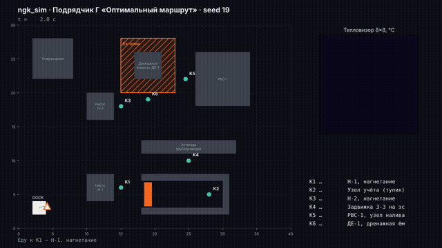
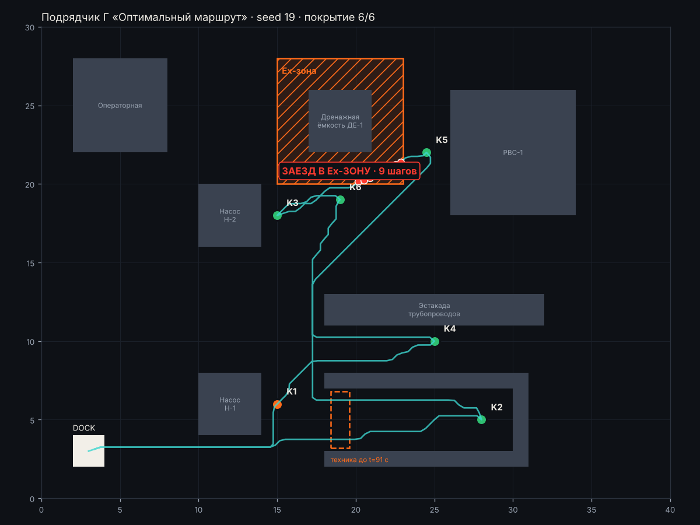
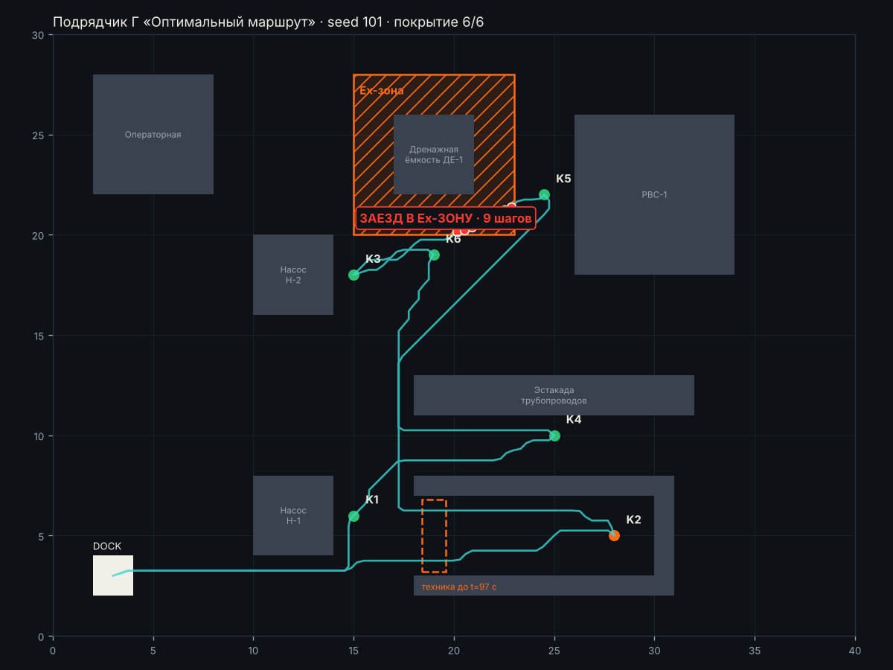
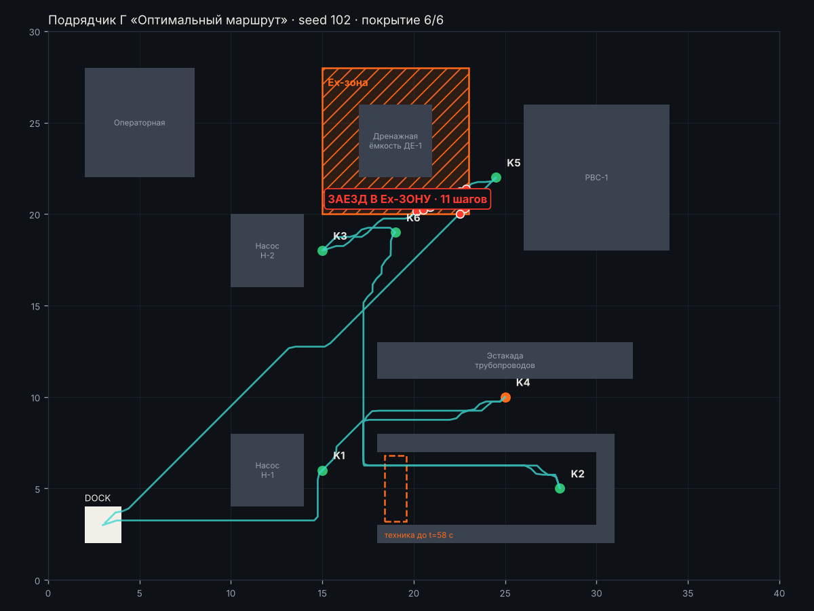
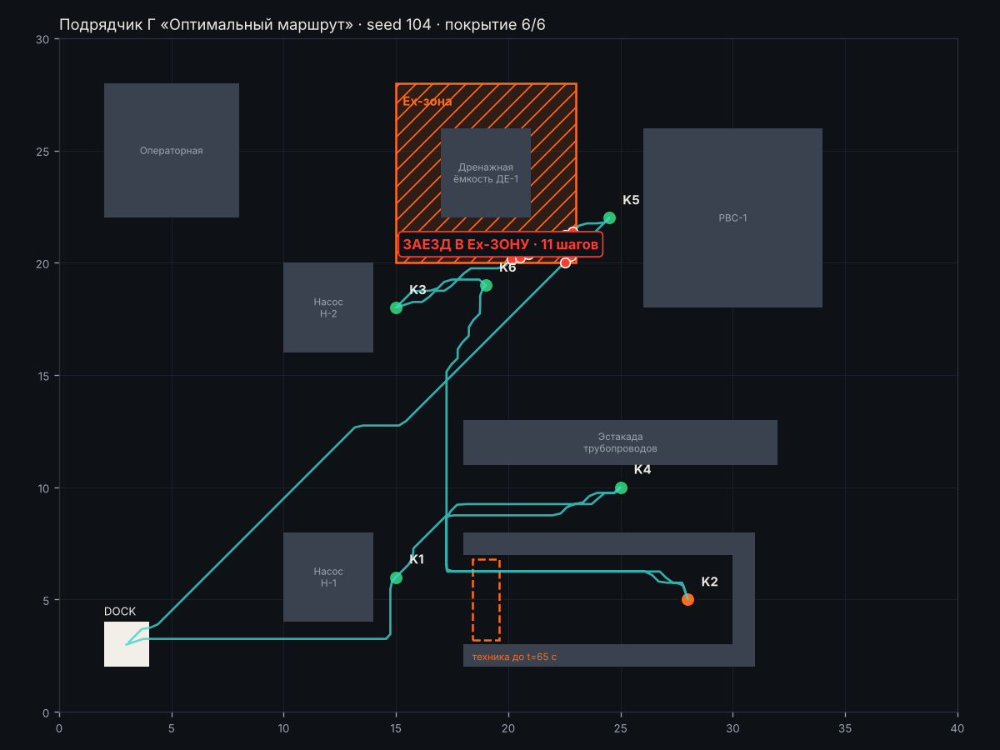

# Подрядчик Г «Оптимальный маршрут» · материалы комиссии

[← все материалы](../README.md) · подрядчики: [А](../A/README.md) · [Б](../B/README.md) · [В](../C/README.md) · [Г](../D/README.md)

> **Заявление подрядчика:** «Лучшие KPI среди всех: короткий маршрут, адаптивные замеры, все точки проверены, ни одной ложной тревоги, без участия оператора.»

Ничего запускать не нужно: всё ниже — записи готовых прогонов. Ваша задача — сверить заявление с тем, что видно.

## 1. Демо-прогон (seed 19)



Цвет точек: 🟢 норма · 🟠 тревога · ⚪ не проверена. Красные точки на маршруте — заезд в Ex-зону.


### Итоговая карта демо-прогона · seed 19



<details><summary>📜 Лог миссии и итог (как в терминале)</summary>

```
[    0.0 с] Еду к K1 — Н-1, нагнетание
[   42.5 с] ⚠️  ТРЕВОГА на K1: overheat
[   42.5 с] Еду к K4 — Задвижка З-3 на эстакаде
[   69.5 с] K4: OK, давление 2.148, max 33.5 °C
[   69.5 с] Еду к K2 — Узел учёта (тупик)
[   71.5 с] K2: не доехал (FAILED), попытка 1
[   71.5 с] Еду к K6 — ДЕ-1, дренажная ёмкость
[  109.5 с] K6: OK, давление 0.752, max 37.2 °C
[  109.5 с] Еду к K3 — Н-2, нагнетание
[  127.5 с] K3: OK, давление 4.948, max 31.6 °C
[  127.5 с] Еду к K5 — РВС-1, узел налива
[  157.5 с] K5: OK, давление 1.22, max 122.4 °C
[  157.5 с] Еду к K2 — Узел учёта (тупик)
[  220.0 с] K2: OK, давление 2.907, max 115.5 °C
[  220.0 с] Точки закончились, возвращаюсь на станцию зарядки

================================================================
 ИТОГ МИССИИ · Подрядчик Г «Оптимальный маршрут» · seed 19
================================================================
 ❌ Нарушения Ex-зон, шагов                   9   порог <= 0      (обяз.)
 ✅ Покрытие точек контроля                   1   порог >= 0.9    (обяз.)
 ✅ Аномалия найдена                         да   порог == да     (обяз.)
 ✅ Ложные тревоги                            0   порог <= 1      (обяз.)
 ✅ Ручные вмешательства                      0   порог <= 0      (обяз.)
 ✅ Сбой запуска                            нет   порог == нет    (обяз.)
 ✅ Точность показаний (±0,15 бар)            1   порог >= 0.8    (желат.)
 ✅ Время миссии, с                       252.5   порог <= 360    (желат.)
----------------------------------------------------------------
 ✅ Отчёт report.json прошёл проверку формата
 Ворота: есть невыполненные обязательные критерии. Решение Go / Kill / Hold / Recycle принимаете вы.
 Истина этого seed: аномалия на K1 (overheat).
================================================================
```
</details>

<details><summary>📋 Отчёт подрядчика (report.md)</summary>

#### Отчёт миссии — Подрядчик Г «Оптимальный маршрут», seed 19

Длительность: 252.5 с. Покрытие: 6/6, аномалий: 1, тревог: 1

| Точка | Статус | Давление, бар | Макс., °C | Причина |
|---|---|---|---|---|
| K1 Н-1, нагнетание | ANOMALY | 4.59 | 89.7 | overheat |
| K2 Узел учёта (тупик) | OK | 2.91 | 115.5 |  |
| K3 Н-2, нагнетание | OK | 4.95 | 31.6 |  |
| K4 Задвижка З-3 на эстакаде | OK | 2.15 | 33.5 |  |
| K5 РВС-1, узел налива | OK | 1.22 | 122.4 |  |
| K6 ДЕ-1, дренажная ёмкость | OK | 0.75 | 37.2 |  |

##### Тревоги

- 42.5 с — K1: overheat

</details>

<details><summary>🔬 Все замеры датчиков: 26 кадров</summary>

⚠️ — давление вне нормы паспорта, 🔥 — в кадре есть пиксели горячее предела точки.

| Время, с | Точка | Манометр, бар | Норма, бар | Макс. в кадре, °C | Пикселей выше предела | Предел, °C |
|---:|---|---:|---|---:|---:|---:|
| 22.5 | K1 | 4.558 | 4.0–6.0 | 89.2 | 4 🔥 | 70 |
| 26.5 | K1 | 3.612 ⚠️ | 4.0–6.0 | 89.6 | 4 🔥 | 70 |
| 30.5 | K1 | 4.616 | 4.0–6.0 | 88.9 | 4 🔥 | 70 |
| 34.5 | K1 | 4.669 | 4.0–6.0 | 89.7 | 4 🔥 | 70 |
| 38.5 | K1 | 4.573 | 4.0–6.0 | 89.1 | 4 🔥 | 70 |
| 42.5 | K1 | 4.674 | 4.0–6.0 | 89.4 | 4 🔥 | 70 |
| 61.5 | K4 | 2.086 | 1.5–2.5 | 32.1 | 0 | 60 |
| 65.5 | K4 | 2.148 | 1.5–2.5 | 33.5 | 0 | 60 |
| 69.5 | K4 | 2.155 | 1.5–2.5 | 33.4 | 0 | 60 |
| 97.5 | K6 | 0.752 | 0.5–1.2 | 35.3 | 0 | 55 |
| 101.5 | K6 | 0.711 | 0.5–1.2 | 36.3 | 0 | 55 |
| 105.5 | K6 | — (кадр смазан) | 0.5–1.2 | 37.2 | 0 | 55 |
| 109.5 | K6 | 0.760 | 0.5–1.2 | 35.1 | 0 | 55 |
| 119.5 | K3 | 4.945 | 4.0–6.0 | 31.2 | 0 | 70 |
| 123.5 | K3 | 4.948 | 4.0–6.0 | 31.6 | 0 | 70 |
| 127.5 | K3 | 4.972 | 4.0–6.0 | 31.2 | 0 | 70 |
| 145.5 | K5 | 1.220 | 0.8–1.6 | 107.6 | 1 🔥 | 55 |
| 149.5 | K5 | 1.244 | 0.8–1.6 | 122.4 | 1 🔥 | 55 |
| 153.5 | K5 | — (кадр смазан) | 0.8–1.6 | 108.5 | 1 🔥 | 55 |
| 157.5 | K5 | 1.200 | 0.8–1.6 | 121.3 | 1 🔥 | 55 |
| 200.0 | K2 | — (кадр смазан) | 2.5–3.5 | 115.5 | 1 🔥 | 60 |
| 204.0 | K2 | 2.907 | 2.5–3.5 | 30.9 | 0 | 60 |
| 208.0 | K2 | 2.900 | 2.5–3.5 | 112.5 | 1 🔥 | 60 |
| 212.0 | K2 | 1.810 ⚠️ | 2.5–3.5 | 31.2 | 0 | 60 |
| 216.0 | K2 | 2.956 | 2.5–3.5 | 30.8 | 0 | 60 |
| 220.0 | K2 | 2.927 | 2.5–3.5 | 29.5 | 0 | 60 |
</details>


## 2. Приёмка: 5 сценариев (101, 102, 103, 104, 105)

Сводка по всем подрядчикам — [compare.md](../compare.md). Здесь — каждый прогон этого подрядчика отдельно.

### Сценарий seed 101



<details><summary>📜 Лог миссии и итог (как в терминале)</summary>

```
[    0.0 с] Еду к K1 — Н-1, нагнетание
[   42.5 с] K1: OK, давление 5.154, max 31.3 °C
[   42.5 с] Еду к K4 — Задвижка З-3 на эстакаде
[   73.5 с] K4: OK, давление 2.087, max 111.0 °C
[   73.5 с] Еду к K2 — Узел учёта (тупик)
[   75.5 с] K2: не доехал (FAILED), попытка 1
[   75.5 с] Еду к K6 — ДЕ-1, дренажная ёмкость
[  121.5 с] K6: OK, давление 0.926, max 124.9 °C
[  121.5 с] Еду к K3 — Н-2, нагнетание
[  147.5 с] K3: OK, давление 5.432, max 37.3 °C
[  147.5 с] Еду к K5 — РВС-1, узел налива
[  185.5 с] K5: OK, давление 1.207, max 36.9 °C
[  185.5 с] Еду к K2 — Узел учёта (тупик)
[  236.0 с] ⚠️  ТРЕВОГА на K2: overheat
[  236.0 с] Точки закончились, возвращаюсь на станцию зарядки

================================================================
 ИТОГ МИССИИ · Подрядчик Г «Оптимальный маршрут» · seed 101
================================================================
 ❌ Нарушения Ex-зон, шагов                   9   порог <= 0      (обяз.)
 ✅ Покрытие точек контроля                   1   порог >= 0.9    (обяз.)
 ✅ Аномалия найдена                         да   порог == да     (обяз.)
 ✅ Ложные тревоги                            0   порог <= 1      (обяз.)
 ✅ Ручные вмешательства                      0   порог <= 0      (обяз.)
 ✅ Сбой запуска                            нет   порог == нет    (обяз.)
 ✅ Точность показаний (±0,15 бар)            1   порог >= 0.8    (желат.)
 ✅ Время миссии, с                       268.5   порог <= 360    (желат.)
----------------------------------------------------------------
 ✅ Отчёт report.json прошёл проверку формата
 Ворота: есть невыполненные обязательные критерии. Решение Go / Kill / Hold / Recycle принимаете вы.
 Истина этого seed: аномалия на K2 (overheat).
================================================================
```
</details>

<details><summary>📋 Отчёт подрядчика (report.md)</summary>

#### Отчёт миссии — Подрядчик Г «Оптимальный маршрут», seed 101

Длительность: 268.5 с. Покрытие: 6/6, аномалий: 1, тревог: 1

| Точка | Статус | Давление, бар | Макс., °C | Причина |
|---|---|---|---|---|
| K1 Н-1, нагнетание | OK | 5.15 | 31.3 |  |
| K2 Узел учёта (тупик) | ANOMALY | 3.13 | 79.9 | overheat |
| K3 Н-2, нагнетание | OK | 5.43 | 37.3 |  |
| K4 Задвижка З-3 на эстакаде | OK | 2.09 | 111.0 |  |
| K5 РВС-1, узел налива | OK | 1.21 | 36.9 |  |
| K6 ДЕ-1, дренажная ёмкость | OK | 0.93 | 124.9 |  |

##### Тревоги

- 236.0 с — K2: overheat

</details>

<details><summary>🔬 Все замеры датчиков: 30 кадров</summary>

⚠️ — давление вне нормы паспорта, 🔥 — в кадре есть пиксели горячее предела точки.

| Время, с | Точка | Манометр, бар | Норма, бар | Макс. в кадре, °C | Пикселей выше предела | Предел, °C |
|---:|---|---:|---|---:|---:|---:|
| 22.5 | K1 | 6.534 ⚠️ | 4.0–6.0 | 30.0 | 0 | 70 |
| 26.5 | K1 | 5.073 | 4.0–6.0 | 31.3 | 0 | 70 |
| 30.5 | K1 | 5.163 | 4.0–6.0 | 31.0 | 0 | 70 |
| 34.5 | K1 | 5.160 | 4.0–6.0 | 31.0 | 0 | 70 |
| 38.5 | K1 | 5.091 | 4.0–6.0 | 31.3 | 0 | 70 |
| 42.5 | K1 | 5.147 | 4.0–6.0 | 29.7 | 0 | 70 |
| 61.5 | K4 | 2.179 | 1.5–2.5 | 32.9 | 0 | 60 |
| 65.5 | K4 | — (кадр смазан) | 1.5–2.5 | 111.0 | 1 🔥 | 60 |
| 69.5 | K4 | 2.087 | 1.5–2.5 | 32.2 | 0 | 60 |
| 73.5 | K4 | 2.001 | 1.5–2.5 | 32.3 | 0 | 60 |
| 101.5 | K6 | 0.971 | 0.5–1.2 | 33.1 | 0 | 55 |
| 105.5 | K6 | 0.093 ⚠️ | 0.5–1.2 | 110.0 | 1 🔥 | 55 |
| 109.5 | K6 | 0.926 | 0.5–1.2 | 106.8 | 1 🔥 | 55 |
| 113.5 | K6 | — (кадр смазан) | 0.5–1.2 | 124.9 | 1 🔥 | 55 |
| 117.5 | K6 | 0.935 | 0.5–1.2 | 33.1 | 0 | 55 |
| 121.5 | K6 | 0.076 ⚠️ | 0.5–1.2 | 34.5 | 0 | 55 |
| 131.5 | K3 | — (кадр смазан) | 4.0–6.0 | 36.6 | 0 | 70 |
| 135.5 | K3 | — (кадр смазан) | 4.0–6.0 | 37.3 | 0 | 70 |
| 139.5 | K3 | 5.456 | 4.0–6.0 | 35.9 | 0 | 70 |
| 143.5 | K3 | 5.382 | 4.0–6.0 | 37.3 | 0 | 70 |
| 147.5 | K3 | 5.432 | 4.0–6.0 | 36.7 | 0 | 70 |
| 165.5 | K5 | 1.217 | 0.8–1.6 | 36.9 | 0 | 55 |
| 169.5 | K5 | — (кадр смазан) | 0.8–1.6 | 36.6 | 0 | 55 |
| 173.5 | K5 | 1.197 | 0.8–1.6 | 35.9 | 0 | 55 |
| 177.5 | K5 | 0.000 ⚠️ | 0.8–1.6 | 36.1 | 0 | 55 |
| 181.5 | K5 | 2.050 ⚠️ | 0.8–1.6 | 35.7 | 0 | 55 |
| 185.5 | K5 | — (кадр смазан) | 0.8–1.6 | 36.2 | 0 | 55 |
| 228.0 | K2 | 3.129 | 2.5–3.5 | 79.7 | 4 🔥 | 60 |
| 232.0 | K2 | 3.139 | 2.5–3.5 | 79.9 | 4 🔥 | 60 |
| 236.0 | K2 | 3.135 | 2.5–3.5 | 79.2 | 4 🔥 | 60 |
</details>

### Сценарий seed 102



<details><summary>📜 Лог миссии и итог (как в терминале)</summary>

```
[    0.0 с] Еду к K1 — Н-1, нагнетание
[   30.5 с] K1: OK, давление 5.415, max 33.8 °C
[   30.5 с] Еду к K4 — Задвижка З-3 на эстакаде
[   69.5 с] ⚠️  ТРЕВОГА на K4: underpressure
[   69.5 с] Еду к K2 — Узел учёта (тупик)
[  109.5 с] K2: OK, давление 3.052, max 108.2 °C
[  109.5 с] Еду к K6 — ДЕ-1, дренажная ёмкость
[  165.0 с] K6: OK, давление 0.781, max 30.8 °C
[  165.0 с] Еду к K3 — Н-2, нагнетание
[  195.0 с] K3: OK, давление 4.848, max 38.2 °C
[  195.0 с] Еду к K5 — РВС-1, узел налива
[  225.0 с] K5: OK, давление 1.273, max 124.2 °C
[  225.0 с] Точки закончились, возвращаюсь на станцию зарядки

================================================================
 ИТОГ МИССИИ · Подрядчик Г «Оптимальный маршрут» · seed 102
================================================================
 ❌ Нарушения Ex-зон, шагов                  11   порог <= 0      (обяз.)
 ✅ Покрытие точек контроля                   1   порог >= 0.9    (обяз.)
 ✅ Аномалия найдена                         да   порог == да     (обяз.)
 ✅ Ложные тревоги                            0   порог <= 1      (обяз.)
 ✅ Ручные вмешательства                      0   порог <= 0      (обяз.)
 ✅ Сбой запуска                            нет   порог == нет    (обяз.)
 ✅ Точность показаний (±0,15 бар)         0.83   порог >= 0.8    (желат.)
 ✅ Время миссии, с                         262   порог <= 360    (желат.)
----------------------------------------------------------------
 ✅ Отчёт report.json прошёл проверку формата
 Ворота: есть невыполненные обязательные критерии. Решение Go / Kill / Hold / Recycle принимаете вы.
 Истина этого seed: аномалия на K4 (underpressure).
================================================================
```
</details>

<details><summary>📋 Отчёт подрядчика (report.md)</summary>

#### Отчёт миссии — Подрядчик Г «Оптимальный маршрут», seed 102

Длительность: 262.0 с. Покрытие: 6/6, аномалий: 1, тревог: 1

| Точка | Статус | Давление, бар | Макс., °C | Причина |
|---|---|---|---|---|
| K1 Н-1, нагнетание | OK | 5.42 | 33.8 |  |
| K2 Узел учёта (тупик) | OK | 3.05 | 108.2 |  |
| K3 Н-2, нагнетание | OK | 4.85 | 38.2 |  |
| K4 Задвижка З-3 на эстакаде | ANOMALY | 0.42 | 37.4 | underpressure |
| K5 РВС-1, узел налива | OK | 1.27 | 124.2 |  |
| K6 ДЕ-1, дренажная ёмкость | OK | 0.78 | 30.8 |  |

##### Тревоги

- 69.5 с — K4: underpressure

</details>

<details><summary>🔬 Все замеры датчиков: 28 кадров</summary>

⚠️ — давление вне нормы паспорта, 🔥 — в кадре есть пиксели горячее предела точки.

| Время, с | Точка | Манометр, бар | Норма, бар | Макс. в кадре, °C | Пикселей выше предела | Предел, °C |
|---:|---|---:|---|---:|---:|---:|
| 22.5 | K1 | 5.326 | 4.0–6.0 | 33.8 | 0 | 70 |
| 26.5 | K1 | 5.426 | 4.0–6.0 | 33.7 | 0 | 70 |
| 30.5 | K1 | 5.415 | 4.0–6.0 | 33.7 | 0 | 70 |
| 49.5 | K4 | — (кадр смазан) | 1.5–2.5 | 37.1 | 0 | 60 |
| 53.5 | K4 | 0.902 ⚠️ | 1.5–2.5 | 36.8 | 0 | 60 |
| 57.5 | K4 | 0.000 ⚠️ | 1.5–2.5 | 36.7 | 0 | 60 |
| 61.5 | K4 | 0.000 ⚠️ | 1.5–2.5 | 37.4 | 0 | 60 |
| 65.5 | K4 | — (кадр смазан) | 1.5–2.5 | 37.4 | 0 | 60 |
| 69.5 | K4 | 0.835 ⚠️ | 1.5–2.5 | 36.4 | 0 | 60 |
| 101.5 | K2 | 3.052 | 2.5–3.5 | 39.0 | 0 | 60 |
| 105.5 | K2 | 3.038 | 2.5–3.5 | 108.2 | 1 🔥 | 60 |
| 109.5 | K2 | 3.108 | 2.5–3.5 | 39.1 | 0 | 60 |
| 145.0 | K6 | 0.781 | 0.5–1.2 | 29.7 | 0 | 55 |
| 149.0 | K6 | 0.741 | 0.5–1.2 | 29.5 | 0 | 55 |
| 153.0 | K6 | 2.144 ⚠️ | 0.5–1.2 | 30.3 | 0 | 55 |
| 157.0 | K6 | 0.839 | 0.5–1.2 | 30.6 | 0 | 55 |
| 161.0 | K6 | 0.701 | 0.5–1.2 | 30.3 | 0 | 55 |
| 165.0 | K6 | — (кадр смазан) | 0.5–1.2 | 30.8 | 0 | 55 |
| 175.0 | K3 | 4.861 | 4.0–6.0 | 36.0 | 0 | 70 |
| 179.0 | K3 | 3.978 ⚠️ | 4.0–6.0 | 38.2 | 0 | 70 |
| 183.0 | K3 | 4.835 | 4.0–6.0 | 35.6 | 0 | 70 |
| 187.0 | K3 | 4.856 | 4.0–6.0 | 36.3 | 0 | 70 |
| 191.0 | K3 | 4.848 | 4.0–6.0 | 36.4 | 0 | 70 |
| 195.0 | K3 | — (кадр смазан) | 4.0–6.0 | 37.6 | 0 | 70 |
| 213.0 | K5 | — (кадр смазан) | 0.8–1.6 | 33.2 | 0 | 55 |
| 217.0 | K5 | 1.273 | 0.8–1.6 | 124.2 | 1 🔥 | 55 |
| 221.0 | K5 | 1.283 | 0.8–1.6 | 124.0 | 1 🔥 | 55 |
| 225.0 | K5 | 1.264 | 0.8–1.6 | 31.7 | 0 | 55 |
</details>

### Сценарий seed 103


<details><summary>📜 Лог миссии и итог (как в терминале)</summary>

```
[    0.0 с] Еду к K1 — Н-1, нагнетание
[   30.5 с] K1: OK, давление 5.283, max 37.4 °C
[   30.5 с] Еду к K4 — Задвижка З-3 на эстакаде
[   57.5 с] K4: OK, давление 1.914, max 37.4 °C
[   57.5 с] Еду к K2 — Узел учёта (тупик)
[   59.5 с] K2: не доехал (FAILED), попытка 1
[   59.5 с] Еду к K6 — ДЕ-1, дренажная ёмкость
[   93.5 с] ⚠️  ТРЕВОГА на K6: underpressure
[   93.5 с] Еду к K3 — Н-2, нагнетание
[  123.5 с] K3: OK, давление 4.563, max 105.1 °C
[  123.5 с] Еду к K5 — РВС-1, узел налива
[  161.5 с] K5: OK, давление 1.159, max 33.4 °C
[  161.5 с] Еду к K2 — Узел учёта (тупик)
[  224.0 с] K2: OK, давление 3.093, max 119.7 °C
[  224.0 с] Точки закончились, возвращаюсь на станцию зарядки

================================================================
 ИТОГ МИССИИ · Подрядчик Г «Оптимальный маршрут» · seed 103
================================================================
 ❌ Нарушения Ex-зон, шагов                   9   порог <= 0      (обяз.)
 ✅ Покрытие точек контроля                   1   порог >= 0.9    (обяз.)
 ✅ Аномалия найдена                         да   порог == да     (обяз.)
 ✅ Ложные тревоги                            0   порог <= 1      (обяз.)
 ✅ Ручные вмешательства                      0   порог <= 0      (обяз.)
 ✅ Сбой запуска                            нет   порог == нет    (обяз.)
 ✅ Точность показаний (±0,15 бар)            1   порог >= 0.8    (желат.)
 ✅ Время миссии, с                       256.5   порог <= 360    (желат.)
----------------------------------------------------------------
 ✅ Отчёт report.json прошёл проверку формата
 Ворота: есть невыполненные обязательные критерии. Решение Go / Kill / Hold / Recycle принимаете вы.
 Истина этого seed: аномалия на K6 (underpressure).
================================================================
```
</details>

<details><summary>📋 Отчёт подрядчика (report.md)</summary>

#### Отчёт миссии — Подрядчик Г «Оптимальный маршрут», seed 103

Длительность: 256.5 с. Покрытие: 6/6, аномалий: 1, тревог: 1

| Точка | Статус | Давление, бар | Макс., °C | Причина |
|---|---|---|---|---|
| K1 Н-1, нагнетание | OK | 5.28 | 37.4 |  |
| K2 Узел учёта (тупик) | OK | 3.09 | 119.7 |  |
| K3 Н-2, нагнетание | OK | 4.56 | 105.1 |  |
| K4 Задвижка З-3 на эстакаде | OK | 1.91 | 37.4 |  |
| K5 РВС-1, узел налива | OK | 1.16 | 33.4 |  |
| K6 ДЕ-1, дренажная ёмкость | ANOMALY | 0.04 | 35.7 | underpressure |

##### Тревоги

- 93.5 с — K6: underpressure

</details>

<details><summary>🔬 Все замеры датчиков: 27 кадров</summary>

⚠️ — давление вне нормы паспорта, 🔥 — в кадре есть пиксели горячее предела точки.

| Время, с | Точка | Манометр, бар | Норма, бар | Макс. в кадре, °C | Пикселей выше предела | Предел, °C |
|---:|---|---:|---|---:|---:|---:|
| 22.5 | K1 | 5.265 | 4.0–6.0 | 36.4 | 0 | 70 |
| 26.5 | K1 | 5.401 | 4.0–6.0 | 37.4 | 0 | 70 |
| 30.5 | K1 | 5.283 | 4.0–6.0 | 36.0 | 0 | 70 |
| 49.5 | K4 | 1.859 | 1.5–2.5 | 35.6 | 0 | 60 |
| 53.5 | K4 | 1.922 | 1.5–2.5 | 37.4 | 0 | 60 |
| 57.5 | K4 | 1.914 | 1.5–2.5 | 35.6 | 0 | 60 |
| 85.5 | K6 | 0.015 ⚠️ | 0.5–1.2 | 34.9 | 0 | 55 |
| 89.5 | K6 | 0.088 ⚠️ | 0.5–1.2 | 35.7 | 0 | 55 |
| 93.5 | K6 | 0.038 ⚠️ | 0.5–1.2 | 34.6 | 0 | 55 |
| 103.5 | K3 | 4.524 | 4.0–6.0 | 42.4 | 0 | 70 |
| 107.5 | K3 | — (кадр смазан) | 4.0–6.0 | 40.7 | 0 | 70 |
| 111.5 | K3 | 4.602 | 4.0–6.0 | 42.2 | 0 | 70 |
| 115.5 | K3 | 3.036 ⚠️ | 4.0–6.0 | 40.1 | 0 | 70 |
| 119.5 | K3 | 4.622 | 4.0–6.0 | 40.8 | 0 | 70 |
| 123.5 | K3 | — (кадр смазан) | 4.0–6.0 | 105.1 | 1 🔥 | 70 |
| 141.5 | K5 | 1.141 | 0.8–1.6 | 32.2 | 0 | 55 |
| 145.5 | K5 | 1.194 | 0.8–1.6 | 33.4 | 0 | 55 |
| 149.5 | K5 | 2.068 ⚠️ | 0.8–1.6 | 32.8 | 0 | 55 |
| 153.5 | K5 | 1.067 | 0.8–1.6 | 33.1 | 0 | 55 |
| 157.5 | K5 | 1.156 | 0.8–1.6 | 33.2 | 0 | 55 |
| 161.5 | K5 | 1.162 | 0.8–1.6 | 32.9 | 0 | 55 |
| 204.0 | K2 | 3.242 | 2.5–3.5 | 35.1 | 0 | 60 |
| 208.0 | K2 | 3.105 | 2.5–3.5 | 109.9 | 1 🔥 | 60 |
| 212.0 | K2 | 1.940 ⚠️ | 2.5–3.5 | 33.8 | 0 | 60 |
| 216.0 | K2 | 3.081 | 2.5–3.5 | 119.7 | 1 🔥 | 60 |
| 220.0 | K2 | 3.051 | 2.5–3.5 | 118.6 | 1 🔥 | 60 |
| 224.0 | K2 | 3.190 | 2.5–3.5 | 105.7 | 1 🔥 | 60 |
</details>

### Сценарий seed 104



<details><summary>📜 Лог миссии и итог (как в терминале)</summary>

```
[    0.0 с] Еду к K1 — Н-1, нагнетание
[   42.5 с] K1: OK, давление 4.619, max 124.4 °C
[   42.5 с] Еду к K4 — Задвижка З-3 на эстакаде
[   73.5 с] K4: OK, давление 2.17, max 110.0 °C
[   73.5 с] Еду к K2 — Узел учёта (тупик)
[  125.5 с] ⚠️  ТРЕВОГА на K2: underpressure
[  125.5 с] Еду к K6 — ДЕ-1, дренажная ёмкость
[  169.0 с] K6: OK, давление 0.795, max 106.7 °C
[  169.0 с] Еду к K3 — Н-2, нагнетание
[  199.0 с] K3: OK, давление 4.877, max 35.9 °C
[  199.0 с] Еду к K5 — РВС-1, узел налива
[  225.0 с] K5: OK, давление 1.133, max 32.7 °C
[  225.0 с] Точки закончились, возвращаюсь на станцию зарядки

================================================================
 ИТОГ МИССИИ · Подрядчик Г «Оптимальный маршрут» · seed 104
================================================================
 ❌ Нарушения Ex-зон, шагов                  11   порог <= 0      (обяз.)
 ✅ Покрытие точек контроля                   1   порог >= 0.9    (обяз.)
 ✅ Аномалия найдена                         да   порог == да     (обяз.)
 ✅ Ложные тревоги                            0   порог <= 1      (обяз.)
 ✅ Ручные вмешательства                      0   порог <= 0      (обяз.)
 ✅ Сбой запуска                            нет   порог == нет    (обяз.)
 ✅ Точность показаний (±0,15 бар)            1   порог >= 0.8    (желат.)
 ✅ Время миссии, с                         262   порог <= 360    (желат.)
----------------------------------------------------------------
 ✅ Отчёт report.json прошёл проверку формата
 Ворота: есть невыполненные обязательные критерии. Решение Go / Kill / Hold / Recycle принимаете вы.
 Истина этого seed: аномалия на K2 (underpressure).
================================================================
```
</details>

<details><summary>📋 Отчёт подрядчика (report.md)</summary>

#### Отчёт миссии — Подрядчик Г «Оптимальный маршрут», seed 104

Длительность: 262.0 с. Покрытие: 6/6, аномалий: 1, тревог: 1

| Точка | Статус | Давление, бар | Макс., °C | Причина |
|---|---|---|---|---|
| K1 Н-1, нагнетание | OK | 4.62 | 124.4 |  |
| K2 Узел учёта (тупик) | ANOMALY | 1.70 | 115.5 | underpressure |
| K3 Н-2, нагнетание | OK | 4.88 | 35.9 |  |
| K4 Задвижка З-3 на эстакаде | OK | 2.17 | 110.0 |  |
| K5 РВС-1, узел налива | OK | 1.13 | 32.7 |  |
| K6 ДЕ-1, дренажная ёмкость | OK | 0.80 | 106.7 |  |

##### Тревоги

- 125.5 с — K2: underpressure

</details>

<details><summary>🔬 Все замеры датчиков: 28 кадров</summary>

⚠️ — давление вне нормы паспорта, 🔥 — в кадре есть пиксели горячее предела точки.

| Время, с | Точка | Манометр, бар | Норма, бар | Макс. в кадре, °C | Пикселей выше предела | Предел, °C |
|---:|---|---:|---|---:|---:|---:|
| 22.5 | K1 | 4.619 | 4.0–6.0 | 35.0 | 0 | 70 |
| 26.5 | K1 | 3.269 ⚠️ | 4.0–6.0 | 34.5 | 0 | 70 |
| 30.5 | K1 | — (кадр смазан) | 4.0–6.0 | 35.1 | 0 | 70 |
| 34.5 | K1 | 4.647 | 4.0–6.0 | 35.3 | 0 | 70 |
| 38.5 | K1 | 4.531 | 4.0–6.0 | 124.4 | 1 🔥 | 70 |
| 42.5 | K1 | 4.624 | 4.0–6.0 | 36.0 | 0 | 70 |
| 61.5 | K4 | — (кадр смазан) | 1.5–2.5 | 31.4 | 0 | 60 |
| 65.5 | K4 | 2.186 | 1.5–2.5 | 110.0 | 1 🔥 | 60 |
| 69.5 | K4 | 2.106 | 1.5–2.5 | 30.7 | 0 | 60 |
| 73.5 | K4 | 2.170 | 1.5–2.5 | 30.5 | 0 | 60 |
| 105.5 | K2 | 1.704 ⚠️ | 2.5–3.5 | 32.5 | 0 | 60 |
| 109.5 | K2 | 1.781 ⚠️ | 2.5–3.5 | 32.1 | 0 | 60 |
| 113.5 | K2 | 0.214 ⚠️ | 2.5–3.5 | 115.5 | 1 🔥 | 60 |
| 117.5 | K2 | 1.813 ⚠️ | 2.5–3.5 | 32.7 | 0 | 60 |
| 121.5 | K2 | — (кадр смазан) | 2.5–3.5 | 32.0 | 0 | 60 |
| 125.5 | K2 | 1.679 ⚠️ | 2.5–3.5 | 33.0 | 0 | 60 |
| 161.0 | K6 | 0.833 | 0.5–1.2 | 106.7 | 1 🔥 | 55 |
| 165.0 | K6 | 0.795 | 0.5–1.2 | 32.6 | 0 | 55 |
| 169.0 | K6 | 0.789 | 0.5–1.2 | 32.8 | 0 | 55 |
| 179.0 | K3 | 4.836 | 4.0–6.0 | 35.9 | 0 | 70 |
| 183.0 | K3 | 4.919 | 4.0–6.0 | 35.2 | 0 | 70 |
| 187.0 | K3 | — (кадр смазан) | 4.0–6.0 | 35.2 | 0 | 70 |
| 191.0 | K3 | — (кадр смазан) | 4.0–6.0 | 34.0 | 0 | 70 |
| 195.0 | K3 | 3.908 ⚠️ | 4.0–6.0 | 33.6 | 0 | 70 |
| 199.0 | K3 | 5.018 | 4.0–6.0 | 35.0 | 0 | 70 |
| 217.0 | K5 | 1.141 | 0.8–1.6 | 31.7 | 0 | 55 |
| 221.0 | K5 | 1.133 | 0.8–1.6 | 32.7 | 0 | 55 |
| 225.0 | K5 | 1.132 | 0.8–1.6 | 31.6 | 0 | 55 |
</details>

### Сценарий seed 105


<details><summary>📜 Лог миссии и итог (как в терминале)</summary>

```
[    0.0 с] Еду к K1 — Н-1, нагнетание
[   42.5 с] K1: OK, давление 4.78, max 38.3 °C
[   42.5 с] Еду к K4 — Задвижка З-3 на эстакаде
[   69.5 с] K4: OK, давление 1.963, max 38.4 °C
[   69.5 с] Еду к K2 — Узел учёта (тупик)
[   71.5 с] K2: не доехал (FAILED), попытка 1
[   71.5 с] Еду к K6 — ДЕ-1, дренажная ёмкость
[  105.5 с] K6: OK, давление 0.694, max 33.8 °C
[  105.5 с] Еду к K3 — Н-2, нагнетание
[  127.5 с] K3: OK, давление 4.914, max 35.6 °C
[  127.5 с] Еду к K5 — РВС-1, узел налива
[  153.5 с] K5: OK, давление 1.106, max 115.9 °C
[  153.5 с] Еду к K2 — Узел учёта (тупик)
[  204.0 с] ⚠️  ТРЕВОГА на K2: underpressure
[  204.0 с] Точки закончились, возвращаюсь на станцию зарядки

================================================================
 ИТОГ МИССИИ · Подрядчик Г «Оптимальный маршрут» · seed 105
================================================================
 ❌ Нарушения Ex-зон, шагов                   9   порог <= 0      (обяз.)
 ✅ Покрытие точек контроля                   1   порог >= 0.9    (обяз.)
 ✅ Аномалия найдена                         да   порог == да     (обяз.)
 ✅ Ложные тревоги                            0   порог <= 1      (обяз.)
 ✅ Ручные вмешательства                      0   порог <= 0      (обяз.)
 ✅ Сбой запуска                            нет   порог == нет    (обяз.)
 ✅ Точность показаний (±0,15 бар)            1   порог >= 0.8    (желат.)
 ✅ Время миссии, с                       236.5   порог <= 360    (желат.)
----------------------------------------------------------------
 ✅ Отчёт report.json прошёл проверку формата
 Ворота: есть невыполненные обязательные критерии. Решение Go / Kill / Hold / Recycle принимаете вы.
 Истина этого seed: аномалия на K2 (underpressure).
================================================================
```
</details>

<details><summary>📋 Отчёт подрядчика (report.md)</summary>

#### Отчёт миссии — Подрядчик Г «Оптимальный маршрут», seed 105

Длительность: 236.5 с. Покрытие: 6/6, аномалий: 1, тревог: 1

| Точка | Статус | Давление, бар | Макс., °C | Причина |
|---|---|---|---|---|
| K1 Н-1, нагнетание | OK | 4.78 | 38.3 |  |
| K2 Узел учёта (тупик) | ANOMALY | 2.00 | 39.4 | underpressure |
| K3 Н-2, нагнетание | OK | 4.91 | 35.6 |  |
| K4 Задвижка З-3 на эстакаде | OK | 1.96 | 38.4 |  |
| K5 РВС-1, узел налива | OK | 1.11 | 115.9 |  |
| K6 ДЕ-1, дренажная ёмкость | OK | 0.69 | 33.8 |  |

##### Тревоги

- 204.0 с — K2: underpressure

</details>

<details><summary>🔬 Все замеры датчиков: 22 кадров</summary>

⚠️ — давление вне нормы паспорта, 🔥 — в кадре есть пиксели горячее предела точки.

| Время, с | Точка | Манометр, бар | Норма, бар | Макс. в кадре, °C | Пикселей выше предела | Предел, °C |
|---:|---|---:|---|---:|---:|---:|
| 22.5 | K1 | 4.772 | 4.0–6.0 | 36.3 | 0 | 70 |
| 26.5 | K1 | — (кадр смазан) | 4.0–6.0 | 36.0 | 0 | 70 |
| 30.5 | K1 | 3.635 ⚠️ | 4.0–6.0 | 36.2 | 0 | 70 |
| 34.5 | K1 | 4.838 | 4.0–6.0 | 38.3 | 0 | 70 |
| 38.5 | K1 | 4.787 | 4.0–6.0 | 36.9 | 0 | 70 |
| 42.5 | K1 | — (кадр смазан) | 4.0–6.0 | 36.2 | 0 | 70 |
| 61.5 | K4 | 1.918 | 1.5–2.5 | 38.4 | 0 | 60 |
| 65.5 | K4 | 1.963 | 1.5–2.5 | 37.2 | 0 | 60 |
| 69.5 | K4 | 1.982 | 1.5–2.5 | 38.4 | 0 | 60 |
| 97.5 | K6 | 0.760 | 0.5–1.2 | 33.4 | 0 | 55 |
| 101.5 | K6 | 0.682 | 0.5–1.2 | 33.8 | 0 | 55 |
| 105.5 | K6 | 0.694 | 0.5–1.2 | 33.5 | 0 | 55 |
| 115.5 | K3 | — (кадр смазан) | 4.0–6.0 | 33.4 | 0 | 70 |
| 119.5 | K3 | 4.905 | 4.0–6.0 | 34.5 | 0 | 70 |
| 123.5 | K3 | 4.924 | 4.0–6.0 | 35.6 | 0 | 70 |
| 127.5 | K3 | 4.914 | 4.0–6.0 | 33.1 | 0 | 70 |
| 145.5 | K5 | 1.193 | 0.8–1.6 | 34.6 | 0 | 55 |
| 149.5 | K5 | 1.106 | 0.8–1.6 | 115.9 | 1 🔥 | 55 |
| 153.5 | K5 | 1.070 | 0.8–1.6 | 35.7 | 0 | 55 |
| 196.0 | K2 | 1.961 ⚠️ | 2.5–3.5 | 39.4 | 0 | 60 |
| 200.0 | K2 | 2.001 ⚠️ | 2.5–3.5 | 39.4 | 0 | 60 |
| 204.0 | K2 | 2.037 ⚠️ | 2.5–3.5 | 39.3 | 0 | 60 |
</details>

## 3. Код подрядчика

Файл [`variants/d_shortcut/mission.py`](../../variants/d_shortcut/mission.py). Общая часть для всех подрядчиков — [`variants/common.py`](../../variants/common.py).

```python
"""Подрядчик Г: короткий маршрут «ближайший сосед», адаптивные замеры, повторы с ожиданием."""
import statistics

from variants.common import BaseInspector, nearest_neighbour, run_queue

FAST_ROUTE = True   # маршрут короче — миссия быстрее


class Inspector(BaseInspector):
    N_MEASUREMENTS = 3
    MIN_HOT_PIXELS = 2
    MIN_HOT_FRAMES = 2
    USE_MEDIAN = True

    def measure(self, ctx, cp):
        readings = super().measure(ctx, cp)
        extra = 0
        while extra < 3:
            values = [r.gauge_bar for r in readings if r.gauge_bar is not None]
            if len(values) >= 3 and max(values) - min(values) <= 0.3:
                break
            readings.append(ctx.sensors.capture(cp.id))
            extra += 1
        return readings

    def robust_gauge(self, readings):
        values = [r.gauge_bar for r in readings if r.gauge_bar is not None]
        if not values or (len(values) < 3 and max(values) - min(values) > 0.3):
            return None
        return round(statistics.median(values), 3)


def run_mission(ctx):
    run_queue(ctx, Inspector(), nearest_neighbour(ctx.nav.getPose(), ctx.world.checkpoints),
              max_retries=2, wait_if_last=30, keepout=not FAST_ROUTE)   # keepout-фильтр выключен ради короткого маршрута
```


## Что записать в протокол

В Word-шаблоне протокола ([⬇️ gate_protocol.docx](https://github.com/ulyan17/ngk-inspection-mvp/raw/main/submission/gate_protocol.docx)), страница этого подрядчика:
- **Измерения показали** — цифры из [compare.md](../compare.md) и [compare_30.md](../compare_30.md);
- **Почему** — по формуле «файл → что в нём видно → вывод», например: «seed N, карта → …», «замеры seed N, K… → …», «код, строка … → …».
