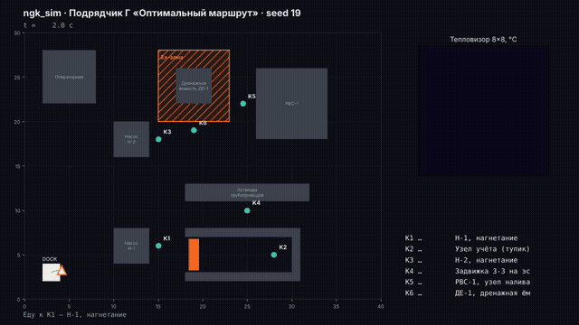
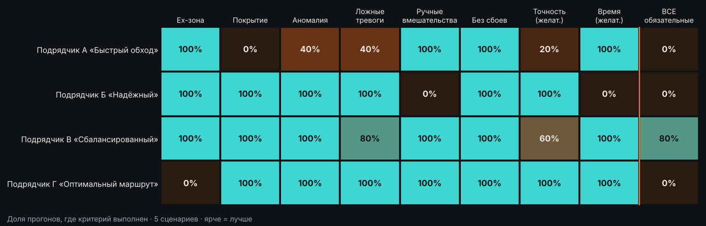
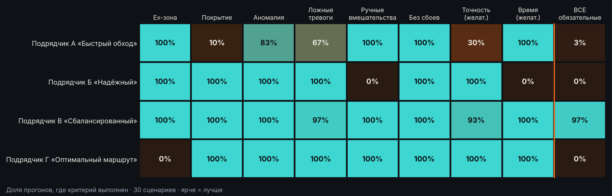
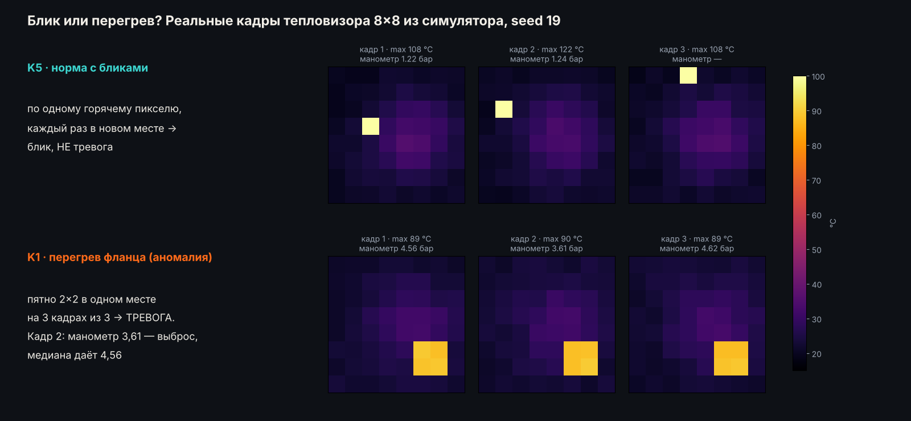

# 🗂 Материалы комиссии

[← к уроку](../README.md)

На занятии **ничего не запускаем**. Все прогоны уже записаны: гифки, карты, логи, замеры датчиков и код. Вы открываете эти страницы прямо на GitHub и заполняете [протокол ворот](../submission/gate_protocol.md).

## Подрядчики

<table><tr>
<td width="25%"> <b><a href="A/README.md">А «Быстрый обход»</a></b></td>
<td width="25%"> <b><a href="B/README.md">Б «Надёжный»</a></b></td>
<td width="25%"> <b><a href="C/README.md">В «Сбалансированный»</a></b></td>
<td width="25%"> <b><a href="D/README.md">Г «Оптимальный маршрут»</a></b></td>
</tr></table>

| | Подрядчик | Заявление | Досье |
|---|---|---|---|
| **А** | «Быстрый обход» | «Самый быстрый робот на рынке: полный обход станции за 2,5 минуты. Один точный замер на точку — больше не нужно.» | [открыть →](A/README.md) |
| **Б** | «Надёжный» | «Стопроцентная точность показаний и ни одной ложной тревоги. Если датчик хоть немного сомневается — подключаем оператора, он перепроверит.» | [открыть →](B/README.md) |
| **В** | «Сбалансированный» | «Выполняем все обязательные критерии заказчика. Повтор недоступной точки, три замера, медиана, перегрев подтверждаем по пятну в нескольких кадрах.» | [открыть →](C/README.md) |
| **Г** | «Оптимальный маршрут» | «Лучшие KPI среди всех: короткий маршрут, адаптивные замеры, все точки проверены, ни одной ложной тревоги, без участия оператора.» | [открыть →](D/README.md) |

В каждом досье: анимация демо-прогона, карты всех 5 сценариев приёмки, лог миссии, отчёт подрядчика, **все замеры датчиков** и код.

## Сводки KPI

| | Что это | Файлы |
|---|---|---|
| **5 сценариев приёмки** | все подрядчики на одинаковых seed 101–105 | [compare.md](compare.md) · [compare.png](compare.png) |
| **30 случайных сценариев** | надёжность: доля прогонов, где критерий выполнен | [compare_30.md](compare_30.md) · [compare_30.png](compare_30.png) |

## Паспорта точек контроля

Нужны, чтобы читать таблицы замеров: давление вне нормы или пиксели горячее предела — это повод для тревоги.

| Точка | Оборудование | Норма давления, бар | Предел температуры, °C |
|---|---|---|---|
| K1 | Н-1, нагнетание | 4.0–6.0 | 70 |
| K2 | Узел учёта (тупик) | 2.5–3.5 | 60 |
| K3 | Н-2, нагнетание | 4.0–6.0 | 70 |
| K4 | Задвижка З-3 на эстакаде | 1.5–2.5 | 60 |
| K5 | РВС-1, узел налива | 0.8–1.6 | 55 |
| K6 | ДЕ-1, дренажная ёмкость | 0.5–1.2 | 55 |

## Блик или перегрев

Датчики ошибаются, как настоящие: бывают смазанные кадры (нет показания манометра), выбросы манометра и блики на тепловизоре. Блик — это один-два горячих пикселя в одном кадре, перегрев — пятно, которое повторяется в нескольких кадрах.

---

*Папка собрана командой `python tools/build_evidence.py`. Дома можете запустить всё сами — см. [homework/README.md](../homework/README.md).*
